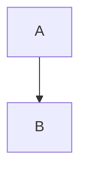

# mdcast M0–M1 Implementation Plan

> **For agentic workers:** REQUIRED SUB-SKILL: Use superpowers:subagent-driven-development (recommended) or superpowers:executing-plans to implement this plan task-by-task. Steps use checkbox (`- [ ]`) syntax for tracking.

**Goal:** Validate the hwpx premise (M0) and ship a working core that converts Markdown with a template into docx and pdf (M1), with fallback reporting and a CLI.

**Architecture:** pandoc parses MD into a pandoc AST (handled in Python through panflute). Template-driven filters reshape the AST per target. The docx writer runs pandoc and then post-processes the OOXML with python-docx and lxml. The pdf writer runs pandoc's typst writer and compiles with the `typst` Python package against a layout library (`pdf.typ`) that reads values from `template.yaml`. Every component records into one `Report` instead of printing.

**Tech Stack:** Python 3.11+, uv, pypandoc-binary 1.17 (pandoc 3.9), panflute 2.3.1, typst 0.15.0 (Python package), python-docx 1.2.0, lxml, PyYAML, click, pytest; dev: pypdfium2, Pillow; spike: pywin32 (Windows, Hancom Office installed).

**Spec:** `docs/superpowers/specs/2026-10-15-mdcast-design.md` (M0 = §10 S1–S5, M1 = §9 M1). Read it before starting; this plan argues from it.

## Global Constraints

- Python `>=3.11`; project managed with `uv`; src layout (`src/mdcast`); package/CLI name `mdcast`; license Apache-2.0.
- Pinned engines: `pypandoc-binary==1.17` (bundles pandoc 3.9), `typst==0.15.0`, `panflute==2.3.1`, `python-docx==1.2.0`.
- Allowed runtime deps only: pypandoc-binary, panflute (BSD-3), typst (Apache-2.0), python-docx (MIT), lxml (BSD), PyYAML (MIT), click (BSD). **No AGPL dependency (PyMuPDF/pymupdf4llm are banned).**
- Core API exchanges bytes, not paths: `convert(source: Source, targets, template, options) -> Result` (spec §2.2). Only CLI touches the filesystem for input/output.
- No-reject rule: template or content problems never fail a conversion; they add `Report` events. Only unreadable input, unwritable output, or a renderer crash produce `error`.
- Event levels: `error` / `warn` / `info`; event codes are stable strings (spec §5.2 plus the M1 additions listed in Task 3).
- All user-facing messages are Korean.
- No network access except fetching `http(s)` images, which `--offline` disables. No telemetry.
- MD reader format string is exactly `markdown-markdown_in_html_blocks` (keeps an HTML `<table>` as a single raw block).
- Temporary test outputs go to pytest `tmp_path` or `.test-output/` (gitignored). Persistent fixtures live in `tests/fixtures/` and `tests/golden/`.
- Must work on Windows and Linux. Windows-only (Hancom/Word) checks are manual or marked `hangul`.
- Commit after every task; end each commit message with the attribution lines from the system reminder.

## Review Focus

1. **Non-UTF-8 Markdown** (a cp949 file saved by Windows Notepad) must convert with an `info` event, not crash → test in Task 7.
2. **Paths containing spaces and Korean** (`./양식 폴더/`, `보고 서.md`) for templates and inputs must resolve → tests in Task 6 and Task 21.
3. **A missing local image or a remote image while offline** must become a visible placeholder with `IMAGE_FETCH_FAILED` while the document is still produced → test in Task 12.
4. **An empty MD file or a frontmatter-only MD** must still produce valid docx and pdf → test in Task 19.
5. **A table nested inside a blockquote, next to top-level tables with variants**, must not shift variant styling onto the wrong table or crash the docx post-processor → test in Task 16.

---

## File Structure

```
pyproject.toml                         # deps, scripts, pytest markers
README.md
src/mdcast/
  __init__.py                          # __version__
  types.py                             # Format, Source, Options, Output, Result
  report.py                            # Level, Codes, Event, TemplateInfo, Report
  units.py                             # length/pt/ratio/color parsing, page sizes
  counters.py                          # numbering patterns (Ⅰ. 가. (1) ①) → text / Word numFmt / Typst pattern
  fonts.py                             # Korean font aliases, family chains, bundled font dir, font probe
  fields.py                            # {{key}} rendering, reserved keys, ResolvedFields
  ast.py                               # pandoc/panflute bridge
  readers/__init__.py
  readers/md.py                        # MD bytes → MdDocument(doc, frontmatter)
  templates/__init__.py                # public re-exports
  templates/schema.py                  # load_yaml, deep_merge, validate_against, sanitize
  templates/resolve.py                 # Container, ResolvedTemplate, resolve_template, list_templates
  templates/inspect.py                 # describe_template, validate_template
  builtin_templates/default/template.yaml
  builtin_templates/default/pdf.typ    # built-in Typst layout library (Task 18)
  filters/__init__.py                  # run_filters
  filters/context.py                   # FilterContext
  filters/pagebreak.py
  filters/tables.py                    # variants, alignment, bold header, width, pdf wrapper; table_settings()
  filters/numbering.py                 # heading numbers, caption numbers
  writers/__init__.py
  writers/context.py                   # WriterContext, RenderError
  writers/images.py                    # localize_images
  writers/docx/__init__.py             # write_docx
  writers/docx/xml.py                  # OOXML helpers (ordered upsert, unit conversion)
  writers/docx/styles.py               # page setup, style remap, element looks, fonts
  writers/docx/headers.py              # yaml slots, reference placeholder fill
  writers/docx/numbering.py            # list numbering (개조식)
  writers/docx/tables.py               # table styles, variants, header repeat, width
  writers/docx/meta.py                 # core properties
  writers/pdf/__init__.py              # write_pdf
  writers/pdf/config.py                # template config → Typst cfg JSON
  assets/fonts/NotoSansKR[wght].ttf    # bundled OFL fallback font (Task 17)
  assets/fonts/OFL.txt
  pipeline.py                          # convert()
  cli.py                               # click CLI
spikes/s1_hwpx/                        # THROWAWAY spike scripts (M0)
docs/superpowers/spikes/2026-10-15-m0-results.md
scripts/render_pages.py                # dev-only: render outputs to PNG for manual review
tests/
  conftest.py                          # --run-visual option, markers
  helpers.py                           # build(), write_template(), make_reference_docx()
  fixtures/md/kitchen-sink.md
  fixtures/md/korean-report.md
  golden/pdf/                          # approved page PNGs (visual tests)
  test_*.py                            # one test module per source module
```

---

# M0 — Spikes

### Task 1: Project scaffold

**Files:**
- Create: `pyproject.toml`, `README.md`, `src/mdcast/__init__.py`, `src/mdcast/cli.py`, `tests/conftest.py`, `tests/test_cli_version.py`

**Interfaces:**
- Produces: package `mdcast` with `__version__ = "0.1.0.dev0"`; console script `mdcast` → `mdcast.cli:main` (a click group); pytest option `--run-visual` and markers `visual`, `hangul`.

- [ ] **Step 1: Write `pyproject.toml`**

```toml
[build-system]
requires = ["hatchling>=1.25"]
build-backend = "hatchling.build"

[project]
name = "mdcast"
version = "0.1.0.dev0"
description = "Markdown ↔ docx · hwpx · pdf, 템플릿 기반 변환기"
readme = "README.md"
requires-python = ">=3.11"
license = "Apache-2.0"
dependencies = [
  "pypandoc-binary==1.17",
  "panflute==2.3.1",
  "typst==0.15.0",
  "python-docx==1.2.0",
  "lxml>=5.2",
  "PyYAML>=6.0",
  "click>=8.1",
]

[project.scripts]
mdcast = "mdcast.cli:main"

[dependency-groups]
dev = [
  "pytest>=8",
  "pypdfium2>=4.30",
  "pillow>=10",
  "ruff>=0.6",
  "pywin32>=306; sys_platform == 'win32'",
]

[tool.hatch.build.targets.wheel]
packages = ["src/mdcast"]

[tool.pytest.ini_options]
testpaths = ["tests"]
filterwarnings = ["ignore::SyntaxWarning"]
markers = [
  "visual: page-image comparison against tests/golden (run with --run-visual)",
  "hangul: needs Hancom Office via COM (local Windows only)",
]

[tool.ruff]
line-length = 100
```

- [ ] **Step 2: Write `README.md`**

```markdown
# mdcast

Markdown ↔ docx · hwpx · pdf, 템플릿 기반 변환기.

개발 중입니다. 설계: `docs/superpowers/specs/2026-10-15-mdcast-design.md`

    uv sync
    uv run mdcast --version
```

- [ ] **Step 3: Write the failing test `tests/test_cli_version.py`**

```python
from click.testing import CliRunner

from mdcast.cli import main


def test_version_prints_name_and_version():
    result = CliRunner().invoke(main, ["--version"])
    assert result.exit_code == 0
    assert "mdcast" in result.output
    assert "0.1.0" in result.output
```

- [ ] **Step 4: Write `tests/conftest.py`**

```python
import pytest


def pytest_addoption(parser):
    parser.addoption("--run-visual", action="store_true", help="run visual golden-image tests")


def pytest_collection_modifyitems(config, items):
    if config.getoption("--run-visual"):
        return
    skip = pytest.mark.skip(reason="visual test: pass --run-visual")
    for item in items:
        if "visual" in item.keywords:
            item.add_marker(skip)
```

- [ ] **Step 5: Run `uv sync`, then the test to confirm it fails**

Run: `uv sync && uv run pytest tests/test_cli_version.py -v`
Expected: FAIL with `ModuleNotFoundError: No module named 'mdcast'` (or ImportError for `mdcast.cli`).

- [ ] **Step 6: Write `src/mdcast/__init__.py` and `src/mdcast/cli.py`**

```python
"""mdcast — Markdown ↔ docx · hwpx · pdf, 템플릿 기반 변환기."""

__version__ = "0.1.0.dev0"
```

```python
import click

from mdcast import __version__


@click.group()
@click.version_option(__version__, prog_name="mdcast")
def main() -> None:
    """mdcast — Markdown ↔ docx · hwpx · pdf, 템플릿 기반 변환기."""
```

- [ ] **Step 7: Run the test to verify it passes**

Run: `uv sync && uv run pytest tests/test_cli_version.py -v`
Expected: PASS

- [ ] **Step 8: Commit**

```bash
git add pyproject.toml uv.lock README.md src/mdcast/__init__.py src/mdcast/cli.py tests/conftest.py tests/test_cli_version.py
git commit -m "chore: scaffold mdcast package with uv and click entry point"
```

---

### Task 2: Spike S1 — generated hwpx opens in Hancom Office (THROWAWAY)

This spike answers spec §10 S1: does a hwpx whose `section0.xml` we rewrite open in 한글 with no error or repair prompt? The code in `spikes/` is throwaway; only the results document is a deliverable. S2 and S5 were already confirmed while this plan was written, and that evidence is recorded in Step 7. S3 and S4 are proven by TDD in Tasks 14–15.

**Files:**
- Create: `spikes/s1_hwpx/make_seed.py`, `spikes/s1_hwpx/patch_hwpx.py`, `spikes/s1_hwpx/verify_open.py`, `docs/superpowers/spikes/2026-10-15-m0-results.md`

**Interfaces:**
- Consumes: nothing from `mdcast`.
- Produces: a written PASS/FAIL decision for S1 that M2 (hwpx writer) relies on.

- [ ] **Step 1: Write `spikes/s1_hwpx/make_seed.py`**

```python
"""THROWAWAY spike S1: create a blank .hwpx with Hancom Office via COM."""

import sys
from pathlib import Path

import win32com.client as win32


def main(out: Path) -> None:
    hwp = win32.gencache.EnsureDispatch("HWPFrame.HwpObject")
    try:
        hwp.XHwpWindows.Item(0).Visible = True
        try:
            hwp.RegisterModule("FilePathCheckDLL", "FilePathCheckerModule")
        except Exception as exc:  # noqa: BLE001 - spike: report and continue
            print("RegisterModule failed (security prompts may appear):", exc)
        ok = hwp.SaveAs(str(out.resolve()), "HWPX", "")
        print("SaveAs ->", ok)
    finally:
        hwp.Clear(1)
        hwp.Quit()


if __name__ == "__main__":
    main(Path(sys.argv[1] if len(sys.argv) > 1 else "seed.hwpx"))
```

- [ ] **Step 2: Create the seed and list its entries**

Run: `uv run python spikes/s1_hwpx/make_seed.py .test-output/s1/seed.hwpx` (create `.test-output/s1/` first)
Then: `uv run python -c "import zipfile; z=zipfile.ZipFile('.test-output/s1/seed.hwpx'); [print(i.filename, i.compress_type) for i in z.infolist()]"`
Expected: a list that includes `mimetype` (compress_type 0 = stored), `Contents/header.xml`, and `Contents/section0.xml`. Copy the full list into the results doc.

If a security dialog ("파일에 접근하려는 시도…") appears for every file access, install the Hancom automation security module. Download `FilePathCheckerModuleExample.dll` from the Hancom developer site, then create the registry string value `HKEY_CURRENT_USER\Software\HNC\HwpAutomation\Modules\FilePathCheckerModule` set to the DLL's full path, and re-run. Record in the results doc whether this was needed.

- [ ] **Step 3: Write `spikes/s1_hwpx/patch_hwpx.py`**

```python
"""THROWAWAY spike S1: append generated paragraphs to section0.xml of a seed hwpx."""

import copy
import sys
import zipfile
from pathlib import Path

from lxml import etree

TEXTS = ["mdcast 스파이크 문단 1", "둘째 문단: 한글 English 123", "셋째 문단 — 특수문자 <>&"]
STRIP = {"secPr", "ctrl", "linesegarray"}


def localname(el) -> str:
    return etree.QName(el).localname


def patch(seed: Path, out: Path) -> None:
    with zipfile.ZipFile(seed) as zin:
        names = zin.namelist()
        section_name = next(n for n in names if n.lower().endswith("section0.xml"))
        root = etree.fromstring(zin.read(section_name))
        paragraphs = [el for el in root if localname(el) == "p"]
        template = paragraphs[0]
        next_id = 1_000_000
        for text in TEXTS:
            p = copy.deepcopy(template)
            for el in [e for e in p.iter() if localname(e) in STRIP]:
                parent = el.getparent()
                if parent is not None:
                    parent.remove(el)
            if "id" in p.attrib:
                p.set("id", str(next_id))
                next_id += 1
            runs = [el for el in p.iter() if localname(el) == "run"]
            for extra in runs[1:]:
                extra.getparent().remove(extra)
            run = runs[0]
            ts = [el for el in run if localname(el) == "t"]
            ns = etree.QName(run).namespace
            t = ts[0] if ts else etree.SubElement(run, f"{{{ns}}}t" if ns else "t")
            for extra in ts[1:]:
                run.remove(extra)
            t.text = text
            root.append(p)
        new_section = etree.tostring(root, xml_declaration=True, encoding="UTF-8", standalone=True)
        with zipfile.ZipFile(out, "w") as zout:
            for info in zin.infolist():
                data = new_section if info.filename == section_name else zin.read(info.filename)
                mode = zipfile.ZIP_STORED if info.filename == "mimetype" else zipfile.ZIP_DEFLATED
                zout.writestr(info.filename, data, compress_type=mode)
    print("wrote", out)


if __name__ == "__main__":
    patch(Path(sys.argv[1]), Path(sys.argv[2]))
```

- [ ] **Step 4: Write `spikes/s1_hwpx/verify_open.py`**

```python
"""THROWAWAY spike S1: open a hwpx in Hancom Office via COM and dump its text."""

import sys
from pathlib import Path

import win32com.client as win32


def main(path: Path) -> int:
    hwp = win32.gencache.EnsureDispatch("HWPFrame.HwpObject")
    try:
        hwp.XHwpWindows.Item(0).Visible = True
        try:
            hwp.RegisterModule("FilePathCheckDLL", "FilePathCheckerModule")
        except Exception as exc:  # noqa: BLE001
            print("RegisterModule failed:", exc)
        ok = hwp.Open(str(path.resolve()), "HWPX", "")
        print("Open ->", ok)
        print("--- text ---")
        print(hwp.GetTextFile("TEXT", ""))
        return 0 if ok else 1
    finally:
        hwp.Clear(1)
        hwp.Quit()


if __name__ == "__main__":
    sys.exit(main(Path(sys.argv[1])))
```

- [ ] **Step 5: Patch, verify by COM, then verify by hand**

Run: `uv run python spikes/s1_hwpx/patch_hwpx.py .test-output/s1/seed.hwpx .test-output/s1/patched.hwpx`
Run: `uv run python spikes/s1_hwpx/verify_open.py .test-output/s1/patched.hwpx`
Expected: `Open -> True` and printed text containing all three `TEXTS` lines with `<>&` intact.
Then double-click `.test-output/s1/patched.hwpx` in Explorer to open it in 한글.
Expected: no "파일이 손상되었습니다" or "복구" dialog, and the three paragraphs are visible. Save a screenshot as `.test-output/s1/opened.png`. It stays out of git; describe it in the results doc.

- [ ] **Step 6: Decide S1**

- **PASS** (Open True, text present, no dialog in both COM and manual open): M2 uses the "reuse the reference.hwpx container, regenerate section0.xml" approach from spec §4.1.
- **FAIL**: record the exact dialog text. Re-test once with `linesegarray` kept, i.e. remove `"linesegarray"` from `STRIP`. If that still fails, record the spec §10 fallback: shrink to minimal edits of a Hangul-saved container. That is a decision to bring back to the human partner before M2 starts.

- [ ] **Step 7: Write `docs/superpowers/spikes/2026-10-15-m0-results.md`**

```markdown
# M0 검증 실험 결과 (2026-10-15)

| ID | 가정 | 결과 | 근거 |
|---|---|---|---|
| S1 | 코드로 재작성한 section0.xml 의 hwpx 가 한글에서 오류 없이 열림 | <PASS/FAIL 기록> | Task 2 스크립트, COM Open 결과, 수동 열기 결과 |
| S2 | pandoc `--reference-doc` 이 머리말·꼬리말·쪽 설정을 유지하고, 스타일 정의 수정이 출력에 반영됨 | PASS (계획 작성 중 확인) | pandoc 3.9: python-docx 로 header/footer 텍스트와 Heading 1 크기·색을 바꾼 reference 로 변환 → 출력에 header/footer 유지, Heading 1 size 20pt·color 1F3864 반영. `<table>` 병합 셀 → docx gridSpan/vMerge 생성 |
| S3 | 분할 run 의 `{{키}}` 채움 | Task 14 TDD 로 검증 | |
| S4 | 개조식 기호를 numbering.xml 후처리로 적용 | Task 15 TDD + Word 수동 확인 | pandoc 은 목록마다 abstractNum 을 만들고 numId 1001+ 를 씀 (확인) |
| S5 | Typst 가 한글 폰트로 조판하고 yaml/json 값으로 머리말·쪽 번호 구성 | PASS (계획 작성 중 확인) | typst-py 0.15: `json(bytes(sys.inputs.cfg))` 로 설정 주입, Malgun Gothic 조판, `counter(page)` 1 / N, 목록 기호 □○-·, enum 패턴 `1.` `가.` `(ㄱ)` `①` 렌더링 확인 |

## 계획 작성 중 발견한 사실 (구현에 반영됨)
- MD 리더 형식은 `markdown-markdown_in_html_blocks` 여야 `<table>…</table>` 이 RawBlock 하나로 남는다 (기본 `markdown` 은 태그별로 쪼갬).
- HTML 표에서 머리행을 가로지르는 rowspan 은 `<thead>`/`<tbody>` 를 명시해야 pandoc AST 에 보존된다. → Skill 작성 규칙에 추가 필요.
- Typst 는 한글 폰트 이름("맑은 고딕")을 인식하지 못한다 → 영문 패밀리명("Malgun Gothic")으로 바꾸는 별칭표 필요.
- Typst figure 는 기본으로 "표 1:" 보충어를 붙인다 → `set figure(numbering: none)` 로 끄고 캡션 번호는 mdcast 가 매긴다.
- Typst 의 `#include` 는 별도 스코프라 정의를 공유하지 않는다 → 본문 앞에 `#import "mdcast.typ": *` 와 `#show: conf.with(cfg)` 를 붙인 단일 main.typ 를 만든다.
- 표 머리행 정렬은 AST 셀 alignment 로 지정하면 docx(jc)·typst(table.cell align) 모두에 반영된다.
- pandoc docx 는 캡션에 자동 번호를 붙이지 않는다 (번호는 mdcast 필터가 담당).

## S1 상세
<엔트리 목록, 보안 모듈 필요 여부, 대화상자 문구, 결정>
```

Fill the `<…>` parts with the observed results before committing.

- [ ] **Step 8: Commit**

```bash
git add spikes/s1_hwpx docs/superpowers/spikes/2026-10-15-m0-results.md
git commit -m "spike: S1 hwpx open-in-Hangul check and M0 results"
```

---

# M1 — Core + MD → docx/pdf export

### Task 3: Core types and Report

**Files:**
- Create: `src/mdcast/types.py`, `src/mdcast/report.py`
- Test: `tests/test_report.py`

**Interfaces:**
- Produces:
  - `Format(str, Enum)` with `MD, DOCX, HWPX, PDF`; `Format.parse(value: str) -> Format`; `Format.from_filename(name: str) -> Format` (raises `ValueError` for unknown suffix; `.markdown` → `MD`).
  - `Source(data: bytes, name: str, format: Format, base_dir: Path | None = None)` (frozen).
  - `Options(offline=False, keep_temp=False, temp_root: Path|None=None, cwd: Path|None=None, home: Path|None=None, url_timeout_s=10.0)` (frozen).
  - `Output(format: Format, name: str, data: bytes | None, assets: dict[str, bytes] = {})`.
  - `Result(outputs: list[Output], report: Report)`.
  - `Level(str, Enum)`: `ERROR="error"`, `WARN="warn"`, `INFO="info"`.
  - `Codes`: string constants (listed below).
  - `Event(level, code, message, where: dict)` with `to_dict()`.
  - `TemplateInfo(name, version, source, location: str|None, per_format: dict[str, dict[str, str]])` with `to_dict()`.
  - `Report(input_name: str, input_format: Format)`, with:
    - `add(level, code, message, *, once=False, **where)` and the shortcuts `info` / `warn` / `error`
    - `events_for(fmt)`, `status_for(fmt) -> "ok" | "degraded" | "failed"`
    - `set_outputs(outputs: Iterable[Output])`, `to_dict()`
    - attributes `events`, `template: TemplateInfo | None`, `outputs: list[dict]`, `temp_dir: str | None`

M1 event codes. Spec §5.2 codes for later milestones are added together with their features:
`TEMPLATE_NOT_FOUND, TEMPLATE_INVALID, TEMPLATE_CONTAINER_FALLBACK, STYLE_UNMAPPED, FIELD_EMPTY, FIELD_RESERVED, TABLE_VARIANT_UNKNOWN, IMAGE_FETCH_FAILED, FONT_FALLBACK, PDF_HEADER_SIMPLIFIED, INPUT_ENCODING_FALLBACK, INPUT_UNSUPPORTED, INPUT_CORRUPT, TARGET_UNSUPPORTED, RENDER_WARNING, RENDER_FAILED, OUTPUT_WRITE_FAILED`.

Status rule:
- `failed` if an `error` event has `where.format` equal to the format or no format.
- otherwise `degraded` if any `warn` event has that format or no format.
- otherwise `ok`.

- [ ] **Step 1: Write the failing tests `tests/test_report.py`**

```python
import pytest

from mdcast.report import Codes, Level, Report, TemplateInfo
from mdcast.types import Format, Output


def new_report() -> Report:
    return Report("a.md", Format.MD)


def test_info_only_is_ok():
    r = new_report()
    r.info(Codes.FIELD_EMPTY, "x")
    assert r.status_for(Format.DOCX) == "ok"


def test_global_warning_degrades_every_format():
    r = new_report()
    r.warn(Codes.TEMPLATE_NOT_FOUND, "x")
    assert r.status_for(Format.DOCX) == "degraded"
    assert r.status_for(Format.PDF) == "degraded"


def test_format_warning_only_degrades_that_format():
    r = new_report()
    r.warn(Codes.FONT_FALLBACK, "x", format="pdf")
    assert r.status_for(Format.DOCX) == "ok"
    assert r.status_for(Format.PDF) == "degraded"


def test_format_error_fails_only_that_format():
    r = new_report()
    r.error(Codes.RENDER_FAILED, "x", format="pdf")
    assert r.status_for(Format.PDF) == "failed"
    assert r.status_for(Format.DOCX) == "ok"


def test_global_error_fails_everything():
    r = new_report()
    r.error(Codes.INPUT_CORRUPT, "x")
    assert r.status_for(Format.DOCX) == "failed"


def test_once_deduplicates_identical_events():
    r = new_report()
    r.info(Codes.FIELD_EMPTY, "x", once=True, field="dept")
    r.info(Codes.FIELD_EMPTY, "x", once=True, field="dept")
    assert len(r.events) == 1
    assert r.events[0].level is Level.INFO


def test_set_outputs_marks_missing_data_failed():
    r = new_report()
    r.set_outputs([Output(Format.DOCX, "a.docx", b"x"), Output(Format.PDF, "a.pdf", None)])
    assert r.outputs == [
        {"format": "docx", "name": "a.docx", "status": "ok"},
        {"format": "pdf", "name": "a.pdf", "status": "failed"},
    ]


def test_to_dict_shape():
    r = new_report()
    r.template = TemplateInfo("rep", "1.0.0", "custom", "/t/rep", {"docx": {"container": "custom", "styles": "custom"}})
    r.warn(Codes.TEMPLATE_INVALID, "bad", key="page.size")
    r.set_outputs([Output(Format.DOCX, "a.docx", b"x")])
    d = r.to_dict()
    assert d["input"] == {"name": "a.md", "format": "md"}
    assert d["template"]["source"] == "custom"
    assert d["template"]["per_format"]["docx"]["container"] == "custom"
    assert d["events"] == [
        {"level": "warn", "code": "TEMPLATE_INVALID", "message": "bad", "where": {"key": "page.size"}}
    ]
    assert d["outputs"][0]["status"] == "degraded"


def test_format_parsing():
    assert Format.parse(" PDF ") is Format.PDF
    assert Format.from_filename("보고서.MD") is Format.MD
    assert Format.from_filename("x.markdown") is Format.MD
    with pytest.raises(ValueError):
        Format.from_filename("x.txt")
```

- [ ] **Step 2: Run to verify failure**

Run: `uv run pytest tests/test_report.py -v`
Expected: FAIL with `ModuleNotFoundError: No module named 'mdcast.report'`

- [ ] **Step 3: Write `src/mdcast/types.py`**

```python
from __future__ import annotations

from dataclasses import dataclass, field
from enum import Enum
from pathlib import Path
from typing import TYPE_CHECKING

if TYPE_CHECKING:
    from mdcast.report import Report


class Format(str, Enum):
    MD = "md"
    DOCX = "docx"
    HWPX = "hwpx"
    PDF = "pdf"

    @classmethod
    def parse(cls, value: str) -> Format:
        return cls(value.strip().lower().lstrip("."))

    @classmethod
    def from_filename(cls, name: str) -> Format:
        suffix = Path(name).suffix.lower().lstrip(".")
        if suffix == "markdown":
            suffix = "md"
        return cls(suffix)


@dataclass(frozen=True)
class Source:
    data: bytes
    name: str
    format: Format
    base_dir: Path | None = None


@dataclass(frozen=True)
class Options:
    offline: bool = False
    keep_temp: bool = False
    temp_root: Path | None = None
    cwd: Path | None = None
    home: Path | None = None
    url_timeout_s: float = 10.0


@dataclass
class Output:
    format: Format
    name: str
    data: bytes | None
    assets: dict[str, bytes] = field(default_factory=dict)


@dataclass
class Result:
    outputs: list[Output]
    report: Report
```

- [ ] **Step 4: Write `src/mdcast/report.py`**

```python
from __future__ import annotations

from collections.abc import Iterable
from dataclasses import dataclass, field
from enum import Enum
from typing import Any

from mdcast.types import Format, Output


class Level(str, Enum):
    ERROR = "error"
    WARN = "warn"
    INFO = "info"


class Codes:
    TEMPLATE_NOT_FOUND = "TEMPLATE_NOT_FOUND"
    TEMPLATE_INVALID = "TEMPLATE_INVALID"
    TEMPLATE_CONTAINER_FALLBACK = "TEMPLATE_CONTAINER_FALLBACK"
    STYLE_UNMAPPED = "STYLE_UNMAPPED"
    FIELD_EMPTY = "FIELD_EMPTY"
    FIELD_RESERVED = "FIELD_RESERVED"
    TABLE_VARIANT_UNKNOWN = "TABLE_VARIANT_UNKNOWN"
    IMAGE_FETCH_FAILED = "IMAGE_FETCH_FAILED"
    FONT_FALLBACK = "FONT_FALLBACK"
    PDF_HEADER_SIMPLIFIED = "PDF_HEADER_SIMPLIFIED"
    INPUT_ENCODING_FALLBACK = "INPUT_ENCODING_FALLBACK"
    INPUT_UNSUPPORTED = "INPUT_UNSUPPORTED"
    INPUT_CORRUPT = "INPUT_CORRUPT"
    TARGET_UNSUPPORTED = "TARGET_UNSUPPORTED"
    RENDER_WARNING = "RENDER_WARNING"
    RENDER_FAILED = "RENDER_FAILED"
    OUTPUT_WRITE_FAILED = "OUTPUT_WRITE_FAILED"


@dataclass(frozen=True)
class Event:
    level: Level
    code: str
    message: str
    where: dict[str, Any] = field(default_factory=dict)

    def to_dict(self) -> dict[str, Any]:
        data: dict[str, Any] = {"level": self.level.value, "code": self.code, "message": self.message}
        if self.where:
            data["where"] = dict(self.where)
        return data


@dataclass
class TemplateInfo:
    name: str
    version: str
    source: str
    location: str | None
    per_format: dict[str, dict[str, str]] = field(default_factory=dict)

    def to_dict(self) -> dict[str, Any]:
        return {
            "name": self.name,
            "version": self.version,
            "source": self.source,
            "location": self.location,
            "per_format": {k: dict(v) for k, v in self.per_format.items()},
        }


class Report:
    def __init__(self, input_name: str, input_format: Format) -> None:
        self.input_name = input_name
        self.input_format = input_format
        self.events: list[Event] = []
        self.template: TemplateInfo | None = None
        self.outputs: list[dict[str, Any]] = []
        self.temp_dir: str | None = None
        self._seen: set[tuple[Any, ...]] = set()

    def add(self, level: Level, code: str, message: str, *, once: bool = False, **where: Any) -> None:
        key = (level, code, message, tuple(sorted((k, repr(v)) for k, v in where.items())))
        if once and key in self._seen:
            return
        self._seen.add(key)
        self.events.append(Event(level, code, message, where))

    def info(self, code: str, message: str, *, once: bool = False, **where: Any) -> None:
        self.add(Level.INFO, code, message, once=once, **where)

    def warn(self, code: str, message: str, *, once: bool = False, **where: Any) -> None:
        self.add(Level.WARN, code, message, once=once, **where)

    def error(self, code: str, message: str, *, once: bool = False, **where: Any) -> None:
        self.add(Level.ERROR, code, message, once=once, **where)

    def events_for(self, fmt: Format) -> list[Event]:
        return [e for e in self.events if e.where.get("format") in (None, fmt.value)]

    def status_for(self, fmt: Format) -> str:
        events = self.events_for(fmt)
        if any(e.level is Level.ERROR for e in events):
            return "failed"
        if any(e.level is Level.WARN for e in events):
            return "degraded"
        return "ok"

    def set_outputs(self, outputs: Iterable[Output]) -> None:
        self.outputs = [
            {
                "format": o.format.value,
                "name": o.name,
                "status": "failed" if o.data is None else self.status_for(o.format),
            }
            for o in outputs
        ]

    def to_dict(self) -> dict[str, Any]:
        data: dict[str, Any] = {
            "input": {"name": self.input_name, "format": self.input_format.value},
            "outputs": [dict(o) for o in self.outputs],
            "template": self.template.to_dict() if self.template else None,
            "events": [e.to_dict() for e in self.events],
        }
        if self.temp_dir:
            data["temp_dir"] = self.temp_dir
        return data
```

- [ ] **Step 5: Run the tests**

Run: `uv run pytest tests/test_report.py -v`
Expected: all PASS

- [ ] **Step 6: Commit**

```bash
git add src/mdcast/types.py src/mdcast/report.py tests/test_report.py
git commit -m "feat: add core types and conversion Report"
```

---

### Task 4: Units, numbering patterns, fonts

**Files:**
- Create: `src/mdcast/units.py`, `src/mdcast/counters.py`, `src/mdcast/fonts.py`
- Test: `tests/test_units.py`, `tests/test_counters.py`, `tests/test_fonts.py`

**Interfaces:**
- Produces:
  - `units.PAGE_SIZES_MM: dict[str, tuple[float, float]]` (keys upper-case: A3, A4, A5, B5, LETTER, LEGAL)
  - `units.parse_length_mm(value) -> float`. Numbers mean mm; units mm/cm/in/pt; raises `ValueError`.
  - `units.parse_pt(value) -> float`. Numbers mean pt; units pt/mm/cm/in.
  - `units.parse_ratio(value) -> float`. `"160%"` → 1.6, `1.6` → 1.6.
  - `units.normalize_color(value) -> str | None`. `"#1f3864"` → `"1F3864"`, `"#abc"` → `"AABBCC"`, `None` → `None`; raises `ValueError`.
  - `units.page_size_mm(size: str, orientation: str) -> tuple[float, float]`
  - `counters.Pattern(prefix, token, suffix)`, `counters.parse_pattern(p: str) -> Pattern`, `counters.format_counter(pattern: str | Pattern, n: int) -> str`, `counters.word_level(pattern: str, level_index: int) -> tuple[str, str]` returning `(numFmt, lvlText)`, `counters.typst_pattern(pattern: str) -> str`
  - `fonts.FONT_ALIASES`, `fonts.latin_name(family) -> str`, `fonts.family_chain(font_cfg: dict) -> list[str]` (latin names, always ending with `"Noto Sans KR"`), `fonts.BUNDLED_FONT_DIR: Path` (`src/mdcast/assets/fonts`), `fonts.BUNDLED_FALLBACK = "Noto Sans KR"`, `fonts.unknown_font_name(message: str) -> str | None` (lower-cased family), `fonts.missing_primary_fonts(fonts_cfg: dict) -> list[str]` (original family names whose primary font Typst cannot find)

- [ ] **Step 1: Write failing tests**

`tests/test_units.py`:

```python
import pytest

from mdcast.units import normalize_color, page_size_mm, parse_length_mm, parse_pt, parse_ratio


def test_length_units():
    assert parse_length_mm("20mm") == 20
    assert parse_length_mm("2cm") == 20
    assert parse_length_mm("1in") == pytest.approx(25.4)
    assert parse_length_mm("72pt") == pytest.approx(25.4)
    assert parse_length_mm(15) == 15


def test_pt_units():
    assert parse_pt("11pt") == 11
    assert parse_pt(10.5) == 10.5
    assert parse_pt("25.4mm") == pytest.approx(72)


def test_ratio():
    assert parse_ratio("160%") == pytest.approx(1.6)
    assert parse_ratio(1.2) == 1.2
    assert parse_ratio("1.5") == 1.5


@pytest.mark.parametrize("bad", ["abc", "12px", "", True])
def test_bad_lengths_raise(bad):
    with pytest.raises(ValueError):
        parse_length_mm(bad)


def test_colors():
    assert normalize_color("#1f3864") == "1F3864"
    assert normalize_color("abc") == "AABBCC"
    assert normalize_color(None) is None
    with pytest.raises(ValueError):
        normalize_color("#12345")


def test_page_sizes():
    assert page_size_mm("a4", "portrait") == (210.0, 297.0)
    assert page_size_mm("A4", "landscape") == (297.0, 210.0)
```

`tests/test_counters.py`:

```python
import pytest

from mdcast.counters import format_counter, parse_pattern, typst_pattern, word_level


@pytest.mark.parametrize(
    ("pattern", "n", "expected"),
    [
        ("1.", 3, "3."),
        ("Ⅰ.", 4, "Ⅳ."),
        ("가.", 2, "나."),
        ("(가)", 14, "(하)"),
        ("(가)", 15, "(15)"),
        ("1)", 10, "10)"),
        ("(ㄱ)", 3, "(ㄷ)"),
        ("①", 2, "②"),
        ("i.", 4, "iv."),
        ("A.", 28, "AB."),
    ],
)
def test_format_counter(pattern, n, expected):
    assert format_counter(pattern, n) == expected


def test_parse_pattern_splits_prefix_and_suffix():
    p = parse_pattern("(가)")
    assert (p.prefix, p.token, p.suffix) == ("(", "가", ")")


def test_parse_pattern_rejects_patterns_without_token():
    with pytest.raises(ValueError):
        parse_pattern("※")


def test_word_level():
    assert word_level("가.", 1) == ("ganada", "%2.")
    assert word_level("(1)", 4) == ("decimal", "(%5)")
    assert word_level("Ⅰ.", 0) == ("upperRoman", "%1.")


def test_typst_pattern():
    assert typst_pattern("Ⅰ.") == "I."
    assert typst_pattern("(가)") == "(가)"
```

`tests/test_fonts.py`:

```python
from mdcast.fonts import family_chain, latin_name, missing_primary_fonts, unknown_font_name


def test_aliases():
    assert latin_name("맑은 고딕") == "Malgun Gothic"
    assert latin_name("Pretendard") == "Pretendard"


def test_family_chain_appends_bundled_fallback_once():
    assert family_chain({"family": "맑은 고딕", "fallback": ["Noto Sans KR"]}) == [
        "Malgun Gothic",
        "Noto Sans KR",
    ]
    assert family_chain({"family": "Consolas", "fallback": []}) == ["Consolas", "Noto Sans KR"]


def test_unknown_font_name():
    assert unknown_font_name("unknown font family: malgun gothic") == "malgun gothic"
    assert unknown_font_name("something else") is None


def test_missing_primary_fonts_detects_unknown_family():
    cfg = {"body": {"family": "없는글꼴xyz", "fallback": []}, "code": {"family": "Libertinus Serif"}}
    assert missing_primary_fonts(cfg) == ["없는글꼴xyz"]
```

- [ ] **Step 2: Run to verify failure**

Run: `uv run pytest tests/test_units.py tests/test_counters.py tests/test_fonts.py -v`
Expected: FAIL with `ModuleNotFoundError`

- [ ] **Step 3: Write `src/mdcast/units.py`**

```python
from __future__ import annotations

import re

PAGE_SIZES_MM: dict[str, tuple[float, float]] = {
    "A3": (297.0, 420.0),
    "A4": (210.0, 297.0),
    "A5": (148.0, 210.0),
    "B5": (182.0, 257.0),
    "LETTER": (215.9, 279.4),
    "LEGAL": (215.9, 355.6),
}
_MM_PER = {"mm": 1.0, "cm": 10.0, "in": 25.4, "pt": 25.4 / 72.0}
_NUM = re.compile(r"^\s*(-?\d+(?:\.\d+)?)\s*([a-z%]*)\s*$", re.IGNORECASE)
_HEX = re.compile(r"^[0-9A-Fa-f]{3}([0-9A-Fa-f]{3})?$")


def _split(value: object) -> tuple[float, str]:
    if isinstance(value, bool) or value is None:
        raise ValueError(f"숫자 값이 필요합니다: {value!r}")
    if isinstance(value, (int, float)):
        return float(value), ""
    match = _NUM.match(str(value))
    if not match:
        raise ValueError(f"값을 해석할 수 없습니다: {value!r}")
    return float(match.group(1)), match.group(2).lower()


def parse_length_mm(value: object) -> float:
    number, unit = _split(value)
    unit = unit or "mm"
    if unit not in _MM_PER:
        raise ValueError(f"지원하지 않는 길이 단위입니다: {value!r}")
    return number * _MM_PER[unit]


def parse_pt(value: object) -> float:
    number, unit = _split(value)
    unit = unit or "pt"
    if unit not in _MM_PER:
        raise ValueError(f"지원하지 않는 크기 단위입니다: {value!r}")
    return number * _MM_PER[unit] / _MM_PER["pt"]


def parse_ratio(value: object) -> float:
    number, unit = _split(value)
    if unit == "%":
        return number / 100.0
    if unit:
        raise ValueError(f"비율 값이 아닙니다: {value!r}")
    return number


def normalize_color(value: object) -> str | None:
    if value is None:
        return None
    text = str(value).strip().lstrip("#")
    if not _HEX.match(text):
        raise ValueError(f"색상 값이 아닙니다: {value!r}")
    if len(text) == 3:
        text = "".join(ch * 2 for ch in text)
    return text.upper()


def page_size_mm(size: str, orientation: str) -> tuple[float, float]:
    width, height = PAGE_SIZES_MM[str(size).upper()]
    if orientation == "landscape":
        return height, width
    return width, height
```

- [ ] **Step 4: Write `src/mdcast/counters.py`**

```python
from __future__ import annotations

from dataclasses import dataclass

_SEQUENCES = {
    "가": "가나다라마바사아자차카타파하",
    "ㄱ": "ㄱㄴㄷㄹㅁㅂㅅㅇㅈㅊㅋㅌㅍㅎ",
    "①": "①②③④⑤⑥⑦⑧⑨⑩⑪⑫⑬⑭⑮⑯⑰⑱⑲⑳",
    "Ⅰ": "ⅠⅡⅢⅣⅤⅥⅦⅧⅨⅩⅪⅫ",
    "ⅰ": "ⅰⅱⅲⅳⅴⅵⅶⅷⅸⅹⅺⅻ",
}
_TOKENS = ("1", "Ⅰ", "ⅰ", "I", "i", "A", "a", "가", "ㄱ", "①")
_WORD_NUMFMT = {
    "1": "decimal",
    "Ⅰ": "upperRoman",
    "I": "upperRoman",
    "ⅰ": "lowerRoman",
    "i": "lowerRoman",
    "A": "upperLetter",
    "a": "lowerLetter",
    "가": "ganada",
    "ㄱ": "chosung",
    "①": "decimalEnclosedCircle",
}
_TYPST_TOKEN = {"Ⅰ": "I", "ⅰ": "i"}
_ROMAN = [
    (1000, "M"), (900, "CM"), (500, "D"), (400, "CD"), (100, "C"), (90, "XC"),
    (50, "L"), (40, "XL"), (10, "X"), (9, "IX"), (5, "V"), (4, "IV"), (1, "I"),
]


@dataclass(frozen=True)
class Pattern:
    prefix: str
    token: str
    suffix: str


def parse_pattern(pattern: str) -> Pattern:
    for index, ch in enumerate(pattern):
        if ch in _TOKENS:
            return Pattern(pattern[:index], ch, pattern[index + 1 :])
    raise ValueError(f"번호 패턴에 번호 기호(1, Ⅰ, 가, ㄱ, ①, a, i …)가 없습니다: {pattern!r}")


def _roman(n: int) -> str:
    out = []
    for value, symbol in _ROMAN:
        while n >= value:
            out.append(symbol)
            n -= value
    return "".join(out)


def _letters(n: int) -> str:
    out = ""
    while n > 0:
        n, rem = divmod(n - 1, 26)
        out = chr(ord("A") + rem) + out
    return out


def format_counter(pattern: str | Pattern, n: int) -> str:
    p = parse_pattern(pattern) if isinstance(pattern, str) else pattern
    t = p.token
    if t == "1":
        body = str(n)
    elif t in ("I", "i"):
        body = _roman(n) if t == "I" else _roman(n).lower()
    elif t in ("A", "a"):
        body = _letters(n) if t == "A" else _letters(n).lower()
    else:
        seq = _SEQUENCES[t]
        body = seq[n - 1] if 1 <= n <= len(seq) else str(n)
    return f"{p.prefix}{body}{p.suffix}"


def word_level(pattern: str, level_index: int) -> tuple[str, str]:
    p = parse_pattern(pattern)
    return _WORD_NUMFMT[p.token], f"{p.prefix}%{level_index + 1}{p.suffix}"


def typst_pattern(pattern: str) -> str:
    p = parse_pattern(pattern)
    return f"{p.prefix}{_TYPST_TOKEN.get(p.token, p.token)}{p.suffix}"
```

- [ ] **Step 5: Write `src/mdcast/fonts.py`**

```python
from __future__ import annotations

import re
import tempfile
from pathlib import Path

FONT_ALIASES = {
    "맑은 고딕": "Malgun Gothic",
    "굴림": "Gulim",
    "굴림체": "GulimChe",
    "돋움": "Dotum",
    "돋움체": "DotumChe",
    "바탕": "Batang",
    "바탕체": "BatangChe",
    "궁서": "Gungsuh",
    "나눔고딕": "NanumGothic",
    "나눔명조": "NanumMyeongjo",
    "함초롬바탕": "HCR Batang",
    "함초롬돋움": "HCR Dotum",
}
BUNDLED_FONT_DIR = Path(__file__).resolve().parent / "assets" / "fonts"
BUNDLED_FALLBACK = "Noto Sans KR"
_UNKNOWN = re.compile(r"^unknown font family:\s*(.+?)\s*$", re.IGNORECASE)


def latin_name(family: str) -> str:
    name = family.strip()
    return FONT_ALIASES.get(name, name)


def family_chain(font_cfg: dict) -> list[str]:
    names = [font_cfg.get("family"), *(font_cfg.get("fallback") or [])]
    chain: list[str] = []
    for name in names:
        if not name:
            continue
        latin = latin_name(str(name))
        if latin not in chain:
            chain.append(latin)
    if BUNDLED_FALLBACK not in chain:
        chain.append(BUNDLED_FALLBACK)
    return chain


def unknown_font_name(message: str) -> str | None:
    match = _UNKNOWN.match(message.strip())
    return match.group(1).lower() if match else None


def font_paths() -> list[str]:
    return [str(BUNDLED_FONT_DIR)] if BUNDLED_FONT_DIR.is_dir() else []


def missing_primary_fonts(fonts_cfg: dict) -> list[str]:
    import typst

    missing: list[str] = []
    with tempfile.TemporaryDirectory(prefix="mdcast-fontprobe-") as tmp:
        for role, font in fonts_cfg.items():
            family = (font or {}).get("family")
            if not family or family in missing:
                continue
            latin = latin_name(str(family)).replace('"', "")
            src = Path(tmp) / f"{role}.typ"
            src.write_text(f'#set text(font: "{latin}")\n가', encoding="utf-8")
            _, warnings = typst.compile_with_warnings(str(src), root=tmp, font_paths=font_paths())
            if any(unknown_font_name(w.message) == latin.lower() for w in warnings):
                missing.append(str(family))
    return missing
```

- [ ] **Step 6: Run the tests**

Run: `uv run pytest tests/test_units.py tests/test_counters.py tests/test_fonts.py -v`
Expected: all PASS

- [ ] **Step 7: Commit**

```bash
git add src/mdcast/units.py src/mdcast/counters.py src/mdcast/fonts.py tests/test_units.py tests/test_counters.py tests/test_fonts.py
git commit -m "feat: add unit parsing, Korean numbering patterns, font aliases"
```

---

### Task 5: Built-in default template and template schema

**Files:**
- Create: `src/mdcast/builtin_templates/default/template.yaml`, `src/mdcast/templates/__init__.py` (empty for now), `src/mdcast/templates/schema.py`
- Test: `tests/test_template_schema.py`

**Interfaces:**
- Consumes: `units.*`, `counters.parse_pattern`, `report.Report/Codes`.
- Produces:
  - `schema.load_yaml(path: Path, report: Report) -> dict`. Invalid or unreadable YAML → `TEMPLATE_INVALID` warn and `{}`.
  - `schema.deep_merge(base: dict, override: dict) -> dict`. Dicts are merged recursively; lists and scalars are replaced.
  - `schema.validate_against(user: dict, reference: dict, report, path="") -> dict`. Unknown keys and type mismatches are dropped with `TEMPLATE_INVALID` warn. A reference value of `{}` or `None` accepts anything.
  - `schema.sanitize(config: dict, default: dict, report) -> dict`. Invalid colors, lengths, ratios, enums, page sizes and numbering patterns are replaced by the default value at the same path, or the key is deleted when the default has none; each replacement is a `TEMPLATE_INVALID` warn.
  - `schema.load_builtin_default() -> dict` (deep copy of the built-in default config)
  - `schema.BUILTIN_DIR: Path`, `schema.DEFAULT_NAME = "default"`

The default template is the **validation reference**. Every key a user may set must appear in it, so element dicts list every supported key, with `null` where the value is unset.

- [ ] **Step 1: Write `src/mdcast/builtin_templates/default/template.yaml`**

```yaml
schema: 1
name: default
version: 1.0.0
description: mdcast 내장 기본 템플릿 (중립 스타터)
extends: null

files:
  docx: reference.docx
  hwpx: reference.hwpx
  pdf: pdf.typ

page:
  size: A4
  orientation: portrait
  margin: { top: 20mm, bottom: 15mm, left: 20mm, right: 20mm }

fonts:
  body:    { family: "맑은 고딕", fallback: ["Noto Sans KR"] }
  heading: { family: "맑은 고딕", fallback: ["Noto Sans KR"] }
  code:    { family: "Consolas", fallback: ["Noto Sans KR"] }

elements:
  heading1: { size: 16pt, bold: true, italic: null, color: "#1F3864", align: null, line_height: null, space_before: 12pt, space_after: 6pt, indent_left: null, background: null, keep_with_next: true }
  heading2: { size: 14pt, bold: true, italic: null, color: null, align: null, line_height: null, space_before: 10pt, space_after: 4pt, indent_left: null, background: null, keep_with_next: true }
  heading3: { size: 12pt, bold: true, italic: null, color: null, align: null, line_height: null, space_before: 8pt, space_after: 4pt, indent_left: null, background: null, keep_with_next: true }
  heading4: { size: 11pt, bold: true, italic: null, color: null, align: null, line_height: null, space_before: 6pt, space_after: 3pt, indent_left: null, background: null, keep_with_next: true }
  heading5: { size: 11pt, bold: true, italic: null, color: null, align: null, line_height: null, space_before: 6pt, space_after: 3pt, indent_left: null, background: null, keep_with_next: true }
  heading6: { size: 11pt, bold: true, italic: null, color: null, align: null, line_height: null, space_before: 6pt, space_after: 3pt, indent_left: null, background: null, keep_with_next: true }
  body:     { size: 11pt, bold: null, italic: null, color: null, align: justify, line_height: 160%, space_before: 0pt, space_after: 4pt, indent_left: null, background: null, keep_with_next: null }
  quote:    { size: 10.5pt, bold: null, italic: null, color: "#555555", align: null, line_height: null, space_before: null, space_after: null, indent_left: 5mm, background: null, keep_with_next: null }
  code:     { size: 9.5pt, bold: null, italic: null, color: null, align: null, line_height: null, space_before: null, space_after: null, indent_left: null, background: "#F6F8FA", keep_with_next: null }
  caption:  { size: 9.5pt, bold: true, italic: null, color: null, align: center, line_height: null, space_before: null, space_after: null, indent_left: null, background: null, keep_with_next: null }
  footnote: { size: 9pt, bold: null, italic: null, color: null, align: null, line_height: null, space_before: null, space_after: null, indent_left: null, background: null, keep_with_next: null }

styles:
  heading1: { docx: "Heading 1", hwpx: "개요 1" }
  heading2: { docx: "Heading 2", hwpx: "개요 2" }
  heading3: { docx: "Heading 3", hwpx: "개요 3" }
  heading4: { docx: "Heading 4", hwpx: "개요 4" }
  heading5: { docx: "Heading 5", hwpx: "개요 5" }
  heading6: { docx: "Heading 6", hwpx: "개요 6" }
  body:     { docx: "Body Text", hwpx: "바탕글" }
  quote:    { docx: "Block Text", hwpx: "바탕글" }
  code:     { docx: "Source Code", hwpx: "바탕글" }
  caption:  { docx: "Table Caption", hwpx: "캡션" }
  footnote: { docx: "Footnote Text", hwpx: "각주" }
  table:    { docx: "Table", hwpx: null }

headings:
  numbering: []

lists:
  bullet:  ["□", "○", "-", "·"]
  ordered: ["1.", "가.", "1)", "가)", "(1)", "(가)"]
  indent_per_level: 5mm

tables:
  width: full
  font_size: 10pt
  cell_padding: 1.5mm
  border:       { width: 0.5pt, color: "#000000" }
  border_outer: { width: 1pt, color: "#000000" }
  header:       { background: "#F2F2F2", bold: true, align: center, valign: middle, repeat: true }
  body:         { align: left, valign: middle, zebra: null }
  first_column: { bold: false, background: null }
  caption:      { position: above, format: "<표 {n}> {text}" }
  variants: {}

figures:
  max_width: 100%
  align: center
  caption: { position: below, format: "[그림 {n}] {text}" }

header:
  source: yaml
  left: ""
  center: ""
  right: "{{title}}"
  line: below
  logo: null

footer:
  source: yaml
  left: ""
  center: "{{page}} / {{pages}}"
  right: ""
  line: none

fields:
  defaults: {}
  date_format: "YYYY-MM-DD"

layout:
  page_break: { before: [], skip_first: true }
```

- [ ] **Step 2: Write the failing tests `tests/test_template_schema.py`**

```python
from pathlib import Path

from mdcast.report import Codes, Report
from mdcast.templates.schema import (
    deep_merge,
    load_builtin_default,
    load_yaml,
    sanitize,
    validate_against,
)
from mdcast.types import Format


def new_report() -> Report:
    return Report("t", Format.MD)


def codes(report: Report) -> list[str]:
    return [e.code for e in report.events]


def test_default_validates_against_itself_cleanly():
    default = load_builtin_default()
    r = new_report()
    assert validate_against(default, default, r) == default
    assert sanitize(default, default, r) == default
    assert r.events == []


def test_unknown_key_dropped_with_warning():
    r = new_report()
    clean = validate_against({"pagee": {}, "page": {"size": "A3"}}, load_builtin_default(), r)
    assert "pagee" not in clean and clean["page"]["size"] == "A3"
    assert codes(r) == [Codes.TEMPLATE_INVALID]


def test_wrong_type_dropped_with_warning():
    r = new_report()
    clean = validate_against({"page": "A4", "lists": {"bullet": "□"}}, load_builtin_default(), r)
    assert "page" not in clean
    assert "bullet" not in clean["lists"]
    assert codes(r) == [Codes.TEMPLATE_INVALID, Codes.TEMPLATE_INVALID]


def test_free_form_sections_accept_anything():
    r = new_report()
    user = {"tables": {"variants": {"plain": {"header": {"background": None}}}}, "fields": {"defaults": {"dept": "기획"}}}
    assert validate_against(user, load_builtin_default(), r) == user
    assert r.events == []


def test_deep_merge_replaces_lists_and_merges_dicts():
    base = {"a": {"x": 1, "y": [1, 2]}, "b": 1}
    out = deep_merge(base, {"a": {"y": [3]}, "c": 2})
    assert out == {"a": {"x": 1, "y": [3]}, "b": 1, "c": 2}
    assert base["a"]["y"] == [1, 2]


def test_sanitize_replaces_bad_values_with_defaults():
    default = load_builtin_default()
    config = deep_merge(default, {
        "page": {"size": "A9", "margin": {"top": "2px"}},
        "elements": {"heading1": {"color": "navy", "size": "big"}},
        "tables": {"header": {"align": "middle"}},
        "lists": {"ordered": ["1.", "※"]},
    })
    r = new_report()
    clean = sanitize(config, default, r)
    assert clean["page"]["size"] == "A4"
    assert clean["page"]["margin"]["top"] == "20mm"
    assert clean["elements"]["heading1"]["color"] == "#1F3864"
    assert clean["elements"]["heading1"]["size"] == "16pt"
    assert clean["tables"]["header"]["align"] == "center"
    assert clean["lists"]["ordered"] == default["lists"]["ordered"]
    assert codes(r).count(Codes.TEMPLATE_INVALID) == 6


def test_sanitize_deletes_bad_value_without_default():
    default = load_builtin_default()
    config = deep_merge(default, {"tables": {"variants": {"plain": {"header": {"background": "zzz"}}}}})
    r = new_report()
    clean = sanitize(config, default, r)
    assert "background" not in clean["tables"]["variants"]["plain"]["header"]


def test_load_yaml_reports_broken_file(tmp_path: Path):
    p = tmp_path / "template.yaml"
    p.write_text("page: [unclosed", encoding="utf-8")
    r = new_report()
    assert load_yaml(p, r) == {}
    assert codes(r) == [Codes.TEMPLATE_INVALID]
```

- [ ] **Step 3: Run to verify failure**

Run: `uv run pytest tests/test_template_schema.py -v`
Expected: FAIL with `ModuleNotFoundError: No module named 'mdcast.templates'`

- [ ] **Step 4: Write `src/mdcast/templates/__init__.py` (empty file) and `src/mdcast/templates/schema.py`**

```python
from __future__ import annotations

import copy
from functools import lru_cache
from pathlib import Path
from typing import Any

import yaml

from mdcast.counters import parse_pattern
from mdcast.report import Codes, Report
from mdcast.units import PAGE_SIZES_MM, normalize_color, parse_length_mm, parse_ratio

BUILTIN_DIR = Path(__file__).resolve().parent.parent / "builtin_templates"
DEFAULT_NAME = "default"
TEMPLATE_FILE = "template.yaml"

COLOR_KEYS = frozenset({"color", "background", "zebra"})
LENGTH_KEYS = frozenset(
    {"size", "space_before", "space_after", "indent_left", "font_size", "cell_padding", "indent_per_level", "height"}
)
RATIO_KEYS = frozenset({"line_height"})
ENUM_KEYS = {
    "align": {"left", "center", "right", "justify"},
    "valign": {"top", "middle", "bottom"},
}
ENUM_PATHS = {
    "page.orientation": {"portrait", "landscape"},
    "tables.width": {"full", "auto"},
    "header.source": {"yaml", "reference"},
    "footer.source": {"yaml", "reference"},
    "header.line": {"none", "below", "above"},
    "footer.line": {"none", "below", "above"},
}
PATTERN_LISTS = ("lists.ordered", "headings.numbering")
_MISSING = object()


def load_yaml(path: Path, report: Report) -> dict[str, Any]:
    try:
        data = yaml.safe_load(path.read_text(encoding="utf-8"))
    except (OSError, UnicodeDecodeError, yaml.YAMLError) as exc:
        report.warn(Codes.TEMPLATE_INVALID, f"template.yaml 을 읽을 수 없어 상위/내장 값을 씁니다: {exc}", template=str(path))
        return {}
    if data is None:
        return {}
    if not isinstance(data, dict):
        report.warn(Codes.TEMPLATE_INVALID, "template.yaml 최상위는 매핑이어야 합니다 — 내장 값을 씁니다", template=str(path))
        return {}
    return data


@lru_cache(maxsize=1)
def _builtin_default() -> dict[str, Any]:
    text = (BUILTIN_DIR / DEFAULT_NAME / TEMPLATE_FILE).read_text(encoding="utf-8")
    return yaml.safe_load(text)


def load_builtin_default() -> dict[str, Any]:
    return copy.deepcopy(_builtin_default())


def deep_merge(base: dict[str, Any], override: dict[str, Any]) -> dict[str, Any]:
    out = copy.deepcopy(base)
    for key, value in override.items():
        if isinstance(value, dict) and isinstance(out.get(key), dict):
            out[key] = deep_merge(out[key], value)
        else:
            out[key] = copy.deepcopy(value)
    return out


def _type_ok(reference: Any, value: Any) -> bool:
    if isinstance(reference, bool):
        return isinstance(value, bool)
    if isinstance(reference, (int, float, str)):
        return isinstance(value, (int, float, str)) and not isinstance(value, bool)
    if isinstance(reference, list):
        return isinstance(value, list)
    return True


def validate_against(user: dict[str, Any], reference: dict[str, Any], report: Report, path: str = "") -> dict[str, Any]:
    clean: dict[str, Any] = {}
    for key, value in user.items():
        dotted = f"{path}.{key}" if path else str(key)
        if key not in reference:
            report.warn(Codes.TEMPLATE_INVALID, f"알 수 없는 템플릿 키 '{dotted}' 를 무시합니다", key=dotted)
            continue
        ref = reference[key]
        if ref is None or value is None:
            clean[key] = value
            continue
        if isinstance(ref, dict):
            if not isinstance(value, dict):
                report.warn(Codes.TEMPLATE_INVALID, f"템플릿 키 '{dotted}' 는 매핑이어야 합니다 — 무시합니다", key=dotted)
                continue
            clean[key] = value if not ref else validate_against(value, ref, report, dotted)
            continue
        if not _type_ok(ref, value):
            report.warn(Codes.TEMPLATE_INVALID, f"템플릿 키 '{dotted}' 의 값 형식이 올바르지 않아 무시합니다", key=dotted)
            continue
        clean[key] = value
    return clean


def _problem(dotted: str, key: str, value: Any) -> str | None:
    if value is None:
        return None
    try:
        if dotted == "page.size":
            if str(value).upper() not in PAGE_SIZES_MM:
                return "허용값: " + ", ".join(PAGE_SIZES_MM)
        elif key in COLOR_KEYS:
            normalize_color(value)
        elif key in LENGTH_KEYS or dotted.startswith("page.margin.") or dotted.endswith(("border.width", "border_outer.width")):
            parse_length_mm(value)
        elif key in RATIO_KEYS:
            parse_ratio(value)
        elif key in ENUM_KEYS and str(value) not in ENUM_KEYS[key]:
            return "허용값: " + ", ".join(sorted(ENUM_KEYS[key]))
        elif dotted in ENUM_PATHS and str(value) not in ENUM_PATHS[dotted]:
            return "허용값: " + ", ".join(sorted(ENUM_PATHS[dotted]))
        elif dotted in PATTERN_LISTS:
            if not isinstance(value, list):
                return "목록이어야 합니다"
            if dotted == "lists.ordered" and not value:
                return "비어 있을 수 없습니다"
            for item in value:
                parse_pattern(str(item))
        elif dotted == "lists.bullet" and (not isinstance(value, list) or not value):
            return "비어 있지 않은 목록이어야 합니다"
    except ValueError as exc:
        return str(exc)
    return None


def _default_at(default: dict[str, Any], parts: list[str]) -> Any:
    node: Any = default
    for part in parts:
        if not isinstance(node, dict) or part not in node:
            return _MISSING
        node = node[part]
    return node


def _walk(node: dict[str, Any], path: list[str], default: dict[str, Any], report: Report) -> None:
    for key in list(node):
        value = node[key]
        parts = [*path, str(key)]
        if isinstance(value, dict):
            _walk(value, parts, default, report)
            continue
        dotted = ".".join(parts)
        problem = _problem(dotted, str(key), value)
        if problem is None:
            continue
        fallback = _default_at(default, parts)
        report.warn(
            Codes.TEMPLATE_INVALID,
            f"템플릿 값 {dotted}={value!r} 이(가) 올바르지 않아 기본값을 씁니다 ({problem})",
            key=dotted,
        )
        if fallback is _MISSING:
            del node[key]
        else:
            node[key] = copy.deepcopy(fallback)


def sanitize(config: dict[str, Any], default: dict[str, Any], report: Report) -> dict[str, Any]:
    out = copy.deepcopy(config)
    _walk(out, [], default, report)
    return out
```

- [ ] **Step 5: Run the tests**

Run: `uv run pytest tests/test_template_schema.py -v`
Expected: all PASS

- [ ] **Step 6: Commit**

```bash
git add src/mdcast/builtin_templates src/mdcast/templates tests/test_template_schema.py
git commit -m "feat: add built-in default template and template schema validation"
```

---

### Task 6: Template resolution

**Files:**
- Create: `src/mdcast/templates/resolve.py`, `tests/helpers.py`
- Modify: `src/mdcast/templates/__init__.py`
- Test: `tests/test_template_resolve.py`

**Interfaces:**
- Consumes: `schema.*`, `Report`, `TemplateInfo`.
- Produces:
  - `Container(path: Path | None, source: str)` (frozen). `path=None` means "engine default" (pandoc's built-in reference.docx).
  - `ResolvedTemplate`:
    - fields `name, version, source ("builtin"|"custom"), location: Path|None, config: dict, containers: dict[str, Container]` (keys `docx`, `hwpx`, `pdf`)
    - `container_for(fmt: str) -> Container`
    - `info(formats: Iterable[str]) -> TemplateInfo`
    - `note_container_fallbacks(fmt: str, report: Report) -> None`
  - `resolve_template(ref: str | None, *, cwd: Path, home: Path, report: Report) -> ResolvedTemplate`
  - `TemplateEntry(name, origin ("project"|"user"|"builtin"), path)`; `list_templates(cwd, home) -> list[TemplateEntry]`
  - `find_template_dir(ref, cwd, home) -> tuple[Path, str] | None` (origin is `"path"`, `"project"`, `"user"` or `"builtin"`)
  - `tests/helpers.py: write_template(root: Path, name: str, yaml_text: str, files: dict[str, bytes] | None = None) -> Path`

Rules (spec §3.5):
- Search order: path → `cwd/.mdcast/templates/<name>` → `home/.mdcast/templates/<name>` → built-in.
- A `ref` that is not found → `TEMPLATE_NOT_FOUND` warn, and the built-in default is used.
- `extends` is one level only. A missing parent → warn, and default is used as the parent. A template extending itself → `TEMPLATE_INVALID` warn. A parent that has its own non-default `extends` → `TEMPLATE_INVALID` warn, and the parent's `extends` is ignored.
- Final config = `sanitize(deep_merge(deep_merge(default, parent), user))`.
- Containers per format: look in the template dir, then the parent dir, then the built-in default dir. Files found in the template or parent dir count as `custom` (when the template is custom); a file from the built-in dir counts as `builtin`; nothing found → `Container(None, "builtin")`.
- `note_container_fallbacks(fmt)` applies only to custom templates and only to `docx` and `hwpx`, because a custom template on the built-in PDF layout is the normal case. It emits `TEMPLATE_CONTAINER_FALLBACK` as `warn` if `header.source` or `footer.source` is `reference`, and as `info` otherwise.

- [ ] **Step 1: Write `tests/helpers.py`**

```python
from __future__ import annotations

import textwrap
from pathlib import Path


def write_template(root: Path, name: str, yaml_text: str, files: dict[str, bytes] | None = None) -> Path:
    directory = root / name
    directory.mkdir(parents=True, exist_ok=True)
    (directory / "template.yaml").write_text(textwrap.dedent(yaml_text), encoding="utf-8")
    for filename, data in (files or {}).items():
        (directory / filename).write_bytes(data)
    return directory
```

- [ ] **Step 2: Write the failing tests `tests/test_template_resolve.py`**

```python
from pathlib import Path

from helpers import write_template
from mdcast.report import Codes, Level, Report
from mdcast.templates import list_templates, resolve_template
from mdcast.types import Format


def resolve(ref, tmp_path: Path):
    report = Report("a.md", Format.MD)
    tpl = resolve_template(ref, cwd=tmp_path, home=tmp_path / "home", report=report)
    return tpl, report


def codes(report):
    return [e.code for e in report.events]


def project_dir(tmp_path: Path) -> Path:
    return tmp_path / ".mdcast" / "templates"


def test_no_ref_uses_builtin_default(tmp_path):
    tpl, r = resolve(None, tmp_path)
    assert (tpl.name, tpl.source) == ("default", "builtin")
    assert r.events == []
    assert tpl.config["page"]["size"] == "A4"
    assert tpl.container_for("docx").path is None
    assert tpl.container_for("pdf").path.name == "pdf.typ"


def test_unknown_name_warns_and_uses_default(tmp_path):
    tpl, r = resolve("no-such", tmp_path)
    assert tpl.source == "builtin"
    assert codes(r) == [Codes.TEMPLATE_NOT_FOUND]


def test_project_template_shadows_user_template(tmp_path):
    write_template(project_dir(tmp_path), "rep", "name: rep\nversion: 2.0.0\npage: {size: A3}\n")
    write_template(tmp_path / "home" / ".mdcast" / "templates", "rep", "name: rep\npage: {size: A5}\n")
    tpl, r = resolve("rep", tmp_path)
    assert (tpl.source, tpl.version) == ("custom", "2.0.0")
    assert tpl.config["page"]["size"] == "A3"
    assert tpl.config["page"]["margin"]["top"] == "20mm"
    assert r.events == []


def test_path_with_spaces_and_korean(tmp_path):
    d = write_template(tmp_path / "양식 폴더", "보고서 양식", "name: 보고서\n")
    tpl, r = resolve(str(d), tmp_path)
    assert tpl.name == "보고서"
    assert tpl.location == d
    assert r.events == []


def test_extends_merges_parent_then_child(tmp_path):
    write_template(project_dir(tmp_path), "base", "name: base\npage: {margin: {top: 30mm}}\ntables: {font_size: 9pt}\n")
    write_template(project_dir(tmp_path), "child", "name: child\nextends: base\ntables: {font_size: 8pt}\n")
    tpl, r = resolve("child", tmp_path)
    assert tpl.config["page"]["margin"]["top"] == "30mm"
    assert tpl.config["tables"]["font_size"] == "8pt"
    assert r.events == []


def test_extends_missing_parent_warns(tmp_path):
    write_template(project_dir(tmp_path), "child", "name: child\nextends: ghost\n")
    tpl, r = resolve("child", tmp_path)
    assert tpl.source == "custom"
    assert codes(r) == [Codes.TEMPLATE_NOT_FOUND]


def test_self_extends_warns(tmp_path):
    write_template(project_dir(tmp_path), "loop", "name: loop\nextends: loop\n")
    _, r = resolve("loop", tmp_path)
    assert codes(r) == [Codes.TEMPLATE_INVALID]


def test_multilevel_extends_warns(tmp_path):
    write_template(project_dir(tmp_path), "a", "name: a\n")
    write_template(project_dir(tmp_path), "b", "name: b\nextends: a\n")
    write_template(project_dir(tmp_path), "c", "name: c\nextends: b\n")
    _, r = resolve("c", tmp_path)
    assert codes(r) == [Codes.TEMPLATE_INVALID]


def test_broken_yaml_reports_and_keeps_custom_identity(tmp_path):
    write_template(project_dir(tmp_path), "broken", "page: [unclosed")
    tpl, r = resolve("broken", tmp_path)
    assert (tpl.source, tpl.name) == ("custom", "broken")
    assert tpl.config["page"]["size"] == "A4"
    assert codes(r) == [Codes.TEMPLATE_INVALID]


def test_container_fallback_is_info_for_yaml_headers(tmp_path):
    write_template(project_dir(tmp_path), "rep", "name: rep\n")
    tpl, r = resolve("rep", tmp_path)
    assert tpl.container_for("docx").source == "builtin"
    tpl.note_container_fallbacks("docx", r)
    assert [(e.level, e.code, e.where["format"]) for e in r.events] == [
        (Level.INFO, Codes.TEMPLATE_CONTAINER_FALLBACK, "docx")
    ]


def test_container_fallback_is_warn_for_reference_headers(tmp_path):
    write_template(project_dir(tmp_path), "rep", "name: rep\nheader: {source: reference}\n")
    tpl, r = resolve("rep", tmp_path)
    tpl.note_container_fallbacks("docx", r)
    assert r.events[0].level is Level.WARN


def test_custom_container_detected(tmp_path):
    write_template(project_dir(tmp_path), "rep", "name: rep\n", {"reference.docx": b"stub"})
    tpl, r = resolve("rep", tmp_path)
    assert tpl.container_for("docx").source == "custom"
    tpl.note_container_fallbacks("docx", r)
    assert r.events == []


def test_info_lists_per_format_sources(tmp_path):
    write_template(project_dir(tmp_path), "rep", "name: rep\nversion: 1.2.0\n", {"reference.docx": b"stub"})
    tpl, _ = resolve("rep", tmp_path)
    info = tpl.info(["docx", "pdf"])
    assert info.source == "custom" and info.version == "1.2.0"
    assert info.per_format == {
        "docx": {"container": "custom", "styles": "custom"},
        "pdf": {"container": "builtin", "styles": "custom"},
    }


def test_list_templates_reports_origins(tmp_path):
    write_template(project_dir(tmp_path), "rep", "name: rep\n")
    write_template(tmp_path / "home" / ".mdcast" / "templates", "mine", "name: mine\n")
    entries = {(e.name, e.origin) for e in list_templates(tmp_path, tmp_path / "home")}
    assert {("rep", "project"), ("mine", "user"), ("default", "builtin")} <= entries
```

- [ ] **Step 3: Run to verify failure**

Run: `uv run pytest tests/test_template_resolve.py -v`
Expected: FAIL with `ImportError: cannot import name 'list_templates' from 'mdcast.templates'`

- [ ] **Step 4: Write `src/mdcast/templates/resolve.py`**

```python
from __future__ import annotations

from collections.abc import Iterable
from dataclasses import dataclass
from pathlib import Path
from typing import Any

from mdcast.report import Codes, Report, TemplateInfo
from mdcast.templates.schema import (
    BUILTIN_DIR,
    DEFAULT_NAME,
    TEMPLATE_FILE,
    deep_merge,
    load_builtin_default,
    load_yaml,
    sanitize,
    validate_against,
)

FORMATS = ("docx", "hwpx", "pdf")
DEFAULT_FILES = {"docx": "reference.docx", "hwpx": "reference.hwpx", "pdf": "pdf.typ"}


@dataclass(frozen=True)
class Container:
    path: Path | None
    source: str


@dataclass(frozen=True)
class TemplateEntry:
    name: str
    origin: str
    path: Path


@dataclass
class ResolvedTemplate:
    name: str
    version: str
    source: str
    location: Path | None
    config: dict[str, Any]
    containers: dict[str, Container]

    def container_for(self, fmt: str) -> Container:
        return self.containers.get(fmt, Container(None, "builtin"))

    def info(self, formats: Iterable[str]) -> TemplateInfo:
        per_format = {
            fmt: {"container": self.container_for(fmt).source, "styles": self.source} for fmt in formats
        }
        location = str(self.location) if self.location else None
        return TemplateInfo(self.name, self.version, self.source, location, per_format)

    def note_container_fallbacks(self, fmt: str, report: Report) -> None:
        if self.source != "custom" or fmt == "pdf":
            return
        if self.container_for(fmt).source == "custom":
            return
        message = f"커스텀 템플릿에 {fmt} 기준 문서가 없어 내장 그릇을 사용합니다 (모양 설정은 커스텀 값 적용)"
        uses_reference = "reference" in (self.config["header"].get("source"), self.config["footer"].get("source"))
        if uses_reference:
            report.warn(
                Codes.TEMPLATE_CONTAINER_FALLBACK,
                message + " — 기준 문서의 머리말/꼬리말은 적용되지 않습니다",
                format=fmt,
            )
        else:
            report.info(Codes.TEMPLATE_CONTAINER_FALLBACK, message, format=fmt)


def _roots(cwd: Path, home: Path) -> list[tuple[str, Path]]:
    return [
        ("project", cwd / ".mdcast" / "templates"),
        ("user", home / ".mdcast" / "templates"),
        ("builtin", BUILTIN_DIR),
    ]


def _looks_like_path(ref: str) -> bool:
    return "/" in ref or "\\" in ref or ref.startswith(".") or Path(ref).is_absolute()


def find_template_dir(ref: str, cwd: Path, home: Path) -> tuple[Path, str] | None:
    if _looks_like_path(ref):
        candidate = Path(ref)
        if not candidate.is_absolute():
            candidate = cwd / candidate
        return (candidate, "path") if (candidate / TEMPLATE_FILE).is_file() else None
    for origin, root in _roots(cwd, home):
        candidate = root / ref
        if (candidate / TEMPLATE_FILE).is_file():
            return candidate, origin
    return None


def list_templates(cwd: Path, home: Path) -> list[TemplateEntry]:
    entries: list[TemplateEntry] = []
    for origin, root in _roots(cwd, home):
        if not root.is_dir():
            continue
        for child in sorted(root.iterdir()):
            if (child / TEMPLATE_FILE).is_file():
                entries.append(TemplateEntry(child.name, origin, child))
    return entries


def _same(a: Path, b: Path) -> bool:
    return a.resolve() == b.resolve()


def _container(fmt: str, config: dict[str, Any], dirs: list[tuple[Path, str]]) -> Container:
    filename = (config.get("files") or {}).get(fmt) or DEFAULT_FILES[fmt]
    for directory, source in dirs:
        candidate = directory / filename
        if candidate.is_file():
            return Container(candidate, source)
        fallback = directory / DEFAULT_FILES[fmt]
        if fallback.is_file():
            return Container(fallback, source)
    return Container(None, "builtin")


def resolve_template(ref: str | None, *, cwd: Path, home: Path, report: Report) -> ResolvedTemplate:
    default_dir = BUILTIN_DIR / DEFAULT_NAME
    default_cfg = load_builtin_default()
    wanted = ref or DEFAULT_NAME
    found = find_template_dir(wanted, cwd, home)
    if found is None:
        if ref:
            report.warn(Codes.TEMPLATE_NOT_FOUND, f"템플릿 '{ref}' 을(를) 찾지 못해 내장 default 템플릿을 사용합니다", template=ref)
        found = (default_dir, "builtin")
    tdir, origin = found
    source = "builtin" if origin == "builtin" else "custom"

    user_cfg: dict[str, Any] = {}
    if not _same(tdir, default_dir):
        user_cfg = validate_against(load_yaml(tdir / TEMPLATE_FILE, report), default_cfg, report)
    if user_cfg.get("schema") not in (None, 1):
        report.warn(Codes.TEMPLATE_INVALID, f"지원하지 않는 schema 버전 {user_cfg.get('schema')!r} — 1 로 간주합니다")

    parent_cfg: dict[str, Any] = {}
    parent_dir: Path | None = None
    parent_ref = user_cfg.get("extends")
    if parent_ref and parent_ref != DEFAULT_NAME:
        parent = find_template_dir(str(parent_ref), cwd, home)
        if parent is None:
            report.warn(Codes.TEMPLATE_NOT_FOUND, f"상위 템플릿 '{parent_ref}' 을(를) 찾지 못해 내장 default 를 상위로 씁니다", template=str(parent_ref))
        elif _same(parent[0], tdir):
            report.warn(Codes.TEMPLATE_INVALID, "템플릿이 자기 자신을 상속합니다 — extends 를 무시합니다")
        elif not _same(parent[0], default_dir):
            parent_dir = parent[0]
            parent_cfg = validate_against(load_yaml(parent_dir / TEMPLATE_FILE, report), default_cfg, report)
            if parent_cfg.get("extends") not in (None, DEFAULT_NAME):
                report.warn(Codes.TEMPLATE_INVALID, f"다단계 상속은 지원하지 않아 '{parent_ref}' 의 extends 를 무시합니다")
            parent_cfg.pop("extends", None)

    config = sanitize(deep_merge(deep_merge(default_cfg, parent_cfg), user_cfg), default_cfg, report)

    dirs: list[tuple[Path, str]] = []
    if not _same(tdir, default_dir):
        dirs.append((tdir, source))
    if parent_dir is not None:
        dirs.append((parent_dir, source))
    dirs.append((default_dir, "builtin"))
    containers = {fmt: _container(fmt, config, dirs) for fmt in FORMATS}

    if source == "builtin" and _same(tdir, default_dir):
        name, version = DEFAULT_NAME, str(default_cfg.get("version"))
    else:
        name = str(user_cfg.get("name") or tdir.name)
        version = str(user_cfg.get("version") or parent_cfg.get("version") or "0.0.0")
    return ResolvedTemplate(name, version, source, tdir if source == "custom" else None, config, containers)
```

- [ ] **Step 5: Write `src/mdcast/templates/__init__.py`**

```python
from mdcast.templates.resolve import (
    Container,
    ResolvedTemplate,
    TemplateEntry,
    find_template_dir,
    list_templates,
    resolve_template,
)

__all__ = [
    "Container",
    "ResolvedTemplate",
    "TemplateEntry",
    "find_template_dir",
    "list_templates",
    "resolve_template",
]
```

- [ ] **Step 6: Make `tests/` importable as a module path**

`tests/helpers.py` is imported as `helpers`. Add this to `pyproject.toml` under `[tool.pytest.ini_options]`:

```toml
pythonpath = ["tests"]
```

- [ ] **Step 7: Create the built-in PDF layout placeholder**

`test_no_ref_uses_builtin_default` needs `src/mdcast/builtin_templates/default/pdf.typ` to exist. Create it with this single line now; Task 18 replaces the contents:

```typ
// mdcast built-in PDF layout library — filled in by Task 18.
```

- [ ] **Step 8: Run the tests**

Run: `uv run pytest tests/test_template_resolve.py tests/test_template_schema.py -v`
Expected: all PASS

- [ ] **Step 9: Commit**

```bash
git add src/mdcast/templates src/mdcast/builtin_templates/default/pdf.typ tests/helpers.py tests/test_template_resolve.py pyproject.toml
git commit -m "feat: resolve templates with search order, one-level extends and container fallback"
```


---

### Task 7: pandoc bridge and MD reader

**Files:**
- Create: `src/mdcast/ast.py`, `src/mdcast/readers/__init__.py` (empty), `src/mdcast/readers/md.py`
- Test: `tests/test_md_reader.py`

**Interfaces:**
- Consumes: `Source`, `Report`, `Codes`.
- Produces:
  - `ast.MD_READER_FORMAT = "markdown-markdown_in_html_blocks"`
  - `ast.json_to_doc(text) -> pf.Doc`, `ast.doc_to_json(doc) -> str`, `ast.clone(doc) -> pf.Doc`
  - `ast.md_to_doc(text: str) -> pf.Doc`, `ast.html_to_blocks(html: str) -> list[pf.Element]`
  - `ast.convert_doc(doc, to: str, *, outputfile: Path | None = None, extra_args: Sequence[str] = ()) -> str`
  - `ast.pandoc_version() -> str`, `ast.pandoc_path() -> str`
  - `readers.md.MdDocument(doc: pf.Doc, frontmatter: dict)`; `readers.md.read_md(source: Source, report: Report) -> MdDocument`; `readers.md.decode_text(data: bytes, report) -> str`

Behaviour:
- UTF-8 (with or without BOM) is read silently.
- CP949 input is read with `INPUT_ENCODING_FALLBACK` info.
- Undecodable input is read with replacement characters and `INPUT_ENCODING_FALLBACK` warn.
- A raw HTML block starting with `<table` is re-parsed with pandoc's HTML reader into a real `pf.Table`, so rowspan and colspan survive.
- Frontmatter values come from `doc.get_metadata()` as builtins: numbers arrive as strings, lists as lists, maps as dicts.

- [ ] **Step 1: Write the failing tests `tests/test_md_reader.py`**

```python
import panflute as pf

from mdcast.readers.md import read_md
from mdcast.report import Codes, Level, Report
from mdcast.types import Format, Source


def read(data: bytes):
    report = Report("a.md", Format.MD)
    return read_md(Source(data, "a.md", Format.MD), report), report


def test_frontmatter_and_body():
    md, r = read("---\ntitle: 사업계획\nn: 3\nl: [a, b]\npage_break: {before: [h2]}\n---\n\n# 개요\n".encode())
    assert md.frontmatter == {"title": "사업계획", "n": "3", "l": ["a", "b"], "page_break": {"before": ["h2"]}}
    assert isinstance(md.doc.content[0], pf.Header)
    assert r.events == []


def test_bom_is_ignored():
    md, r = read("# 제목\n".encode())
    assert pf.stringify(md.doc.content[0]) == "제목"
    assert r.events == []


def test_cp949_input_is_read_with_info():
    md, r = read("# 제목\n\n본문입니다\n".encode("cp949"))
    assert pf.stringify(md.doc.content[0]) == "제목"
    assert [(e.level, e.code) for e in r.events] == [(Level.INFO, Codes.INPUT_ENCODING_FALLBACK)]


def test_pagebreak_marker_survives_as_raw_html():
    md, _ = read(b"a\n\n<!-- pagebreak -->\n\nb\n")
    raw = md.doc.content[1]
    assert isinstance(raw, pf.RawBlock) and raw.format == "html"


def test_html_table_becomes_table_with_spans():
    html = (
        "<table><thead><tr><th rowspan=\"2\">구분</th><th colspan=\"2\">값</th></tr>"
        "<tr><th>a</th><th>b</th></tr></thead>"
        "<tbody><tr><td>X</td><td>1</td><td>2</td></tr></tbody></table>\n"
    )
    md, _ = read(html.encode())
    table = md.doc.content[0]
    assert isinstance(table, pf.Table)
    first_head_row = table.head.content[0].content
    assert (first_head_row[0].rowspan, first_head_row[1].colspan) == (2, 2)


def test_empty_input():
    md, r = read(b"")
    assert list(md.doc.content) == [] and md.frontmatter == {}
```

- [ ] **Step 2: Run to verify failure**

Run: `uv run pytest tests/test_md_reader.py -v`
Expected: FAIL with `ModuleNotFoundError: No module named 'mdcast.readers'`

- [ ] **Step 3: Write `src/mdcast/ast.py`**

```python
from __future__ import annotations

import io
from collections.abc import Sequence
from pathlib import Path

import panflute as pf
import pypandoc

MD_READER_FORMAT = "markdown-markdown_in_html_blocks"


def json_to_doc(text: str) -> pf.Doc:
    return pf.load(io.StringIO(text))


def doc_to_json(doc: pf.Doc) -> str:
    buffer = io.StringIO()
    pf.dump(doc, buffer)
    return buffer.getvalue()


def clone(doc: pf.Doc) -> pf.Doc:
    return json_to_doc(doc_to_json(doc))


def md_to_doc(text: str) -> pf.Doc:
    return json_to_doc(pypandoc.convert_text(text, "json", format=MD_READER_FORMAT))


def html_to_blocks(html: str) -> list[pf.Element]:
    return list(json_to_doc(pypandoc.convert_text(html, "json", format="html")).content)


def convert_doc(
    doc: pf.Doc,
    to: str,
    *,
    outputfile: Path | None = None,
    extra_args: Sequence[str] = (),
) -> str:
    return pypandoc.convert_text(
        doc_to_json(doc),
        to,
        format="json",
        outputfile=str(outputfile) if outputfile else None,
        extra_args=list(extra_args),
    )


def pandoc_version() -> str:
    return pypandoc.get_pandoc_version()


def pandoc_path() -> str:
    return pypandoc.get_pandoc_path()
```

- [ ] **Step 4: Write `src/mdcast/readers/__init__.py` (empty) and `src/mdcast/readers/md.py`**

```python
from __future__ import annotations

import re
from dataclasses import dataclass, field
from typing import Any

import panflute as pf

from mdcast.ast import html_to_blocks, md_to_doc
from mdcast.report import Codes, Report
from mdcast.types import Source

_TABLE_START = re.compile(r"^\s*<table[\s>]", re.IGNORECASE)


@dataclass
class MdDocument:
    doc: pf.Doc
    frontmatter: dict[str, Any] = field(default_factory=dict)


def decode_text(data: bytes, report: Report) -> str:
    try:
        return data.decode("utf-8-sig")
    except UnicodeDecodeError:
        pass
    try:
        text = data.decode("cp949")
    except UnicodeDecodeError:
        report.warn(Codes.INPUT_ENCODING_FALLBACK, "입력 인코딩을 알 수 없어 깨진 글자를 대체 문자로 바꿨습니다")
        return data.decode("utf-8", errors="replace")
    report.info(Codes.INPUT_ENCODING_FALLBACK, "입력이 UTF-8 이 아니어서 CP949(EUC-KR)로 읽었습니다")
    return text


def expand_html_tables(doc: pf.Doc) -> pf.Doc:
    def action(elem: pf.Element, _doc: pf.Doc):
        if isinstance(elem, pf.RawBlock) and elem.format == "html" and _TABLE_START.match(elem.text):
            blocks = html_to_blocks(elem.text)
            if blocks:
                return blocks
        return None

    return doc.walk(action)


def read_md(source: Source, report: Report) -> MdDocument:
    text = decode_text(source.data, report)
    doc = expand_html_tables(md_to_doc(text))
    meta = doc.get_metadata()
    return MdDocument(doc, dict(meta) if isinstance(meta, dict) else {})
```

- [ ] **Step 5: Run the tests**

Run: `uv run pytest tests/test_md_reader.py -v`
Expected: all PASS

- [ ] **Step 6: Commit**

```bash
git add src/mdcast/ast.py src/mdcast/readers tests/test_md_reader.py
git commit -m "feat: add pandoc bridge and MD reader with HTML table expansion"
```

---

### Task 8: Fields

**Files:**
- Create: `src/mdcast/fields.py`
- Test: `tests/test_fields.py`

**Interfaces:**
- Consumes: `Report`, `Codes`.
- Produces:
  - `fields.RESERVED = ("page", "pages", "today")`, `fields.FIELD_RE` (compiled `{{ key }}` pattern)
  - `Text(value: str)`, `PageField(kind: "page"|"pages")` (frozen dataclasses); `Segment = Text | PageField`
  - `ResolvedFields(values: dict[str, str], report: Report)` with `render(template: str) -> list[Segment]` and `text(template: str) -> str` (page fields dropped)
  - `keys_in(template: str) -> list[str]`
  - `format_date(d: date, fmt: str) -> str` (tokens `YYYY`, `MM`, `DD`)
  - `resolve_fields(frontmatter: dict, config: dict, report: Report, today: date | None = None) -> ResolvedFields`

Rules (spec §3.4):
- Fill order: frontmatter → `fields.defaults` → empty, with `FIELD_EMPTY` info emitted once per key.
- A reserved key in frontmatter is ignored with `FIELD_RESERVED` info.
- `{{today}}` uses `fields.date_format`. Defaults may contain `{{today}}`, which is expanded.
- Lists are joined with `", "`, `None` becomes `""`.

- [ ] **Step 1: Write the failing tests `tests/test_fields.py`**

```python
from datetime import date

from mdcast.fields import PageField, Text, keys_in, resolve_fields
from mdcast.report import Codes, Report
from mdcast.templates.schema import deep_merge, load_builtin_default
from mdcast.types import Format


def make(frontmatter, overrides=None):
    report = Report("a.md", Format.MD)
    config = deep_merge(load_builtin_default(), overrides or {})
    return resolve_fields(frontmatter, config, report, today=date(2026, 10, 15)), report


def test_render_mixes_text_and_page_fields():
    f, _ = make({"dept": "전략기획팀"})
    assert f.render("{{dept}} | {{page}} / {{pages}}") == [
        Text("전략기획팀 | "),
        PageField("page"),
        Text(" / "),
        PageField("pages"),
    ]


def test_missing_value_is_blank_with_single_info():
    f, r = make({})
    assert f.render("[{{dept}}]") == [Text("[]")]
    f.render("{{dept}}")
    assert [e.code for e in r.events] == [Codes.FIELD_EMPTY]


def test_defaults_and_today_expansion():
    f, _ = make({}, {"fields": {"defaults": {"security": "대외비", "date": "{{today}}"}, "date_format": "YYYY.MM.DD"}})
    assert f.text("{{security}} {{date}} {{today}}") == "대외비 2026.10.15 2026.10.15"


def test_frontmatter_wins_over_defaults_and_reserved_is_ignored():
    f, r = make({"security": "공개", "page": "99"}, {"fields": {"defaults": {"security": "대외비"}}})
    assert f.text("{{security}}") == "공개"
    assert f.render("{{page}}") == [PageField("page")]
    assert [e.code for e in r.events] == [Codes.FIELD_RESERVED]


def test_list_values_are_joined():
    f, _ = make({"authors": ["김", "이"]})
    assert f.text("{{authors}}") == "김, 이"


def test_keys_in():
    assert keys_in("{{dept}} - {{ title }} {{page}}") == ["dept", "title", "page"]
```

- [ ] **Step 2: Run to verify failure**

Run: `uv run pytest tests/test_fields.py -v`
Expected: FAIL with `ModuleNotFoundError: No module named 'mdcast.fields'`

- [ ] **Step 3: Write `src/mdcast/fields.py`**

```python
from __future__ import annotations

import re
from dataclasses import dataclass
from datetime import date
from typing import Any, Union

from mdcast.report import Codes, Report

RESERVED = ("page", "pages", "today")
FIELD_RE = re.compile(r"\{\{\s*([A-Za-z0-9_\-가-힣]+)\s*\}\}")


@dataclass(frozen=True)
class Text:
    value: str


@dataclass(frozen=True)
class PageField:
    kind: str


Segment = Union[Text, PageField]


def keys_in(template: str) -> list[str]:
    return [m.group(1) for m in FIELD_RE.finditer(template or "")]


def format_date(d: date, fmt: str) -> str:
    return fmt.replace("YYYY", f"{d.year:04d}").replace("MM", f"{d.month:02d}").replace("DD", f"{d.day:02d}")


def _to_str(value: Any) -> str:
    if value is None:
        return ""
    if isinstance(value, list):
        return ", ".join(_to_str(v) for v in value)
    if isinstance(value, dict):
        return ""
    return str(value)


def _merge_text(segments: list[Segment]) -> list[Segment]:
    merged: list[Segment] = []
    for seg in segments:
        if isinstance(seg, Text) and merged and isinstance(merged[-1], Text):
            merged[-1] = Text(merged[-1].value + seg.value)
        elif not (isinstance(seg, Text) and seg.value == ""):
            merged.append(seg)
    return merged


@dataclass
class ResolvedFields:
    values: dict[str, str]
    report: Report

    def render(self, template: str) -> list[Segment]:
        template = template or ""
        segments: list[Segment] = []
        pos = 0
        for match in FIELD_RE.finditer(template):
            segments.append(Text(template[pos : match.start()]))
            key = match.group(1)
            if key in ("page", "pages"):
                segments.append(PageField(key))
            else:
                value = self.values.get(key, "")
                if value == "":
                    self.report.info(Codes.FIELD_EMPTY, f"필드 '{key}' 값이 없어 빈칸으로 둡니다", once=True, field=key)
                segments.append(Text(value))
            pos = match.end()
        segments.append(Text(template[pos:]))
        return _merge_text(segments)

    def text(self, template: str) -> str:
        return "".join(s.value for s in self.render(template) if isinstance(s, Text))


def resolve_fields(
    frontmatter: dict[str, Any],
    config: dict[str, Any],
    report: Report,
    today: date | None = None,
) -> ResolvedFields:
    fields_cfg = config.get("fields") or {}
    values = {str(k): _to_str(v) for k, v in (fields_cfg.get("defaults") or {}).items()}
    for key, value in frontmatter.items():
        if key in RESERVED:
            report.info(Codes.FIELD_RESERVED, f"'{key}' 는 예약 키라 frontmatter 값을 무시합니다", field=key)
            continue
        values[str(key)] = _to_str(value)
    values["today"] = format_date(today or date.today(), fields_cfg.get("date_format") or "YYYY-MM-DD")

    def expand(match: re.Match[str]) -> str:
        key = match.group(1)
        return match.group(0) if key in ("page", "pages") else values.get(key, "")

    for key in list(values):
        if key != "today" and "{{" in values[key]:
            values[key] = FIELD_RE.sub(expand, values[key])
    return ResolvedFields(values, report)
```

- [ ] **Step 4: Run the tests**

Run: `uv run pytest tests/test_fields.py -v`
Expected: all PASS

- [ ] **Step 5: Commit**

```bash
git add src/mdcast/fields.py tests/test_fields.py
git commit -m "feat: add field rendering with reserved keys and defaults"
```

---

### Task 9: Filter context and page breaks

**Files:**
- Create: `src/mdcast/filters/context.py`, `src/mdcast/filters/pagebreak.py`, `src/mdcast/filters/__init__.py`
- Test: `tests/test_filter_pagebreak.py`

**Interfaces:**
- Consumes: `Format`, `Report`, the template config dict.
- Produces:
  - `FilterContext(target: Format, config: dict, frontmatter: dict, report: Report, state: dict = {})`
  - `pagebreak.apply(doc, ctx) -> pf.Doc`, `pagebreak.break_block(target: Format) -> pf.RawBlock`, `pagebreak.is_marker(elem) -> bool`
  - `filters.run_filters(doc, ctx) -> pf.Doc` (Tasks 10–11 append to its pipeline tuple)

Rules (spec §1.1, §4.1):
- The marker is `<!-- pagebreak -->` (case-insensitive, whitespace tolerant) as a top-level block.
- Heading rule: `layout.page_break.before` lists `h1`–`h6`. With `skip_first: true` the first heading matching the rule gets no break.
- Never insert a break at the very start of the document, and never insert two breaks in a row.
- Frontmatter `page_break` may be a dict (`{before: [...], skip_first: bool}`), a list (`[h2]`) or a string (`h2`), and it overrides the template.
- Break block per target:
  - docx: `RawBlock('<w:p><w:r><w:br w:type="page"/></w:r></w:p>', "openxml")`
  - pdf: `RawBlock("#pagebreak()", "typst")`
  - other targets: the HTML marker itself.

- [ ] **Step 1: Write the failing tests `tests/test_filter_pagebreak.py`**

```python
import panflute as pf

from mdcast.ast import md_to_doc
from mdcast.filters import pagebreak
from mdcast.filters.context import FilterContext
from mdcast.report import Report
from mdcast.templates.schema import deep_merge, load_builtin_default
from mdcast.types import Format


def run(md, target=Format.DOCX, before=None, skip_first=True, frontmatter=None):
    overrides = {}
    if before is not None:
        overrides = {"layout": {"page_break": {"before": before, "skip_first": skip_first}}}
    config = deep_merge(load_builtin_default(), overrides)
    ctx = FilterContext(target, config, frontmatter or {}, Report("a.md", Format.MD))
    return list(pagebreak.apply(md_to_doc(md), ctx).content)


def kinds(blocks):
    return ["BR" if isinstance(b, pf.RawBlock) and b.format in ("openxml", "typst") else type(b).__name__ for b in blocks]


def test_marker_becomes_docx_page_break():
    blocks = run("가\n\n<!-- pagebreak -->\n\n나\n")
    assert kinds(blocks) == ["Para", "BR", "Para"]
    assert 'w:type="page"' in blocks[1].text


def test_marker_becomes_typst_pagebreak_and_is_case_insensitive():
    blocks = run("가\n\n<!--PageBreak-->\n\n나\n", target=Format.PDF)
    assert blocks[1].text == "#pagebreak()"


def test_heading_rule_skips_first_matching_heading():
    blocks = run("# A\n\nx\n\n## B\n\ny\n\n## C\n", before=["h2"])
    assert kinds(blocks) == ["Header", "Para", "Header", "Para", "BR", "Header"]


def test_no_break_at_document_start_even_without_skip_first():
    blocks = run("## B\n\ny\n\n## C\n", before=["h2"], skip_first=False)
    assert kinds(blocks) == ["Header", "Para", "BR", "Header"]


def test_frontmatter_overrides_template_dict_list_and_string():
    md = "x\n\n# A\n\ny\n\n# B\n"
    assert kinds(run(md, frontmatter={"page_break": {"before": ["h1"]}})) == [
        "Para", "Header", "Para", "BR", "Header"
    ]
    assert kinds(run(md, frontmatter={"page_break": {"before": ["h1"], "skip_first": False}})) == [
        "Para", "BR", "Header", "Para", "BR", "Header"
    ]
    assert kinds(run("x\n\n## B\n", frontmatter={"page_break": "h2"})) == ["Para", "Header"]
    assert kinds(run("x\n\n## B\n\ny\n\n## C\n", frontmatter={"page_break": ["h2"]})) == [
        "Para", "Header", "Para", "BR", "Header"
    ]


def test_marker_right_before_rule_heading_gives_single_break():
    blocks = run("x\n\n<!-- pagebreak -->\n\n## B\n", before=["h2"], skip_first=False)
    assert kinds(blocks) == ["Para", "BR", "Header"]
```

- [ ] **Step 2: Run to verify failure**

Run: `uv run pytest tests/test_filter_pagebreak.py -v`
Expected: FAIL with `ModuleNotFoundError: No module named 'mdcast.filters'`

- [ ] **Step 3: Write `src/mdcast/filters/context.py`**

```python
from __future__ import annotations

from dataclasses import dataclass, field
from typing import Any

from mdcast.report import Report
from mdcast.types import Format


@dataclass
class FilterContext:
    target: Format
    config: dict[str, Any]
    frontmatter: dict[str, Any]
    report: Report
    state: dict[str, Any] = field(default_factory=dict)
```

- [ ] **Step 4: Write `src/mdcast/filters/pagebreak.py`**

```python
from __future__ import annotations

import re

import panflute as pf

from mdcast.filters.context import FilterContext
from mdcast.types import Format

_MARKER = re.compile(r"^\s*<!--\s*pagebreak\s*-->\s*$", re.IGNORECASE)
_LEVELS = {f"h{i}": i for i in range(1, 7)}


def is_marker(elem: pf.Element) -> bool:
    return isinstance(elem, pf.RawBlock) and elem.format == "html" and bool(_MARKER.match(elem.text))


def break_block(target: Format) -> pf.RawBlock:
    if target is Format.DOCX:
        return pf.RawBlock('<w:p><w:r><w:br w:type="page"/></w:r></w:p>', format="openxml")
    if target is Format.PDF:
        return pf.RawBlock("#pagebreak()", format="typst")
    return pf.RawBlock("<!-- pagebreak -->", format="html")


def _is_break(elem: pf.Element, target: Format) -> bool:
    sample = break_block(target)
    return isinstance(elem, pf.RawBlock) and elem.format == sample.format and elem.text == sample.text


def _settings(ctx: FilterContext) -> tuple[set[int], bool]:
    settings = dict(ctx.config["layout"]["page_break"])
    override = ctx.frontmatter.get("page_break")
    if isinstance(override, dict):
        settings.update({k: v for k, v in override.items() if k in ("before", "skip_first")})
    elif isinstance(override, (list, str)):
        settings["before"] = override
    before = settings.get("before") or []
    if isinstance(before, str):
        before = [before]
    levels = {_LEVELS[str(b).strip().lower()] for b in before if str(b).strip().lower() in _LEVELS}
    skip_first = settings.get("skip_first", True)
    if isinstance(skip_first, str):
        skip_first = skip_first.strip().lower() not in ("false", "no", "0")
    return levels, bool(skip_first)


def apply(doc: pf.Doc, ctx: FilterContext) -> pf.Doc:
    levels, skip_first = _settings(ctx)
    out: list[pf.Element] = []
    seen_rule_heading = False

    def add_break() -> None:
        if out and not _is_break(out[-1], ctx.target):
            out.append(break_block(ctx.target))

    for block in doc.content:
        if is_marker(block):
            add_break()
            continue
        if isinstance(block, pf.Header) and block.level in levels:
            if seen_rule_heading or not skip_first:
                add_break()
            seen_rule_heading = True
        out.append(block)
    doc.content = out
    return doc
```

- [ ] **Step 5: Write `src/mdcast/filters/__init__.py`**

```python
from __future__ import annotations

import panflute as pf

from mdcast.filters import pagebreak
from mdcast.filters.context import FilterContext

PIPELINE = (pagebreak.apply,)


def run_filters(doc: pf.Doc, ctx: FilterContext) -> pf.Doc:
    for step in PIPELINE:
        doc = step(doc, ctx)
    return doc


__all__ = ["FilterContext", "run_filters"]
```

- [ ] **Step 6: Run the tests**

Run: `uv run pytest tests/test_filter_pagebreak.py -v`
Expected: all PASS

- [ ] **Step 7: Commit**

```bash
git add src/mdcast/filters tests/test_filter_pagebreak.py
git commit -m "feat: add page break filter (marker + heading rule)"
```

---

### Task 10: Table filter

**Files:**
- Create: `src/mdcast/filters/tables.py`
- Modify: `src/mdcast/filters/__init__.py` (pipeline becomes `(pagebreak.apply, tables.apply)`)
- Test: `tests/test_filter_tables.py`

**Interfaces:**
- Consumes: `FilterContext`, `deep_merge`, `Codes`.
- Produces:
  - `tables.apply(doc, ctx) -> pf.Doc`
  - `tables.table_settings(config: dict, variant: str | None) -> dict` (the `tables` section without `variants`, merged with the variant's overrides)
  - `ctx.state["tables"]: list[{"variant": str | None, "head_rows": int}]`, one entry per table (top-level or nested), in `doc.walk` order. For tables that do not contain other tables this is document order, which matches the order of `w:tbl` elements in the docx body. Task 16 zips the two lists. Nested tables always have `variant: None`.

Rules (spec §3.2 `tables`, §4.4):
- The marker `<!-- table: NAME -->` applies to the next top-level block if it is a Table, and the marker itself is removed. An unknown NAME, or a marker that no table follows, gives `TABLE_VARIANT_UNKNOWN` info and the default style is used.
- Columns whose alignment is `AlignDefault` get `tables.body.align`. Explicit MD alignment (`:---:`) is kept.
- Header cells get `tables.header.align` as cell alignment and are wrapped in `Strong` when `header.bold` is true. When `first_column.bold` is true, the first body cell of each row is wrapped too.
- When `tables.width == "full"` and every column width is default, the widths are set to equal fractions (`1/n`).
- For a pdf target every top-level table is wrapped as `RawBlock('#mdcast-table(cfg, "<name or _default>", <head_rows>)[', "typst")`, then the Table, then `RawBlock("]", "typst")`. Task 18 defines `mdcast-table`.
- Tables that are not top-level (inside a blockquote, list or div) still get alignment, bold and width and a record with `variant: None`, but no pdf wrapper.
- Known limitation: a table inside a table cell is recorded in post-order (inner before outer). docx enumerates tables in pre-order, so for that rare case variants may land on the wrong table. Document it; do not handle it in M1.

- [ ] **Step 1: Write the failing tests `tests/test_filter_tables.py`**

```python
import panflute as pf

from mdcast.ast import md_to_doc
from mdcast.filters import tables
from mdcast.filters.context import FilterContext
from mdcast.report import Codes, Report
from mdcast.templates.schema import deep_merge, load_builtin_default
from mdcast.types import Format

VARIANTS = {"tables": {"variants": {"plain": {"header": {"background": None, "bold": False}}}}}
TWO_TABLES = "<!-- table: plain -->\n\n| a | b |\n|---|---|\n| 1 | 2 |\n\n| c |\n|---|\n| 3 |\n"


def run(md, target=Format.DOCX, overrides=None):
    config = deep_merge(load_builtin_default(), overrides or {})
    ctx = FilterContext(target, config, {}, Report("a.md", Format.MD))
    return tables.apply(md_to_doc(md), ctx), ctx


def test_variant_marker_attaches_to_next_table_and_is_removed():
    doc, ctx = run(TWO_TABLES, overrides=VARIANTS)
    assert [type(b).__name__ for b in doc.content] == ["Table", "Table"]
    assert ctx.state["tables"] == [{"variant": "plain", "head_rows": 1}, {"variant": None, "head_rows": 1}]


def test_unknown_variant_is_info_and_uses_default():
    doc, ctx = run("<!-- table: fancy -->\n\n| a |\n|---|\n| 1 |\n")
    assert ctx.state["tables"] == [{"variant": None, "head_rows": 1}]
    assert [e.code for e in ctx.report.events] == [Codes.TABLE_VARIANT_UNKNOWN]


def test_marker_without_table_is_info_and_paragraph_kept():
    doc, ctx = run("<!-- table: plain -->\n\n문단\n", overrides=VARIANTS)
    assert [type(b).__name__ for b in doc.content] == ["Para"]
    assert [e.code for e in ctx.report.events] == [Codes.TABLE_VARIANT_UNKNOWN]


def test_default_alignment_keeps_explicit_alignment():
    doc, _ = run("| a | b |\n|---|--:|\n| 1 | 2 |\n")
    assert [a for a, _ in doc.content[0].colspec] == ["AlignLeft", "AlignRight"]


def test_header_cells_centered_and_bold():
    doc, _ = run("| a | b |\n|---|---|\n| 1 | 2 |\n")
    cells = doc.content[0].head.content[0].content
    assert all(c.alignment == "AlignCenter" for c in cells)
    assert isinstance(cells[0].content[0].content[0], pf.Strong)


def test_variant_without_bold_leaves_header_plain():
    doc, _ = run(TWO_TABLES, overrides=VARIANTS)
    first_cell = doc.content[0].head.content[0].content[0]
    assert not isinstance(first_cell.content[0].content[0], pf.Strong)


def test_full_width_sets_equal_fractions_and_auto_keeps_default():
    doc, _ = run("| a | b |\n|---|---|\n| 1 | 2 |\n")
    assert [w for _, w in doc.content[0].colspec] == [0.5, 0.5]
    doc, _ = run("| a | b |\n|---|---|\n| 1 | 2 |\n", overrides={"tables": {"width": "auto"}})
    assert [w for _, w in doc.content[0].colspec] == ["ColWidthDefault", "ColWidthDefault"]


def test_pdf_wraps_top_level_tables():
    doc, _ = run(TWO_TABLES, target=Format.PDF, overrides=VARIANTS)
    texts = [b.text if isinstance(b, pf.RawBlock) else type(b).__name__ for b in doc.content]
    assert texts == [
        '#mdcast-table(cfg, "plain", 1)[', "Table", "]",
        '#mdcast-table(cfg, "_default", 1)[', "Table", "]",
    ]


def test_nested_table_is_styled_and_recorded_in_document_order():
    md = "> | a |\n> |---|\n> | 1 |\n\n<!-- table: plain -->\n\n| b |\n|---|\n| 2 |\n"
    doc, ctx = run(md, overrides=VARIANTS)
    nested = doc.content[0].content[0]
    assert nested.head.content[0].content[0].alignment == "AlignCenter"
    assert ctx.state["tables"] == [{"variant": None, "head_rows": 1}, {"variant": "plain", "head_rows": 1}]


def test_table_settings_merges_variant():
    config = deep_merge(load_builtin_default(), VARIANTS)
    s = tables.table_settings(config, "plain")
    assert s["header"]["background"] is None and s["font_size"] == "10pt" and "variants" not in s
```

- [ ] **Step 2: Run to verify failure**

Run: `uv run pytest tests/test_filter_tables.py -v`
Expected: FAIL with `ImportError: cannot import name 'tables'`

- [ ] **Step 3: Write `src/mdcast/filters/tables.py`**

```python
from __future__ import annotations

import re
from typing import Any

import panflute as pf

from mdcast.filters.context import FilterContext
from mdcast.report import Codes
from mdcast.templates.schema import deep_merge
from mdcast.types import Format

_VARIANT = re.compile(r"^\s*<!--\s*table\s*:\s*([\w\-가-힣]+)\s*-->\s*$", re.IGNORECASE)
_ALIGN = {"left": "AlignLeft", "center": "AlignCenter", "right": "AlignRight"}


def table_settings(config: dict[str, Any], variant: str | None) -> dict[str, Any]:
    base = {k: v for k, v in config["tables"].items() if k != "variants"}
    overrides = (config["tables"].get("variants") or {}).get(variant) if variant else None
    return deep_merge(base, overrides) if overrides else base


def _embolden(cell: pf.TableCell) -> None:
    for block in cell.content:
        if isinstance(block, (pf.Plain, pf.Para)) and block.content:
            inlines = list(block.content)
            if len(inlines) == 1 and isinstance(inlines[0], pf.Strong):
                continue
            block.content = [pf.Strong(*inlines)]


def _style(table: pf.Table, settings: dict[str, Any]) -> None:
    body_align = _ALIGN.get(settings["body"].get("align"), "AlignDefault")
    full = settings.get("width") == "full"
    widths_default = all(width == "ColWidthDefault" for _, width in table.colspec)
    n = len(table.colspec) or 1
    table.colspec = [
        (body_align if align == "AlignDefault" else align, 1.0 / n if full and widths_default else width)
        for align, width in table.colspec
    ]
    header_align = _ALIGN.get(settings["header"].get("align"))
    for row in table.head.content:
        for cell in row.content:
            if header_align:
                cell.alignment = header_align
            if settings["header"].get("bold"):
                _embolden(cell)
    if settings["first_column"].get("bold"):
        for body in table.content:
            for row in body.content:
                if row.content:
                    _embolden(row.content[0])


def _variant_marker(block: pf.Element) -> str | None:
    if isinstance(block, pf.RawBlock) and block.format == "html":
        match = _VARIANT.match(block.text)
        if match:
            return match.group(1)
    return None


def apply(doc: pf.Doc, ctx: FilterContext) -> pf.Doc:
    known = ctx.config["tables"].get("variants") or {}
    out: list[pf.Element] = []
    variant_of: dict[int, str | None] = {}
    pending: str | None = None

    for block in doc.content:
        marker = _variant_marker(block)
        if marker is not None:
            pending = marker
            continue
        if isinstance(block, pf.Table):
            variant = None
            if pending is not None:
                if pending in known:
                    variant = pending
                else:
                    ctx.report.info(Codes.TABLE_VARIANT_UNKNOWN, f"표 종류 '{pending}' 이(가) 템플릿에 없어 기본 표 스타일을 씁니다", variant=pending)
                pending = None
            _style(block, table_settings(ctx.config, variant))
            variant_of[id(block)] = variant
            head_rows = len(block.head.content)
            if ctx.target is Format.PDF:
                out.append(pf.RawBlock(f'#mdcast-table(cfg, "{variant or "_default"}", {head_rows})[', format="typst"))
                out.append(block)
                out.append(pf.RawBlock("]", format="typst"))
                continue
        elif pending is not None:
            ctx.report.info(Codes.TABLE_VARIANT_UNKNOWN, f"표 종류 표시 '{pending}' 다음에 표가 없어 무시합니다", variant=pending)
            pending = None
        out.append(block)
    if pending is not None:
        ctx.report.info(Codes.TABLE_VARIANT_UNKNOWN, f"표 종류 표시 '{pending}' 다음에 표가 없어 무시합니다", variant=pending)
    doc.content = out

    default_settings = table_settings(ctx.config, None)
    records: list[dict[str, Any]] = []

    def collect(elem: pf.Element, _doc: pf.Doc):
        if isinstance(elem, pf.Table):
            if id(elem) not in variant_of:
                _style(elem, default_settings)
            records.append({"variant": variant_of.get(id(elem)), "head_rows": len(elem.head.content)})

    doc.walk(collect)
    ctx.state["tables"] = records
    return doc
```

- [ ] **Step 4: Register the filter in `src/mdcast/filters/__init__.py`**

Change the import and pipeline lines to:

```python
from mdcast.filters import pagebreak, tables
```

```python
PIPELINE = (pagebreak.apply, tables.apply)
```

- [ ] **Step 5: Run the tests**

Run: `uv run pytest tests/test_filter_tables.py tests/test_filter_pagebreak.py -v`
Expected: all PASS

- [ ] **Step 6: Commit**

```bash
git add src/mdcast/filters tests/test_filter_tables.py
git commit -m "feat: add table filter (variants, alignment, bold header, width, pdf wrapper)"
```

---

### Task 11: Numbering filter (headings and captions)

**Files:**
- Create: `src/mdcast/filters/numbering.py`
- Modify: `src/mdcast/filters/__init__.py` (pipeline becomes `(pagebreak.apply, tables.apply, numbering.apply)`)
- Test: `tests/test_filter_numbering.py`

**Interfaces:**
- Consumes: `counters.format_counter`, `FilterContext`.
- Produces: `numbering.apply(doc, ctx) -> pf.Doc`. Heading numbers are literal prefixes (`Str` + `Space`) placed before the heading text. Each numbered header gets the attribute `mdcast-number=<prefix>`, which the M3 importer will strip. Captions are decorated with `tables.caption.format` and `figures.caption.format`, where `{n}` is a running counter and `{text}` is the original caption inlines.

Rules:
- `headings.numbering` holds patterns for levels 1..len(patterns). Deeper levels and headers with the class `unnumbered` are not numbered and do not advance counters. Numbering a level resets all deeper counters.
- Only tables and figures that have a non-empty caption are numbered. The table and figure counters are independent.

- [ ] **Step 1: Write the failing tests `tests/test_filter_numbering.py`**

```python
import panflute as pf

from mdcast.ast import md_to_doc
from mdcast.filters import numbering
from mdcast.filters.context import FilterContext
from mdcast.report import Report
from mdcast.templates.schema import deep_merge, load_builtin_default
from mdcast.types import Format


def run(md, overrides=None):
    config = deep_merge(load_builtin_default(), overrides or {})
    ctx = FilterContext(Format.DOCX, config, {}, Report("a.md", Format.MD))
    return numbering.apply(md_to_doc(md), ctx)


def headers(doc):
    found = []
    doc.walk(lambda e, d: found.append(pf.stringify(e)) if isinstance(e, pf.Header) else None)
    return found


def captions(doc):
    found = []

    def grab(e, d):
        if isinstance(e, (pf.Table, pf.Figure)) and e.caption is not None:
            found.append(pf.stringify(e.caption))

    doc.walk(grab)
    return found


def test_heading_numbers_reset_deeper_levels():
    doc = run("# 개요\n\n## 배경\n\n## 목적\n\n# 계획\n\n## 일정\n", {"headings": {"numbering": ["Ⅰ.", "1."]}})
    assert headers(doc) == ["Ⅰ. 개요", "1. 배경", "2. 목적", "Ⅱ. 계획", "1. 일정"]


def test_levels_beyond_patterns_and_unnumbered_are_skipped():
    doc = run("# A\n\n### deep\n\n# 부록 {.unnumbered}\n\n# B\n", {"headings": {"numbering": ["Ⅰ."]}})
    assert headers(doc) == ["Ⅰ. A", "deep", "부록", "Ⅱ. B"]


def test_no_patterns_means_no_change():
    assert headers(run("# A\n\n## B\n")) == ["A", "B"]


def test_table_and_figure_captions_numbered_independently():
    md = (
        "Table: 요약\n\n| a |\n|---|\n| 1 |\n\n"
        "\n\n"
        "Table: 둘째\n\n| b |\n|---|\n| 2 |\n"
    )
    assert captions(run(md)) == ["<표 1> 요약", "[그림 1] 구성도", "<표 2> 둘째"]


def test_uncaptioned_table_is_not_numbered():
    md = "| a |\n|---|\n| 1 |\n\nTable: 캡션\n\n| b |\n|---|\n| 2 |\n"
    assert captions(run(md)) == ["", "<표 1> 캡션"]
```

- [ ] **Step 2: Run to verify failure**

Run: `uv run pytest tests/test_filter_numbering.py -v`
Expected: FAIL with `ImportError: cannot import name 'numbering'`

- [ ] **Step 3: Write `src/mdcast/filters/numbering.py`**

```python
from __future__ import annotations

import panflute as pf

from mdcast.counters import format_counter
from mdcast.filters.context import FilterContext


def _inlines(text: str) -> list[pf.Inline]:
    out: list[pf.Inline] = []
    for index, part in enumerate(text.split(" ")):
        if index:
            out.append(pf.Space())
        if part:
            out.append(pf.Str(part))
    return out


def _has_caption(caption: pf.Caption | None) -> bool:
    return caption is not None and pf.stringify(caption).strip() != ""


def _decorate(caption: pf.Caption, fmt: str, n: int) -> None:
    before, _, after = fmt.partition("{text}")
    before = before.replace("{n}", str(n))
    after = after.replace("{n}", str(n))
    blocks = [b for b in caption.content if isinstance(b, (pf.Plain, pf.Para))]
    if not blocks:
        return
    if before:
        blocks[0].content = [*_inlines(before), *blocks[0].content]
    if after:
        blocks[-1].content = [*blocks[-1].content, *_inlines(after)]


def apply(doc: pf.Doc, ctx: FilterContext) -> pf.Doc:
    patterns = list(ctx.config["headings"].get("numbering") or [])
    counters = [0] * 6
    table_fmt = ctx.config["tables"]["caption"]["format"]
    figure_fmt = ctx.config["figures"]["caption"]["format"]
    seen = {"table": 0, "figure": 0}

    def action(elem: pf.Element, _doc: pf.Doc):
        if isinstance(elem, pf.Header) and patterns and "unnumbered" not in elem.classes:
            level = elem.level
            if level <= len(patterns):
                counters[level - 1] += 1
                for deeper in range(level, 6):
                    counters[deeper] = 0
                prefix = format_counter(patterns[level - 1], counters[level - 1])
                elem.content = [pf.Str(prefix), pf.Space(), *elem.content]
                elem.attributes["mdcast-number"] = prefix
        elif isinstance(elem, pf.Table) and _has_caption(elem.caption):
            seen["table"] += 1
            _decorate(elem.caption, table_fmt, seen["table"])
        elif isinstance(elem, pf.Figure) and _has_caption(elem.caption):
            seen["figure"] += 1
            _decorate(elem.caption, figure_fmt, seen["figure"])

    doc.walk(action)
    return doc
```

- [ ] **Step 4: Register the filter in `src/mdcast/filters/__init__.py`**

```python
from mdcast.filters import numbering, pagebreak, tables
```

```python
PIPELINE = (pagebreak.apply, tables.apply, numbering.apply)
```

- [ ] **Step 5: Run the tests**

Run: `uv run pytest tests/test_filter_numbering.py tests/test_filter_tables.py tests/test_filter_pagebreak.py -v`
Expected: all PASS

- [ ] **Step 6: Commit**

```bash
git add src/mdcast/filters tests/test_filter_numbering.py
git commit -m "feat: add heading and caption numbering filter"
```


---

### Task 12: Writer context, image localisation, test builder

**Files:**
- Create: `src/mdcast/writers/__init__.py` (empty), `src/mdcast/writers/context.py`, `src/mdcast/writers/images.py`
- Modify: `tests/helpers.py` (add `tiny_png`, `build`, `make_reference_docx`)
- Test: `tests/test_images.py`

**Interfaces:**
- Consumes: `ResolvedTemplate`, `ResolvedFields`, `Report`, `Options`, `Format`, `read_md`, `resolve_template`, `resolve_fields`, `run_filters`, `clone`.
- Produces:
  - `WriterContext(target: Format, template: ResolvedTemplate, fields: ResolvedFields, report: Report, options: Options, base_dir: Path | None, work_dir: Path, state: dict = {}, generator: dict = {})`
  - `RenderError(Exception)`, raised by writers when a target cannot be rendered.
  - `images.localize_images(doc, ctx) -> pf.Doc`. Every `pf.Image` is copied into `ctx.work_dir/assets/imgN.<ext>` and its url is rewritten to `assets/imgN.<ext>`. An image that cannot be loaded is replaced by `Emph(Str("[이미지: <alt or url>]"))` with `IMAGE_FETCH_FAILED` warn (`format=<target>`). A remote image is fetched only when `options.offline` is false, with `options.url_timeout_s`.
  - `tests/helpers.py`:
    - `tiny_png() -> bytes`
    - `build(tmp_path, md, target, template=None, *, offline=True) -> tuple[pf.Doc, WriterContext]`. This runs reader → template → fields → filters exactly as the pipeline will.
    - `make_reference_docx(path, *, header_runs=None, footer_runs=None, extra_styles=()) -> Path`

- [ ] **Step 1: Extend `tests/helpers.py`**

Append:

```python
import struct
import subprocess
import zlib

from mdcast.ast import clone
from mdcast.fields import resolve_fields
from mdcast.filters import FilterContext, run_filters
from mdcast.readers.md import read_md
from mdcast.report import Report
from mdcast.templates import resolve_template
from mdcast.types import Format, Options, Source
from mdcast.writers.context import WriterContext


def tiny_png() -> bytes:
    def chunk(kind: bytes, data: bytes) -> bytes:
        return struct.pack(">I", len(data)) + kind + data + struct.pack(">I", zlib.crc32(kind + data) & 0xFFFFFFFF)

    header = struct.pack(">IIBBBBB", 1, 1, 8, 2, 0, 0, 0)
    return b"\x89PNG\r\n\x1a\n" + chunk(b"IHDR", header) + chunk(b"IDAT", zlib.compress(b"\x00\xff\xff\xff")) + chunk(b"IEND", b"")


def build(tmp_path: Path, md: str, target: Format, template: str | None = None, *, offline: bool = True):
    report = Report("doc.md", Format.MD)
    source = Source(textwrap.dedent(md).encode("utf-8"), "doc.md", Format.MD, base_dir=tmp_path)
    document = read_md(source, report)
    ref = template or document.frontmatter.get("template")
    tpl = resolve_template(ref, cwd=tmp_path, home=tmp_path / "home", report=report)
    fields = resolve_fields(document.frontmatter, tpl.config, report)
    fctx = FilterContext(target, tpl.config, document.frontmatter, report)
    doc = run_filters(clone(document.doc), fctx)
    work = tmp_path / f"work-{target.value}"
    work.mkdir(exist_ok=True)
    ctx = WriterContext(
        target=target,
        template=tpl,
        fields=fields,
        report=report,
        options=Options(offline=offline, cwd=tmp_path, home=tmp_path / "home"),
        base_dir=tmp_path,
        work_dir=work,
        state=fctx.state,
        generator={"generator": "mdcast test", "template": {"name": tpl.name, "source": tpl.source}},
    )
    return doc, ctx


def make_reference_docx(
    path: Path,
    *,
    header_runs: list[str] | None = None,
    footer_runs: list[str] | None = None,
    extra_styles: tuple[str, ...] = (),
) -> Path:
    import docx
    import pypandoc
    from docx.enum.style import WD_STYLE_TYPE

    subprocess.run(
        [pypandoc.get_pandoc_path(), "-o", str(path), "--print-default-data-file", "reference.docx"],
        check=True,
    )
    document = docx.Document(str(path))
    for name in extra_styles:
        document.styles.add_style(name, WD_STYLE_TYPE.PARAGRAPH)
    section = document.sections[0]
    for part, runs in ((section.header, header_runs), (section.footer, footer_runs)):
        if runs is None:
            continue
        part.is_linked_to_previous = False
        paragraph = part.paragraphs[0]
        paragraph.text = ""
        for text in runs:
            paragraph.add_run(text)
    document.save(str(path))
    return path
```

- [ ] **Step 2: Write the failing tests `tests/test_images.py`**

```python
import panflute as pf

from helpers import build, tiny_png
from mdcast.report import Codes
from mdcast.types import Format
from mdcast.writers.images import localize_images


def images(doc):
    found = []
    doc.walk(lambda e, d: found.append(e.url) if isinstance(e, pf.Image) else None)
    return found


def test_relative_image_with_korean_and_space_is_copied(tmp_path):
    (tmp_path / "그림 1.png").write_bytes(tiny_png())
    doc, ctx = build(tmp_path, "\n", Format.DOCX)
    doc = localize_images(doc, ctx)
    assert images(doc) == ["assets/img1.png"]
    assert (ctx.work_dir / "assets" / "img1.png").read_bytes() == tiny_png()
    assert ctx.report.events == []


def test_missing_image_becomes_placeholder_with_warning(tmp_path):
    doc, ctx = build(tmp_path, "앞  뒤\n", Format.PDF)
    doc = localize_images(doc, ctx)
    assert images(doc) == []
    assert "[이미지: 없는 그림]" in pf.stringify(doc)
    assert [(e.code, e.where["format"]) for e in ctx.report.events] == [(Codes.IMAGE_FETCH_FAILED, "pdf")]


def test_remote_image_offline_is_not_fetched(tmp_path):
    doc, ctx = build(tmp_path, "\n", Format.DOCX, offline=True)
    doc = localize_images(doc, ctx)
    assert images(doc) == []
    assert [e.code for e in ctx.report.events] == [Codes.IMAGE_FETCH_FAILED]


def test_absolute_path_image(tmp_path):
    target = tmp_path / "abs.png"
    target.write_bytes(tiny_png())
    doc, ctx = build(tmp_path, f"}>)\n", Format.DOCX)
    doc = localize_images(doc, ctx)
    assert images(doc) == ["assets/img1.png"]
```

- [ ] **Step 3: Run to verify failure**

Run: `uv run pytest tests/test_images.py -v`
Expected: FAIL with `ModuleNotFoundError: No module named 'mdcast.writers'`

- [ ] **Step 4: Write `src/mdcast/writers/__init__.py` (empty) and `src/mdcast/writers/context.py`**

```python
from __future__ import annotations

from dataclasses import dataclass, field
from pathlib import Path
from typing import Any

from mdcast.fields import ResolvedFields
from mdcast.report import Report
from mdcast.templates import ResolvedTemplate
from mdcast.types import Format, Options


class RenderError(Exception):
    """A target format could not be rendered."""


@dataclass
class WriterContext:
    target: Format
    template: ResolvedTemplate
    fields: ResolvedFields
    report: Report
    options: Options
    base_dir: Path | None
    work_dir: Path
    state: dict[str, Any] = field(default_factory=dict)
    generator: dict[str, Any] = field(default_factory=dict)
```

- [ ] **Step 5: Write `src/mdcast/writers/images.py`**

```python
from __future__ import annotations

import itertools
import urllib.parse
import urllib.request
from pathlib import Path

import panflute as pf

from mdcast.report import Codes
from mdcast.writers.context import WriterContext


class _ImageError(Exception):
    pass


def _load(url: str, ctx: WriterContext) -> tuple[bytes, str]:
    parsed = urllib.parse.urlparse(url)
    if parsed.scheme in ("http", "https"):
        if ctx.options.offline:
            raise _ImageError("오프라인 모드")
        try:
            with urllib.request.urlopen(url, timeout=ctx.options.url_timeout_s) as response:
                data = response.read()
        except (OSError, ValueError) as exc:
            raise _ImageError(str(exc)) from exc
        return data, Path(parsed.path).suffix.lower() or ".png"
    if parsed.scheme and len(parsed.scheme) > 1:
        raise _ImageError(f"지원하지 않는 주소 형식: {parsed.scheme}")
    path = Path(urllib.parse.unquote(url))
    if not path.is_absolute():
        path = (ctx.base_dir or Path.cwd()) / path
    if not path.is_file():
        raise _ImageError("파일이 없습니다")
    return path.read_bytes(), path.suffix.lower() or ".png"


def localize_images(doc: pf.Doc, ctx: WriterContext) -> pf.Doc:
    assets = ctx.work_dir / "assets"
    assets.mkdir(parents=True, exist_ok=True)
    counter = itertools.count(1)

    def action(elem: pf.Element, _doc: pf.Doc):
        if not isinstance(elem, pf.Image):
            return None
        try:
            data, ext = _load(elem.url, ctx)
        except _ImageError as exc:
            alt = pf.stringify(elem).strip() or elem.url
            ctx.report.warn(
                Codes.IMAGE_FETCH_FAILED,
                f"이미지를 가져오지 못해 자리표시로 대체했습니다: {elem.url} ({exc})",
                format=ctx.target.value,
                url=elem.url,
            )
            return pf.Emph(pf.Str(f"[이미지: {alt}]"))
        name = f"img{next(counter)}{ext}"
        (assets / name).write_bytes(data)
        elem.url = f"assets/{name}"
        return None

    return doc.walk(action)
```

- [ ] **Step 6: Run the tests**

Run: `uv run pytest tests/test_images.py -v`
Expected: all PASS

- [ ] **Step 7: Commit**

```bash
git add src/mdcast/writers tests/helpers.py tests/test_images.py
git commit -m "feat: add writer context and image localisation with placeholders"
```

---

### Task 13: docx writer core (pandoc run, page setup, styles)

**Files:**
- Create: `src/mdcast/writers/docx/__init__.py`, `src/mdcast/writers/docx/xml.py`, `src/mdcast/writers/docx/styles.py`
- Test: `tests/test_docx_styles.py`

**Interfaces:**
- Consumes: `WriterContext`, `RenderError`, `localize_images`, `convert_doc`, `units.*`, `fonts.latin_name`.
- Produces:
  - `writers.docx.write_docx(doc: pf.Doc, ctx: WriterContext) -> bytes`
  - `xml.upsert(parent, tag, order=None, **attrs)`. It returns the existing or a newly created child at its schema position; attribute names are given without the `w:` prefix.
  - `xml.remove_all(parent, tag)`, `xml.mm_to_twips(mm) -> int`, `xml.pt_to_eighths(pt) -> int`, `xml.half_points(pt) -> int`
  - Order lists: `PPR_ORDER`, `RPR_ORDER`, `TBLPR_ORDER`, `TCPR_ORDER`, `STYLE_ORDER`, `LVL_ORDER`, `BORDER_ORDER`, `MAR_ORDER`
  - `styles.PANDOC_STYLES`, `styles.apply_page(d, config)`, `styles.remap_styles(d, config, report) -> dict[str, list[str]]`, `styles.apply_elements(d, config, used)`

Rules:
- The yaml values are written into **style definitions**, never as direct paragraph formatting (spec §3.3).
- The mapped style names in `styles.<element>.docx` replace pandoc's names. Both styles must exist in the output; if the target does not, emit `STYLE_UNMAPPED` info (`format=docx`) and keep pandoc's style.
- Theme font attributes (`asciiTheme` and similar) are removed so the template fonts take effect. `eastAsia` gets the Korean family name; `ascii`, `hAnsi` and `cs` get the latin alias.

- [ ] **Step 1: Write the failing tests `tests/test_docx_styles.py`**

```python
import io

import docx
from docx.enum.text import WD_ALIGN_PARAGRAPH
from docx.oxml.ns import qn

from helpers import build, make_reference_docx, write_template
from mdcast.report import Codes
from mdcast.types import Format
from mdcast.writers.docx import write_docx


def render(tmp_path, md, template=None):
    doc, ctx = build(tmp_path, md, Format.DOCX, template=template)
    return docx.Document(io.BytesIO(write_docx(doc, ctx))), ctx


def test_page_setup_from_template(tmp_path):
    tpl = write_template(tmp_path, "t", "name: t\npage: {size: A5, orientation: landscape, margin: {top: 10mm, bottom: 10mm, left: 12mm, right: 12mm}}\n")
    d, _ = render(tmp_path, "본문\n", str(tpl))
    s = d.sections[0]
    assert (round(s.page_width.mm), round(s.page_height.mm)) == (210, 148)
    assert round(s.top_margin.mm) == 10 and round(s.left_margin.mm) == 12


def test_default_element_looks(tmp_path):
    d, _ = render(tmp_path, "# 제목\n\n본문\n")
    h1 = d.styles["Heading 1"]
    assert h1.font.size.pt == 16 and str(h1.font.color.rgb) == "1F3864"
    body = d.styles["Body Text"]
    assert body.font.size.pt == 11
    assert body.paragraph_format.alignment == WD_ALIGN_PARAGRAPH.JUSTIFY
    assert body.paragraph_format.line_spacing == 1.6
    rfonts = d.styles["Normal"].element.rPr.rFonts
    assert rfonts.get(qn("w:eastAsia")) == "맑은 고딕"
    assert rfonts.get(qn("w:ascii")) == "Malgun Gothic"
    assert rfonts.get(qn("w:asciiTheme")) is None


def test_heading_paragraph_remapped_to_custom_style(tmp_path):
    tpl = write_template(tmp_path, "t", "name: t\nstyles: {heading1: {docx: 보고서 제목1}}\n")
    make_reference_docx(tpl / "reference.docx", extra_styles=("보고서 제목1",))
    d, ctx = render(tmp_path, "# 제목\n\n본문\n", str(tpl))
    heading = next(p for p in d.paragraphs if p.text == "제목")
    assert heading.style.name == "보고서 제목1"
    assert d.styles["보고서 제목1"].font.size.pt == 16
    assert not [e for e in ctx.report.events if e.code == Codes.STYLE_UNMAPPED]


def test_missing_mapped_style_is_info_and_keeps_pandoc_style(tmp_path):
    tpl = write_template(tmp_path, "t", "name: t\nstyles: {heading1: {docx: 없는스타일}}\n")
    d, ctx = render(tmp_path, "# 제목\n", str(tpl))
    heading = next(p for p in d.paragraphs if p.text == "제목")
    assert heading.style.name == "Heading 1"
    assert [(e.code, e.where.get("format")) for e in ctx.report.events if e.code == Codes.STYLE_UNMAPPED] == [
        (Codes.STYLE_UNMAPPED, "docx")
    ]


def test_code_block_style_uses_code_font(tmp_path):
    d, _ = render(tmp_path, "```\nprint(1)\n```\n")
    names = {s.name for s in d.styles}
    assert "Source Code" in names
    assert d.styles["Source Code"].font.name == "Consolas"


def test_corrupt_custom_reference_falls_back_to_builtin_container(tmp_path):
    tpl = write_template(tmp_path, "t", "name: t\n", {"reference.docx": b"not a zip"})
    d, ctx = render(tmp_path, "# 제목\n", str(tpl))
    assert any(p.text == "제목" for p in d.paragraphs)
    assert [(e.code, e.where.get("format")) for e in ctx.report.events if e.code == Codes.TEMPLATE_INVALID] == [
        (Codes.TEMPLATE_INVALID, "docx")
    ]
```

- [ ] **Step 2: Run to verify failure**

Run: `uv run pytest tests/test_docx_styles.py -v`
Expected: FAIL with `ModuleNotFoundError: No module named 'mdcast.writers.docx'`

- [ ] **Step 3: Write `src/mdcast/writers/docx/xml.py`**

```python
from __future__ import annotations

from docx.oxml import OxmlElement
from docx.oxml.ns import qn
from lxml import etree

PPR_ORDER = [
    "pStyle", "keepNext", "keepLines", "pageBreakBefore", "framePr", "widowControl", "numPr",
    "suppressLineNumbers", "pBdr", "shd", "tabs", "suppressAutoHyphens", "kinsoku", "wordWrap",
    "overflowPunct", "topLinePunct", "autoSpaceDE", "autoSpaceDN", "bidi", "adjustRightInd",
    "snapToGrid", "spacing", "ind", "contextualSpacing", "mirrorIndents", "suppressOverlap", "jc",
    "textDirection", "textAlignment", "textboxTightWrap", "outlineLvl", "divId", "cnfStyle", "rPr",
    "sectPr", "pPrChange",
]
RPR_ORDER = [
    "rStyle", "rFonts", "b", "bCs", "i", "iCs", "caps", "smallCaps", "strike", "dstrike", "outline",
    "shadow", "emboss", "imprint", "noProof", "snapToGrid", "vanish", "webHidden", "color", "spacing",
    "w", "kern", "position", "sz", "szCs", "highlight", "u", "effect", "bdr", "shd", "fitText",
    "vertAlign", "rtl", "cs", "em", "lang", "eastAsianLayout", "specVanish", "oMath",
]
TBLPR_ORDER = [
    "tblStyle", "tblpPr", "tblOverlap", "bidiVisual", "tblStyleRowBandSize", "tblStyleColBandSize",
    "tblW", "jc", "tblCellSpacing", "tblInd", "tblBorders", "shd", "tblLayout", "tblCellMar", "tblLook",
    "tblCaption", "tblDescription",
]
TCPR_ORDER = [
    "cnfStyle", "tcW", "gridSpan", "hMerge", "vMerge", "tcBorders", "shd", "noWrap", "tcMar",
    "textDirection", "tcFitText", "vAlign", "hideMark",
]
STYLE_ORDER = [
    "name", "aliases", "basedOn", "next", "link", "autoRedefine", "hidden", "uiPriority",
    "semiHidden", "unhideWhenUsed", "qFormat", "locked", "personal", "personalCompose",
    "personalReply", "rsid", "pPr", "rPr", "tblPr", "trPr", "tcPr", "tblStylePr",
]
LVL_ORDER = [
    "start", "numFmt", "lvlRestart", "pStyle", "isLgl", "suff", "lvlText", "lvlPicBulletId",
    "legacy", "lvlJc", "pPr", "rPr",
]
BORDER_ORDER = ["top", "start", "left", "bottom", "end", "right", "insideH", "insideV"]
MAR_ORDER = ["top", "start", "left", "bottom", "end", "right"]


def _local(tag: str) -> str:
    return tag.split(":", 1)[1] if ":" in tag else tag


def _insert_ordered(parent, child, tag: str, order: list[str] | None) -> None:
    name = _local(tag)
    if not order or name not in order:
        parent.append(child)
        return
    later = set(order[order.index(name) + 1 :])
    for index, sibling in enumerate(parent):
        if not isinstance(sibling.tag, str):
            continue
        if etree.QName(sibling).localname in later:
            parent.insert(index, child)
            return
    parent.append(child)


def upsert(parent, tag: str, order: list[str] | None = None, **attrs: object):
    child = parent.find(qn(tag))
    if child is None:
        child = OxmlElement(tag)
        _insert_ordered(parent, child, tag, order)
    for key, value in attrs.items():
        child.set(qn(f"w:{key}"), str(value))
    return child


def remove_all(parent, tag: str) -> None:
    for child in parent.findall(qn(tag)):
        parent.remove(child)


def mm_to_twips(mm: float) -> int:
    return round(mm / 25.4 * 1440)


def pt_to_eighths(pt: float) -> int:
    return max(2, round(pt * 8))


def half_points(pt: float) -> int:
    return round(pt * 2)
```

- [ ] **Step 4: Write `src/mdcast/writers/docx/styles.py`**

```python
from __future__ import annotations

from typing import Any

from docx.enum.section import WD_ORIENT
from docx.enum.text import WD_ALIGN_PARAGRAPH
from docx.oxml.ns import qn
from docx.shared import Mm, Pt, RGBColor

from mdcast.fonts import latin_name
from mdcast.report import Codes, Report
from mdcast.units import normalize_color, page_size_mm, parse_length_mm, parse_pt, parse_ratio
from mdcast.writers.docx.xml import PPR_ORDER, upsert

PANDOC_STYLES: dict[str, list[str]] = {
    **{f"heading{i}": [f"Heading {i}"] for i in range(1, 7)},
    "body": ["Body Text", "First Paragraph", "Compact"],
    "quote": ["Block Text"],
    "code": ["Source Code"],
    "caption": ["Table Caption", "Image Caption", "Caption"],
    "footnote": ["Footnote Text"],
}
CHARACTER_ONLY = {"Compact"}
_ALIGN = {
    "left": WD_ALIGN_PARAGRAPH.LEFT,
    "center": WD_ALIGN_PARAGRAPH.CENTER,
    "right": WD_ALIGN_PARAGRAPH.RIGHT,
    "justify": WD_ALIGN_PARAGRAPH.JUSTIFY,
}
_THEME_ATTRS = ("asciiTheme", "hAnsiTheme", "eastAsiaTheme", "cstheme")


def apply_page(d, config: dict[str, Any]) -> None:
    page = config["page"]
    width, height = page_size_mm(page["size"], page["orientation"])
    margin = page["margin"]
    for section in d.sections:
        section.orientation = WD_ORIENT.LANDSCAPE if page["orientation"] == "landscape" else WD_ORIENT.PORTRAIT
        section.page_width = Mm(width)
        section.page_height = Mm(height)
        section.top_margin = Mm(parse_length_mm(margin["top"]))
        section.bottom_margin = Mm(parse_length_mm(margin["bottom"]))
        section.left_margin = Mm(parse_length_mm(margin["left"]))
        section.right_margin = Mm(parse_length_mm(margin["right"]))


def _names(d) -> set[str]:
    return {s.name for s in d.styles}


def remap_styles(d, config: dict[str, Any], report: Report) -> dict[str, list[str]]:
    names = _names(d)
    used: dict[str, list[str]] = {}
    for element, pandoc_names in PANDOC_STYLES.items():
        target = (config["styles"].get(element) or {}).get("docx")
        primary = pandoc_names[0]
        if not target or target == primary:
            used[element] = list(pandoc_names)
            continue
        if target not in names:
            report.info(
                Codes.STYLE_UNMAPPED,
                f"docx 기준 문서에 스타일 '{target}' 이(가) 없어 '{primary}' 를 씁니다",
                format="docx",
                element=element,
            )
            used[element] = list(pandoc_names)
            continue
        if primary in names:
            old_id = d.styles[primary].style_id
            new_id = d.styles[target].style_id
            for p_style in d.element.body.iter(qn("w:pStyle")):
                if p_style.get(qn("w:val")) == old_id:
                    p_style.set(qn("w:val"), new_id)
        used[element] = [target, *pandoc_names[1:]]
    return used


def set_font(style, font_cfg: dict[str, Any]) -> None:
    family = str(font_cfg.get("family") or "").strip()
    if not family:
        return
    latin = latin_name(family)
    style.font.name = latin
    rfonts = style.element.get_or_add_rPr().get_or_add_rFonts()
    for attr in _THEME_ATTRS:
        rfonts.attrib.pop(qn(f"w:{attr}"), None)
    rfonts.set(qn("w:ascii"), latin)
    rfonts.set(qn("w:hAnsi"), latin)
    rfonts.set(qn("w:cs"), latin)
    rfonts.set(qn("w:eastAsia"), family)


def apply_look(style, look: dict[str, Any], *, character_only: bool = False) -> None:
    font = style.font
    if look.get("size") is not None:
        font.size = Pt(parse_pt(look["size"]))
    if look.get("bold") is not None:
        font.bold = bool(look["bold"])
    if look.get("italic") is not None:
        font.italic = bool(look["italic"])
    if look.get("color") is not None:
        font.color.rgb = RGBColor.from_string(normalize_color(look["color"]))
    if character_only:
        return
    fmt = style.paragraph_format
    if look.get("align") in _ALIGN:
        fmt.alignment = _ALIGN[look["align"]]
    if look.get("line_height") is not None:
        fmt.line_spacing = parse_ratio(look["line_height"])
    if look.get("space_before") is not None:
        fmt.space_before = Pt(parse_pt(look["space_before"]))
    if look.get("space_after") is not None:
        fmt.space_after = Pt(parse_pt(look["space_after"]))
    if look.get("indent_left") is not None:
        fmt.left_indent = Mm(parse_length_mm(look["indent_left"]))
    if look.get("keep_with_next") is not None:
        fmt.keep_with_next = bool(look["keep_with_next"])
    if look.get("background") is not None:
        ppr = style.element.get_or_add_pPr()
        upsert(ppr, "w:shd", PPR_ORDER, val="clear", color="auto", fill=normalize_color(look["background"]))


def apply_elements(d, config: dict[str, Any], used: dict[str, list[str]]) -> None:
    names = _names(d)
    fonts = config["fonts"]
    if "Normal" in names:
        normal = d.styles["Normal"]
        set_font(normal, fonts["body"])
        apply_look(normal, {"size": config["elements"]["body"].get("size")}, character_only=True)
    for element, style_names in used.items():
        look = config["elements"].get(element) or {}
        if element.startswith("heading"):
            font_cfg = fonts["heading"]
        elif element == "code":
            font_cfg = fonts["code"]
        else:
            font_cfg = None
        for name in style_names:
            if name not in names:
                continue
            style = d.styles[name]
            if font_cfg:
                set_font(style, font_cfg)
            apply_look(style, look, character_only=name in CHARACTER_ONLY)
    if "Verbatim Char" in names:
        set_font(d.styles["Verbatim Char"], fonts["code"])
```

- [ ] **Step 5: Write `src/mdcast/writers/docx/__init__.py`**

A custom `reference.docx` that pandoc or python-docx cannot use is a template problem, so it must not reject the conversion. Emit `TEMPLATE_INVALID` warn (`format=docx`) and retry with pandoc's built-in container.

```python
from __future__ import annotations

import io
from pathlib import Path

import panflute as pf
from docx import Document

from mdcast.ast import convert_doc
from mdcast.report import Codes
from mdcast.writers.context import RenderError, WriterContext
from mdcast.writers.docx.styles import apply_elements, apply_page, remap_styles
from mdcast.writers.images import localize_images


def _pandoc_docx(doc: pf.Doc, ctx: WriterContext, reference: Path | None):
    out = ctx.work_dir / "out.docx"
    args = [f"--resource-path={ctx.work_dir}"]
    if reference is not None:
        args.append(f"--reference-doc={reference}")
    convert_doc(doc, "docx", outputfile=out, extra_args=args)
    return Document(str(out))


def _open_output(doc: pf.Doc, ctx: WriterContext):
    container = ctx.template.container_for("docx")
    if container.path is not None:
        try:
            return _pandoc_docx(doc, ctx, container.path)
        except Exception as exc:  # noqa: BLE001 - a broken reference must not reject the conversion
            if container.source != "custom":
                raise RenderError(f"pandoc docx 변환 실패: {exc}") from exc
            ctx.report.warn(
                Codes.TEMPLATE_INVALID,
                f"커스텀 reference.docx 를 쓸 수 없어 내장 그릇으로 변환합니다: {exc}",
                format="docx",
            )
    try:
        return _pandoc_docx(doc, ctx, None)
    except Exception as exc:  # noqa: BLE001
        raise RenderError(f"pandoc docx 변환 실패: {exc}") from exc


def write_docx(doc: pf.Doc, ctx: WriterContext) -> bytes:
    doc = localize_images(doc, ctx)
    d = _open_output(doc, ctx)
    config = ctx.template.config
    apply_page(d, config)
    used = remap_styles(d, config, ctx.report)
    apply_elements(d, config, used)
    buffer = io.BytesIO()
    d.save(buffer)
    return buffer.getvalue()
```

- [ ] **Step 6: Run the tests**

Run: `uv run pytest tests/test_docx_styles.py -v`
Expected: all PASS. If `test_code_block_style_uses_code_font` fails because pandoc did not create `Source Code`, print `sorted(s.name for s in d.styles)`. If pandoc names the style differently (for example `Source Code` vs `SourceCode`), use the name it prints in `PANDOC_STYLES["code"]` and in the default template's `styles.code.docx`.

- [ ] **Step 7: Commit**

```bash
git add src/mdcast/writers/docx tests/test_docx_styles.py
git commit -m "feat: docx writer core with page setup and template-driven styles"
```

---

### Task 14: docx headers and footers (S3)

**Files:**
- Create: `src/mdcast/writers/docx/headers.py`
- Modify: `src/mdcast/writers/docx/__init__.py` (call `apply_headers` after `apply_elements`)
- Test: `tests/test_docx_headers.py`

**Interfaces:**
- Consumes: `ResolvedFields.render`, `Text`, `PageField`, `FIELD_RE`, `xml.upsert`.
- Produces:
  - `headers.apply_headers(d, config, fields) -> None`
  - `headers.fill_placeholders(paragraph, fields) -> None`. It replaces `{{key}}` even when Word split it across runs; `{{page}}` and `{{pages}}` become `w:fldSimple` elements (`PAGE` and `NUMPAGES`), and run formatting is preserved.
  - `headers.page_field(kind: str, template_run=None)` → a `w:fldSimple` element

Rules (spec §3.4):
- `source: yaml` (default): each section's primary header or footer is unlinked and its content replaced by one paragraph with a center tab at half the text width and a right tab at the full text width. The content is `left \t center \t right`. `line: below` adds a bottom paragraph border, `line: above` a top one. `different_first_page_header_footer` is turned off.
- `source: reference`: every existing (unlinked) header or footer part (primary, first page, even page) gets `fill_placeholders` on all its paragraphs, including those in tables.

- [ ] **Step 1: Write the failing tests `tests/test_docx_headers.py`**

```python
import io

import docx
from docx.oxml.ns import qn

from helpers import build, make_reference_docx, write_template
from mdcast.fields import ResolvedFields
from mdcast.report import Codes, Report
from mdcast.types import Format
from mdcast.writers.docx import write_docx
from mdcast.writers.docx.headers import fill_placeholders


def render(tmp_path, md, template=None):
    doc, ctx = build(tmp_path, md, Format.DOCX, template=template)
    return docx.Document(io.BytesIO(write_docx(doc, ctx))), ctx


def xml_of(part) -> str:
    return part._element.xml


def test_yaml_slots_write_left_center_right(tmp_path):
    tpl = write_template(tmp_path, "t", "name: t\nheader: {left: '{{dept}}', center: '', right: '{{security}}'}\n")
    d, _ = render(tmp_path, "---\ndept: 전략기획팀\nsecurity: 대외비\n---\n\n본문\n", str(tpl))
    assert [p.text for p in d.sections[0].header.paragraphs] == ["전략기획팀\t\t대외비"]


def test_default_footer_has_page_fields_and_header_has_bottom_line(tmp_path):
    d, _ = render(tmp_path, "---\ntitle: 사업계획\n---\n\n본문\n")
    footer_xml = xml_of(d.sections[0].footer)
    assert 'w:instr=" PAGE "' in footer_xml and 'w:instr=" NUMPAGES "' in footer_xml
    header_xml = xml_of(d.sections[0].header)
    assert "<w:bottom " in header_xml and "사업계획" in header_xml


def test_reference_mode_fills_split_runs_and_page_field(tmp_path):
    tpl = write_template(tmp_path, "t", "name: t\nheader: {source: reference}\n")
    make_reference_docx(tpl / "reference.docx", header_runs=["부서: {{de", "pt}} / ", "{{page}}"])
    d, ctx = render(tmp_path, "---\ndept: 전략기획팀\n---\n\n본문\n", str(tpl))
    header = d.sections[0].header
    assert header.paragraphs[0].text == "부서: 전략기획팀 / "
    assert 'w:instr=" PAGE "' in xml_of(header)
    assert ctx.report.events == []


def fields(**values) -> ResolvedFields:
    return ResolvedFields(dict(values), Report("a.md", Format.MD))


def paragraph_with_runs(*texts):
    document = docx.Document()
    paragraph = document.add_paragraph()
    for text in texts:
        paragraph.add_run(text)
    return paragraph


def test_fill_two_placeholders_in_one_run_and_keep_surroundings():
    p = paragraph_with_runs("[{{a}}-{{b}}]")
    fill_placeholders(p, fields(a="가", b="나"))
    assert p.text == "[가-나]"


def test_fill_keeps_run_formatting_of_first_run():
    p = paragraph_with_runs("x{{ti", "tle}}y")
    p.runs[0].bold = True
    fill_placeholders(p, fields(title="제목"))
    assert p.text == "x제목y"
    assert p.runs[0].bold is True


def test_fill_missing_value_reports_field_empty():
    f = fields()
    p = paragraph_with_runs("{{dept}}")
    fill_placeholders(p, f)
    assert p.text == ""
    assert [e.code for e in f.report.events] == [Codes.FIELD_EMPTY]


def test_fill_page_field_mid_run():
    p = paragraph_with_runs("쪽 {{page}} 끝")
    fill_placeholders(p, fields())
    assert p.text == "쪽  끝"
    assert p._p.find(qn("w:fldSimple")) is not None
```

- [ ] **Step 2: Run to verify failure**

Run: `uv run pytest tests/test_docx_headers.py -v`
Expected: FAIL with `ModuleNotFoundError: No module named 'mdcast.writers.docx.headers'`

- [ ] **Step 3: Write `src/mdcast/writers/docx/headers.py`**

```python
from __future__ import annotations

import copy
from collections.abc import Iterator
from typing import Any

from docx.enum.text import WD_TAB_ALIGNMENT
from docx.oxml import OxmlElement
from docx.oxml.ns import qn
from docx.shared import Emu
from docx.text.run import Run

from mdcast.fields import FIELD_RE, PageField, ResolvedFields, Text
from mdcast.writers.docx.xml import PPR_ORDER, upsert

_INSTR = {"page": " PAGE ", "pages": " NUMPAGES "}


def _set_text(run_element, paragraph, text: str) -> None:
    Run(run_element, paragraph).text = text


def page_field(kind: str, template_run=None):
    field = OxmlElement("w:fldSimple")
    field.set(qn("w:instr"), _INSTR[kind])
    run = copy.deepcopy(template_run) if template_run is not None else OxmlElement("w:r")
    for child in list(run):
        if child.tag != qn("w:rPr"):
            run.remove(child)
    text = OxmlElement("w:t")
    text.text = "1"
    run.append(text)
    field.append(run)
    return field


def fill_placeholders(paragraph, fields: ResolvedFields) -> None:
    runs = paragraph.runs
    full = "".join(r.text for r in runs)
    matches = list(FIELD_RE.finditer(full))
    if not matches:
        return
    bounds: list[tuple[int, int]] = []
    pos = 0
    for run in runs:
        bounds.append((pos, pos + len(run.text)))
        pos += len(run.text)
    for match in reversed(matches):
        start, end = match.span()
        first = next(i for i, (a, b) in enumerate(bounds) if a <= start < b)
        last = next(i for i, (a, b) in enumerate(bounds) if a < end <= b)
        head = runs[first].text[: start - bounds[first][0]]
        tail = runs[last].text[end - bounds[last][0] :]
        for i in range(first + 1, last):
            runs[i].text = ""
        if first != last:
            runs[last].text = tail
            tail_in_first = ""
        else:
            tail_in_first = tail
        segments = fields.render(match.group(0))
        if all(isinstance(s, Text) for s in segments):
            runs[first].text = head + "".join(s.value for s in segments) + tail_in_first
            continue
        runs[first].text = head
        template_run = runs[first]._r
        anchor = template_run
        pieces = [*segments, *([Text(tail_in_first)] if tail_in_first else [])]
        for seg in pieces:
            if isinstance(seg, PageField):
                new = page_field(seg.kind, template_run)
            else:
                new = copy.deepcopy(template_run)
                _set_text(new, paragraph, seg.value)
            anchor.addnext(new)
            anchor = new


def _paragraphs(container) -> Iterator[Any]:
    yield from container.paragraphs
    for table in container.tables:
        for row in table.rows:
            for cell in row.cells:
                yield from _paragraphs(cell)


def _write_slots(part, spec: dict[str, Any], fields: ResolvedFields, section) -> None:
    element = part._element
    for child in list(element):
        element.remove(child)
    paragraph = part.add_paragraph()
    width = section.page_width - section.left_margin - section.right_margin
    tabs = paragraph.paragraph_format.tab_stops
    tabs.add_tab_stop(Emu(width // 2), WD_TAB_ALIGNMENT.CENTER)
    tabs.add_tab_stop(Emu(width), WD_TAB_ALIGNMENT.RIGHT)
    for index, slot in enumerate(("left", "center", "right")):
        if index:
            paragraph.add_run("\t")
        for seg in fields.render(spec.get(slot) or ""):
            if isinstance(seg, PageField):
                paragraph._p.append(page_field(seg.kind))
            else:
                paragraph.add_run(seg.value)
    line = spec.get("line")
    if line in ("below", "above"):
        ppr = paragraph._p.get_or_add_pPr()
        borders = upsert(ppr, "w:pBdr", PPR_ORDER)
        side = "bottom" if line == "below" else "top"
        upsert(borders, f"w:{side}", ["top", "left", "bottom", "right"], val="single", sz=4, space=1, color="auto")


def _parts(section, kind: str):
    if kind == "header":
        return (section.header, section.first_page_header, section.even_page_header)
    return (section.footer, section.first_page_footer, section.even_page_footer)


def apply_headers(d, config: dict[str, Any], fields: ResolvedFields) -> None:
    for kind in ("header", "footer"):
        spec = config[kind]
        if spec.get("source") == "reference":
            for section in d.sections:
                for part in _parts(section, kind):
                    if part.is_linked_to_previous:
                        continue
                    for paragraph in _paragraphs(part):
                        fill_placeholders(paragraph, fields)
            continue
        for section in d.sections:
            section.different_first_page_header_footer = False
            part = section.header if kind == "header" else section.footer
            part.is_linked_to_previous = False
            _write_slots(part, spec, fields, section)
```

- [ ] **Step 4: Call it from `write_docx`**

In `src/mdcast/writers/docx/__init__.py`, add the import and the call:

```python
from mdcast.writers.docx.headers import apply_headers
```

```python
    apply_elements(d, config, used)
    apply_headers(d, config, ctx.fields)
```

- [ ] **Step 5: Run the tests**

Run: `uv run pytest tests/test_docx_headers.py tests/test_docx_styles.py -v`
Expected: all PASS

- [ ] **Step 6: Commit**

```bash
git add src/mdcast/writers/docx tests/test_docx_headers.py
git commit -m "feat: docx headers/footers from yaml slots and reference placeholders"
```

---

### Task 15: docx list numbering — 개조식 (S4)

**Files:**
- Create: `src/mdcast/writers/docx/numbering.py`
- Modify: `src/mdcast/writers/docx/__init__.py` (call `apply_list_numbering` after `apply_headers`)
- Test: `tests/test_docx_numbering.py`

**Interfaces:**
- Consumes: `counters.word_level`, `fonts.latin_name`, `xml.*`, `units.parse_length_mm`.
- Produces: `numbering.apply_list_numbering(d, config) -> None`. It rewrites every `w:abstractNum` that pandoc created:
  - bullet lists get `lvlText = lists.bullet[min(level, len-1)]`, with `rFonts` set to the body font (replacing pandoc's Symbol font).
  - ordered lists get `numFmt` and `lvlText` from `word_level(lists.ordered[min(level, len-1)], level)`.
  - every level gets `w:ind left = indent*(level+1)` and `hanging = indent` (twips).

- [ ] **Step 1: Write the failing tests `tests/test_docx_numbering.py`**

```python
import io
import zipfile

from docx.oxml.ns import qn
from lxml import etree

from helpers import build, write_template
from mdcast.types import Format
from mdcast.writers.docx import write_docx
from mdcast.writers.docx.xml import mm_to_twips


def abstract_levels(data: bytes):
    root = etree.fromstring(zipfile.ZipFile(io.BytesIO(data)).read("word/numbering.xml"))
    result = []
    for abstract in root.findall(qn("w:abstractNum")):
        levels = []
        for lvl in abstract.findall(qn("w:lvl")):
            fmt = lvl.find(qn("w:numFmt")).get(qn("w:val"))
            text = lvl.find(qn("w:lvlText")).get(qn("w:val"))
            ind = lvl.find(qn("w:pPr")).find(qn("w:ind"))
            fonts = lvl.find(qn("w:rPr"))
            east = fonts.find(qn("w:rFonts")).get(qn("w:eastAsia")) if fonts is not None and fonts.find(qn("w:rFonts")) is not None else None
            levels.append((fmt, text, int(ind.get(qn("w:left"))), east))
        result.append(levels)
    return result


def render(tmp_path, md, template=None):
    doc, ctx = build(tmp_path, md, Format.DOCX, template=template)
    return write_docx(doc, ctx)


def test_bullet_levels_use_template_symbols_and_body_font(tmp_path):
    data = render(tmp_path, "- 하나\n    - 둘\n        - 셋\n")
    bullets = [lv for lv in abstract_levels(data) if lv[0][0] == "bullet"]
    assert bullets, "pandoc should create a bullet abstractNum"
    first = bullets[0]
    assert [t for _, t, _, _ in first[:5]] == ["□", "○", "-", "·", "·"]
    assert first[0][3] == "맑은 고딕"
    assert first[1][2] == mm_to_twips(10)


def test_ordered_levels_use_korean_formats(tmp_path):
    data = render(tmp_path, "1. 첫째\n    1. 둘째\n        1. 셋째\n")
    ordered = [lv for lv in abstract_levels(data) if lv[0][0] != "bullet"]
    first = ordered[0]
    assert [(f, t) for f, t, _, _ in first[:3]] == [("decimal", "%1."), ("ganada", "%2."), ("decimal", "%3)")]


def test_custom_patterns(tmp_path):
    tpl = write_template(tmp_path, "t", "name: t\nlists: {ordered: ['(1)', '①']}\n")
    data = render(tmp_path, "1. a\n    1. b\n        1. c\n", str(tpl))
    ordered = [lv for lv in abstract_levels(data) if lv[0][0] != "bullet"][0]
    assert [(f, t) for f, t, _, _ in ordered[:3]] == [
        ("decimal", "(%1)"),
        ("decimalEnclosedCircle", "%2"),
        ("decimalEnclosedCircle", "%3"),
    ]
```

- [ ] **Step 2: Run to verify failure**

Run: `uv run pytest tests/test_docx_numbering.py -v`
Expected: FAIL, because pandoc's own symbols are still present (for example `lvlText` ``), or with an `ImportError` once the call is added.

- [ ] **Step 3: Write `src/mdcast/writers/docx/numbering.py`**

```python
from __future__ import annotations

from typing import Any

from docx.oxml.ns import qn

from mdcast.counters import word_level
from mdcast.fonts import latin_name
from mdcast.units import parse_length_mm
from mdcast.writers.docx.xml import LVL_ORDER, PPR_ORDER, RPR_ORDER, mm_to_twips, remove_all, upsert


def apply_list_numbering(d, config: dict[str, Any]) -> None:
    numbering = d.part.numbering_part.element
    lists = config["lists"]
    bullets = [str(b) for b in lists["bullet"]]
    ordered = [str(o) for o in lists["ordered"]]
    indent = parse_length_mm(lists["indent_per_level"])
    family = str(config["fonts"]["body"].get("family") or "").strip()
    latin = latin_name(family) if family else ""
    for abstract in numbering.findall(qn("w:abstractNum")):
        levels = abstract.findall(qn("w:lvl"))
        if not levels:
            continue
        first_fmt = levels[0].find(qn("w:numFmt"))
        is_bullet = first_fmt is not None and first_fmt.get(qn("w:val")) == "bullet"
        for lvl in levels:
            index = int(lvl.get(qn("w:ilvl"), "0"))
            if is_bullet:
                upsert(lvl, "w:numFmt", LVL_ORDER, val="bullet")
                upsert(lvl, "w:lvlText", LVL_ORDER, val=bullets[min(index, len(bullets) - 1)])
                if family:
                    rpr = upsert(lvl, "w:rPr", LVL_ORDER)
                    remove_all(rpr, "w:rFonts")
                    upsert(rpr, "w:rFonts", RPR_ORDER, ascii=latin, hAnsi=latin, eastAsia=family, cs=latin)
            else:
                fmt, text = word_level(ordered[min(index, len(ordered) - 1)], index)
                upsert(lvl, "w:numFmt", LVL_ORDER, val=fmt)
                upsert(lvl, "w:lvlText", LVL_ORDER, val=text)
            ppr = upsert(lvl, "w:pPr", LVL_ORDER)
            upsert(ppr, "w:ind", PPR_ORDER, left=mm_to_twips(indent * (index + 1)), hanging=mm_to_twips(indent))
```

- [ ] **Step 4: Call it from `write_docx`**

```python
from mdcast.writers.docx.numbering import apply_list_numbering
```

```python
    apply_headers(d, config, ctx.fields)
    apply_list_numbering(d, config)
```

- [ ] **Step 5: Run the tests**

Run: `uv run pytest tests/test_docx_numbering.py tests/test_docx_headers.py tests/test_docx_styles.py -v`
Expected: all PASS

- [ ] **Step 6: Manual check in Word (S4)**

Run:

```bash
uv run python -c "from pathlib import Path; import tempfile; from helpers import build; from mdcast.types import Format; from mdcast.writers.docx import write_docx; p=Path('.test-output/m1'); p.mkdir(parents=True, exist_ok=True); doc, ctx = build(Path(tempfile.mkdtemp()), '- 하나\n    - 둘\n        - 셋\n            - 넷\n\n1. 첫째\n    1. 둘째\n        1. 셋째\n', Format.DOCX); (p/'lists.docx').write_bytes(write_docx(doc, ctx))"
```

(Run it from the repository root with `PYTHONPATH=tests`; on PowerShell `$env:PYTHONPATH='tests'`.)
Open `.test-output/m1/lists.docx` in Word.
Expected: bullets show `□ / ○ / - / ·`, ordered levels show `1. / 가. / 1)`, there is no "unreadable content" prompt, and the Korean text uses 맑은 고딕. Record the result in the S4 row of `docs/superpowers/spikes/2026-10-15-m0-results.md`.

- [ ] **Step 7: Commit**

```bash
git add src/mdcast/writers/docx tests/test_docx_numbering.py docs/superpowers/spikes/2026-10-15-m0-results.md
git commit -m "feat: docx 개조식 list numbering from template"
```

---

### Task 16: docx tables and metadata

**Files:**
- Create: `src/mdcast/writers/docx/tables.py`, `src/mdcast/writers/docx/meta.py`
- Modify: `src/mdcast/writers/docx/__init__.py` (call `apply_tables`, then `apply_metadata`)
- Test: `tests/test_docx_tables.py`

**Interfaces:**
- Consumes: `filters.tables.table_settings`, `ctx.state["tables"]` (Task 10), `xml.*`, `units.*`.
- Produces:
  - `tables.apply_tables(d, config, records, report) -> None`. It configures the base table style (borders: outer and inner; cell padding; font size; body vertical alignment; conditional `firstRow` header fill; `band2Horz` zebra; `firstCol` fill), creates one style per used variant (`styleId MdcastTable<N>`, name `Table (<variant>)`), and for each `w:tbl` in body pre-order, zipped with `records`: assigns the variant style, sets `tblLook`, sets `tblW 5000 pct` when the width is `full`, and marks the first `head_rows` rows with `w:tblHeader` when `header.repeat` is true.
  - `meta.apply_metadata(d, generator: dict, fields) -> None`: `core_properties.comments` = JSON of `generator`, `keywords = "mdcast"`, `title` = the `title` field when it is present.

- [ ] **Step 1: Write the failing tests `tests/test_docx_tables.py`**

```python
import io
import json
import zipfile

import docx
from docx.oxml.ns import qn
from lxml import etree

from helpers import build, write_template
from mdcast.types import Format
from mdcast.writers.docx import write_docx

VARIANT_TPL = "name: t\ntables: {variants: {plain: {header: {background: null}, border_outer: {width: 0.5pt}}}}\n"


def render(tmp_path, md, template=None):
    doc, ctx = build(tmp_path, md, Format.DOCX, template=template)
    return write_docx(doc, ctx)


def part(data: bytes, name: str):
    return etree.fromstring(zipfile.ZipFile(io.BytesIO(data)).read(name))


def style(styles, style_id):
    return next(s for s in styles.findall(qn("w:style")) if s.get(qn("w:styleId")) == style_id)


def test_base_table_style_has_header_fill_and_borders(tmp_path):
    data = render(tmp_path, "| a | b |\n|---|---|\n| 1 | 2 |\n")
    table_style = style(part(data, "word/styles.xml"), "Table")
    first_row = next(p for p in table_style.findall(qn("w:tblStylePr")) if p.get(qn("w:type")) == "firstRow")
    assert first_row.find(qn("w:tcPr")).find(qn("w:shd")).get(qn("w:fill")) == "F2F2F2"
    borders = table_style.find(qn("w:tblPr")).find(qn("w:tblBorders"))
    assert borders.find(qn("w:top")).get(qn("w:sz")) == "8"
    assert borders.find(qn("w:insideH")).get(qn("w:sz")) == "4"


def test_variant_style_created_and_assigned_to_right_table(tmp_path):
    tpl = write_template(tmp_path, "t", VARIANT_TPL)
    md = "<!-- table: plain -->\n\n| a |\n|---|\n| 1 |\n\n| b |\n|---|\n| 2 |\n"
    data = render(tmp_path, md, str(tpl))
    body = part(data, "word/document.xml").find(qn("w:body"))
    ids = [t.find(qn("w:tblPr")).find(qn("w:tblStyle")).get(qn("w:val")) for t in body.iter(qn("w:tbl"))]
    assert ids == ["MdcastTable1", "Table"]
    variant = style(part(data, "word/styles.xml"), "MdcastTable1")
    assert variant.find(qn("w:name")).get(qn("w:val")) == "Table (plain)"
    assert all(p.get(qn("w:type")) != "firstRow" or p.find(qn("w:tcPr")).find(qn("w:shd")) is None
               for p in variant.findall(qn("w:tblStylePr")))


def test_nested_table_does_not_shift_variant(tmp_path):
    tpl = write_template(tmp_path, "t", VARIANT_TPL)
    md = "> | n |\n> |---|\n> | 1 |\n\n<!-- table: plain -->\n\n| a |\n|---|\n| 1 |\n"
    data = render(tmp_path, md, str(tpl))
    body = part(data, "word/document.xml").find(qn("w:body"))
    ids = [t.find(qn("w:tblPr")).find(qn("w:tblStyle")).get(qn("w:val")) for t in body.iter(qn("w:tbl"))]
    assert ids == ["Table", "MdcastTable1"]


def test_header_rows_repeat_and_full_width(tmp_path):
    data = render(tmp_path, "| a | b |\n|---|---|\n| 1 | 2 |\n")
    tbl = next(part(data, "word/document.xml").iter(qn("w:tbl")))
    first_tr = tbl.findall(qn("w:tr"))[0]
    assert first_tr.find(qn("w:trPr")).find(qn("w:tblHeader")) is not None
    width = tbl.find(qn("w:tblPr")).find(qn("w:tblW"))
    assert (width.get(qn("w:type")), width.get(qn("w:w"))) == ("pct", "5000")


def test_metadata_records_generator_and_title(tmp_path):
    data = render(tmp_path, "---\ntitle: 사업계획\n---\n\n본문\n")
    props = docx.Document(io.BytesIO(data)).core_properties
    assert props.title == "사업계획" and props.keywords == "mdcast"
    assert json.loads(props.comments)["template"]["name"] == "default"
```

- [ ] **Step 2: Run to verify failure**

Run: `uv run pytest tests/test_docx_tables.py -v`
Expected: FAIL (no `firstRow` fill F2F2F2, no `MdcastTable1`, no metadata)

- [ ] **Step 3: Write `src/mdcast/writers/docx/tables.py`**

```python
from __future__ import annotations

import copy
from typing import Any

from docx.enum.style import WD_STYLE_TYPE
from docx.oxml import OxmlElement
from docx.oxml.ns import qn

from mdcast.filters.tables import table_settings
from mdcast.report import Codes, Report
from mdcast.units import normalize_color, parse_length_mm, parse_pt
from mdcast.writers.docx.xml import (
    BORDER_ORDER,
    MAR_ORDER,
    RPR_ORDER,
    STYLE_ORDER,
    TBLPR_ORDER,
    TCPR_ORDER,
    half_points,
    mm_to_twips,
    pt_to_eighths,
    remove_all,
    upsert,
)

_VALIGN = {"top": "top", "middle": "center", "bottom": "bottom"}


def _border(parent, side: str, width: Any, color: Any) -> None:
    upsert(
        parent,
        f"w:{side}",
        BORDER_ORDER,
        val="single",
        sz=pt_to_eighths(parse_pt(width)),
        space=0,
        color=normalize_color(color) or "000000",
    )


def _conditional(style_el, kind: str, background: Any, valign: Any) -> None:
    element = OxmlElement("w:tblStylePr")
    element.set(qn("w:type"), kind)
    tcpr = OxmlElement("w:tcPr")
    if background:
        upsert(tcpr, "w:shd", TCPR_ORDER, val="clear", color="auto", fill=normalize_color(background))
    if valign:
        upsert(tcpr, "w:vAlign", TCPR_ORDER, val=_VALIGN.get(str(valign), "top"))
    element.append(tcpr)
    style_el.append(element)


def _configure_style(style_el, s: dict[str, Any]) -> None:
    tblpr = upsert(style_el, "w:tblPr", STYLE_ORDER)
    upsert(tblpr, "w:tblStyleRowBandSize", TBLPR_ORDER, val=1)
    borders = upsert(tblpr, "w:tblBorders", TBLPR_ORDER)
    for child in list(borders):
        borders.remove(child)
    inner_color = s["border"].get("color")
    outer_color = s["border_outer"].get("color") or inner_color
    for side in ("top", "left", "bottom", "right"):
        _border(borders, side, s["border_outer"]["width"], outer_color)
    for side in ("insideH", "insideV"):
        _border(borders, side, s["border"]["width"], inner_color)
    margins = upsert(tblpr, "w:tblCellMar", TBLPR_ORDER)
    for child in list(margins):
        margins.remove(child)
    pad = mm_to_twips(parse_length_mm(s["cell_padding"]))
    for side in ("top", "left", "bottom", "right"):
        upsert(margins, f"w:{side}", MAR_ORDER, w=pad, type="dxa")
    rpr = upsert(style_el, "w:rPr", STYLE_ORDER)
    size = half_points(parse_pt(s["font_size"]))
    upsert(rpr, "w:sz", RPR_ORDER, val=size)
    upsert(rpr, "w:szCs", RPR_ORDER, val=size)
    tcpr = upsert(style_el, "w:tcPr", STYLE_ORDER)
    upsert(tcpr, "w:vAlign", TCPR_ORDER, val=_VALIGN.get(str(s["body"].get("valign")), "top"))
    remove_all(style_el, "w:tblStylePr")
    _conditional(style_el, "firstRow", s["header"].get("background"), s["header"].get("valign"))
    if s["body"].get("zebra"):
        _conditional(style_el, "band2Horz", s["body"]["zebra"], None)
    if s["first_column"].get("background"):
        _conditional(style_el, "firstCol", s["first_column"]["background"], None)


def _tr_pr(tr):
    trpr = tr.find(qn("w:trPr"))
    if trpr is None:
        trpr = OxmlElement("w:trPr")
        index = 1 if len(tr) and tr[0].tag == qn("w:tblPrEx") else 0
        tr.insert(index, trpr)
    return trpr


def apply_tables(d, config: dict[str, Any], records: list[dict[str, Any]], report: Report) -> None:
    names = {s.name for s in d.styles}
    base_name = (config["styles"].get("table") or {}).get("docx") or "Table"
    if base_name not in names:
        if base_name != "Table":
            report.info(Codes.STYLE_UNMAPPED, f"docx 기준 문서에 표 스타일 '{base_name}' 이(가) 없어 'Table' 을 씁니다", format="docx", element="table")
        base_name = "Table"
        if "Table" not in names:
            d.styles.add_style("Table", WD_STYLE_TYPE.TABLE)
    base = d.styles[base_name]
    _configure_style(base.element, table_settings(config, None))

    style_ids: dict[str, str] = {}
    for index, variant in enumerate(sorted({r["variant"] for r in records if r["variant"]}), start=1):
        element = copy.deepcopy(base.element)
        style_id = f"MdcastTable{index}"
        element.set(qn("w:styleId"), style_id)
        element.attrib.pop(qn("w:default"), None)
        element.find(qn("w:name")).set(qn("w:val"), f"Table ({variant})")
        d.styles.element.append(element)
        _configure_style(element, table_settings(config, variant))
        style_ids[variant] = style_id

    for tbl, record in zip(d.element.body.iter(qn("w:tbl")), records):
        s = table_settings(config, record["variant"])
        tblpr = tbl.find(qn("w:tblPr"))
        if tblpr is None:
            tblpr = OxmlElement("w:tblPr")
            tbl.insert(0, tblpr)
        if record["variant"]:
            upsert(tblpr, "w:tblStyle", TBLPR_ORDER, val=style_ids[record["variant"]])
        else:
            upsert(tblpr, "w:tblStyle", TBLPR_ORDER, val=base.style_id)
        look = upsert(tblpr, "w:tblLook", TBLPR_ORDER)
        look.attrib.pop(qn("w:val"), None)
        flags = {
            "firstRow": "1",
            "lastRow": "0",
            "firstColumn": "1" if s["first_column"].get("background") else "0",
            "lastColumn": "0",
            "noHBand": "0" if s["body"].get("zebra") else "1",
            "noVBand": "1",
        }
        for key, value in flags.items():
            look.set(qn(f"w:{key}"), value)
        if s.get("width") == "full":
            upsert(tblpr, "w:tblW", TBLPR_ORDER, w=5000, type="pct")
        for tr in tbl.findall(qn("w:tr"))[: record["head_rows"]]:
            trpr = _tr_pr(tr)
            remove_all(trpr, "w:tblHeader")
            if s["header"].get("repeat"):
                upsert(trpr, "w:tblHeader", None, val="true")
```

- [ ] **Step 4: Write `src/mdcast/writers/docx/meta.py`**

```python
from __future__ import annotations

import json
from typing import Any

from mdcast.fields import ResolvedFields


def apply_metadata(d, generator: dict[str, Any], fields: ResolvedFields) -> None:
    props = d.core_properties
    props.comments = json.dumps(generator, ensure_ascii=False)
    props.keywords = "mdcast"
    title = fields.values.get("title")
    if title:
        props.title = title
```

- [ ] **Step 5: Wire both into `write_docx`**

```python
from mdcast.writers.docx.meta import apply_metadata
from mdcast.writers.docx.tables import apply_tables
```

```python
    apply_list_numbering(d, config)
    apply_tables(d, config, ctx.state.get("tables", []), ctx.report)
    apply_metadata(d, ctx.generator, ctx.fields)
```

- [ ] **Step 6: Run all docx tests**

Run: `uv run pytest tests/test_docx_tables.py tests/test_docx_numbering.py tests/test_docx_headers.py tests/test_docx_styles.py -v`
Expected: all PASS

- [ ] **Step 7: Manual check in Word**

Generate a table sample the same way as Task 15 Step 6, using this MD:

```
| 구분 | 값 |
|---|---|
| a | 1 |
| b | 2 |

<!-- table: plain -->

| x | y |
|---|---|
| 1 | 2 |
```

Use a template with the `plain` variant (`VARIANT_TPL`). Write it to `.test-output/m1/tables.docx` and open it in Word.
Expected: no repair prompt; the first table has a grey, bold, centred header and a thick outer border; the second table has a plain header.

- [ ] **Step 8: Commit**

```bash
git add src/mdcast/writers/docx tests/test_docx_tables.py
git commit -m "feat: docx table styles, variants, header repeat and metadata"
```


---

### Task 17: Bundled fallback font and Typst config builder

**Files:**
- Create: `src/mdcast/assets/fonts/NotoSansKR[wght].ttf`, `src/mdcast/assets/fonts/OFL.txt` (downloaded), `src/mdcast/writers/pdf/__init__.py` (empty for now), `src/mdcast/writers/pdf/config.py`
- Test: `tests/test_pdf_config.py`

**Interfaces:**
- Consumes: `ResolvedTemplate`, `ResolvedFields`, `Report`, `table_settings`, `family_chain`, `typst_pattern`, `units.*`.
- Produces: `config.build_typst_config(tpl: ResolvedTemplate, fields: ResolvedFields, report: Report) -> dict`. The result is JSON-serialisable and has exactly this shape; the layout library in Task 18 reads these keys:

```
document: {title: str|None, keywords: [str]}
page:     {width: mm, height: mm, margin: {top, bottom, left, right: mm}}
fonts:    {body|heading|code: [latin family names…, "Noto Sans KR"]}
elements: {body|quote|code|caption|footnote|heading1..6:
           {size: pt|None, bold, italic, color: "#RRGGBB"|None, align, leading: em,
            space_before: pt, space_after: pt, indent_left: mm, background: "#RRGGBB"|None}}
lists:    {bullet: [str], ordered: [typst pattern], indent: mm}
tables:   {"_default"|<variant>: {font_size: pt, cell_padding: mm,
           border: {width: pt, color}, border_outer: {width: pt, color},
           header: {background, repeat}, body: {zebra}, first_column: {background},
           caption: {position}}}
figures:  {caption: {position}}
header|footer: {left|center|right: [{t: "text", v} | {t: "page"} | {t: "pages"}], line}
```

- If `header.source` or `footer.source` is `reference`, emit `PDF_HEADER_SIMPLIFIED` warn (`format=pdf`); the yaml slots are still used.
- `leading = max(0.2, line_height × 1.2 − 1.0)` em, or `0.65` when `line_height` is null. This is an approximation of Word's "multiple" line spacing.

- [ ] **Step 1: Vendor the OFL font**

```bash
mkdir -p src/mdcast/assets/fonts
curl -L -o "src/mdcast/assets/fonts/NotoSansKR[wght].ttf" "https://github.com/google/fonts/raw/main/ofl/notosanskr/NotoSansKR%5Bwght%5D.ttf"
curl -L -o src/mdcast/assets/fonts/OFL.txt "https://github.com/google/fonts/raw/main/ofl/notosanskr/OFL.txt"
```

Verify with `ls -la src/mdcast/assets/fonts`. The ttf must be several MB, not a tiny HTML error page.
If the URL has moved, download "Noto Sans KR" from fonts.google.com instead: either the variable TTF, or the static Regular and Bold files placed in the same folder. Keep the OFL.txt licence next to it.

- [ ] **Step 2: Write the failing tests `tests/test_pdf_config.py`**

```python
import json

import pytest

from helpers import build, write_template
from mdcast.fonts import missing_primary_fonts
from mdcast.report import Codes
from mdcast.types import Format
from mdcast.writers.pdf.config import build_typst_config


def cfg_for(tmp_path, md="본문\n", template=None):
    _, ctx = build(tmp_path, md, Format.PDF, template=template)
    return build_typst_config(ctx.template, ctx.fields, ctx.report), ctx


def test_bundled_font_is_visible_to_typst():
    assert missing_primary_fonts({"body": {"family": "Noto Sans KR"}}) == []


def test_page_fonts_and_json_serialisable(tmp_path):
    cfg, _ = cfg_for(tmp_path)
    assert (cfg["page"]["width"], cfg["page"]["height"]) == (210.0, 297.0)
    assert cfg["page"]["margin"]["top"] == 20
    assert cfg["fonts"]["body"] == ["Malgun Gothic", "Noto Sans KR"]
    json.dumps(cfg)


def test_elements_are_normalised(tmp_path):
    cfg, _ = cfg_for(tmp_path)
    h1 = cfg["elements"]["heading1"]
    assert (h1["size"], h1["bold"], h1["color"]) == (16.0, True, "#1F3864")
    assert cfg["elements"]["body"]["leading"] == pytest.approx(0.92)
    assert cfg["elements"]["quote"]["indent_left"] == 5.0
    assert cfg["elements"]["code"]["background"] == "#F6F8FA"


def test_header_footer_segments(tmp_path):
    cfg, _ = cfg_for(tmp_path, "---\ntitle: 사업계획\n---\n\n본문\n")
    assert cfg["header"]["right"] == [{"t": "text", "v": "사업계획"}]
    assert cfg["header"]["line"] == "below"
    assert cfg["footer"]["center"] == [{"t": "page"}, {"t": "text", "v": " / "}, {"t": "pages"}]
    assert cfg["document"]["title"] == "사업계획"


def test_table_variants_and_lists(tmp_path):
    tpl = write_template(tmp_path, "t", "name: t\ntables: {variants: {plain: {header: {background: null}}}}\nlists: {ordered: ['Ⅰ.', '(가)']}\n")
    cfg, _ = cfg_for(tmp_path, template=str(tpl))
    assert cfg["tables"]["_default"]["header"]["background"] == "#F2F2F2"
    assert cfg["tables"]["plain"]["header"]["background"] is None
    assert cfg["tables"]["plain"]["font_size"] == 10.0
    assert cfg["lists"]["ordered"] == ["I.", "(가)"]


def test_reference_header_is_simplified_for_pdf(tmp_path):
    tpl = write_template(tmp_path, "t", "name: t\nheader: {source: reference}\n")
    _, ctx = cfg_for(tmp_path, template=str(tpl))
    assert [(e.code, e.where["format"]) for e in ctx.report.events if e.code == Codes.PDF_HEADER_SIMPLIFIED] == [
        (Codes.PDF_HEADER_SIMPLIFIED, "pdf")
    ]
```

- [ ] **Step 3: Run to verify failure**

Run: `uv run pytest tests/test_pdf_config.py -v`
Expected: FAIL with `ModuleNotFoundError: No module named 'mdcast.writers.pdf'` (the font test passes once Step 1 is done)

- [ ] **Step 4: Write `src/mdcast/writers/pdf/__init__.py` (empty) and `src/mdcast/writers/pdf/config.py`**

```python
from __future__ import annotations

from typing import Any

from mdcast.counters import typst_pattern
from mdcast.fields import PageField, ResolvedFields
from mdcast.filters.tables import table_settings
from mdcast.fonts import family_chain
from mdcast.report import Codes, Report
from mdcast.templates import ResolvedTemplate
from mdcast.units import normalize_color, page_size_mm, parse_length_mm, parse_pt, parse_ratio

ELEMENT_KEYS = ("body", "quote", "code", "caption", "footnote", *(f"heading{i}" for i in range(1, 7)))


def _pt(value: Any) -> float | None:
    return None if value is None else round(parse_pt(value), 3)


def _mm(value: Any) -> float | None:
    return None if value is None else round(parse_length_mm(value), 3)


def _color(value: Any) -> str | None:
    color = normalize_color(value)
    return None if color is None else f"#{color}"


def _leading(line_height: Any) -> float:
    if line_height is None:
        return 0.65
    return max(0.2, round(parse_ratio(line_height) * 1.2 - 1.0, 3))


def _element(look: dict[str, Any]) -> dict[str, Any]:
    return {
        "size": _pt(look.get("size")),
        "bold": look.get("bold"),
        "italic": look.get("italic"),
        "color": _color(look.get("color")),
        "align": look.get("align"),
        "leading": _leading(look.get("line_height")),
        "space_before": _pt(look.get("space_before")) or 0.0,
        "space_after": _pt(look.get("space_after")) or 0.0,
        "indent_left": _mm(look.get("indent_left")) or 0.0,
        "background": _color(look.get("background")),
    }


def _segments(fields: ResolvedFields, template: str) -> list[dict[str, str]]:
    out: list[dict[str, str]] = []
    for seg in fields.render(template):
        if isinstance(seg, PageField):
            out.append({"t": seg.kind})
        else:
            out.append({"t": "text", "v": seg.value})
    return out


def _slots(spec: dict[str, Any], fields: ResolvedFields) -> dict[str, Any]:
    return {
        "left": _segments(fields, spec.get("left") or ""),
        "center": _segments(fields, spec.get("center") or ""),
        "right": _segments(fields, spec.get("right") or ""),
        "line": spec.get("line") or "none",
    }


def _table(s: dict[str, Any]) -> dict[str, Any]:
    inner_color = _color(s["border"].get("color")) or "#000000"
    return {
        "font_size": _pt(s["font_size"]),
        "cell_padding": _mm(s["cell_padding"]),
        "border": {"width": _pt(s["border"]["width"]), "color": inner_color},
        "border_outer": {
            "width": _pt(s["border_outer"]["width"]),
            "color": _color(s["border_outer"].get("color")) or inner_color,
        },
        "header": {"background": _color(s["header"].get("background")), "repeat": bool(s["header"].get("repeat"))},
        "body": {"zebra": _color(s["body"].get("zebra"))},
        "first_column": {"background": _color(s["first_column"].get("background"))},
        "caption": {"position": s["caption"].get("position") or "above"},
    }


def build_typst_config(tpl: ResolvedTemplate, fields: ResolvedFields, report: Report) -> dict[str, Any]:
    c = tpl.config
    if "reference" in (c["header"].get("source"), c["footer"].get("source")):
        report.warn(
            Codes.PDF_HEADER_SIMPLIFIED,
            "PDF 는 기준 문서의 머리말/꼬리말을 쓸 수 없어 yaml 칸 정의로 단순화해 그렸습니다",
            format="pdf",
        )
    width, height = page_size_mm(c["page"]["size"], c["page"]["orientation"])
    tables = {"_default": _table(table_settings(c, None))}
    for name in c["tables"].get("variants") or {}:
        tables[str(name)] = _table(table_settings(c, str(name)))
    return {
        "document": {
            "title": fields.values.get("title") or None,
            "keywords": ["mdcast", f"template:{tpl.name}", f"template-version:{tpl.version}", f"template-source:{tpl.source}"],
        },
        "page": {
            "width": width,
            "height": height,
            "margin": {side: _mm(value) for side, value in c["page"]["margin"].items()},
        },
        "fonts": {role: family_chain(c["fonts"][role]) for role in ("body", "heading", "code")},
        "elements": {key: _element(c["elements"].get(key) or {}) for key in ELEMENT_KEYS},
        "lists": {
            "bullet": [str(b) for b in c["lists"]["bullet"]],
            "ordered": [typst_pattern(str(p)) for p in c["lists"]["ordered"]],
            "indent": _mm(c["lists"]["indent_per_level"]),
        },
        "tables": tables,
        "figures": {"caption": {"position": c["figures"]["caption"].get("position") or "below"}},
        "header": _slots(c["header"], fields),
        "footer": _slots(c["footer"], fields),
    }
```

- [ ] **Step 5: Run the tests**

Run: `uv run pytest tests/test_pdf_config.py -v`
Expected: all PASS

- [ ] **Step 6: Commit**

```bash
git add "src/mdcast/assets/fonts" src/mdcast/writers/pdf tests/test_pdf_config.py
git commit -m "feat: bundle Noto Sans KR fallback and build Typst layout config"
```

---

### Task 18: PDF writer and built-in Typst layout library (S5)

**Files:**
- Modify: `src/mdcast/builtin_templates/default/pdf.typ` (replace the placeholder), `src/mdcast/writers/pdf/__init__.py`
- Test: `tests/test_pdf_writer.py`

**Interfaces:**
- Consumes: `build_typst_config`, `localize_images`, `convert_doc`, `fonts.font_paths`, `fonts.unknown_font_name`, `RenderError`, `schema.BUILTIN_DIR`.
- Produces: `writers.pdf.write_pdf(doc: pf.Doc, ctx: WriterContext) -> bytes`. `main.typ` is `#import "mdcast.typ": *` + `#let cfg = json(bytes(sys.inputs.cfg))` + `#show: conf.with(cfg)` + the pandoc typst body.

Layout contract: a custom `pdf.typ` must define `conf(cfg, doc)`, `mdcast-table(cfg, name, head, body)` and `horizontalrule`.

Rules:
- An unknown *primary* font family gives `FONT_FALLBACK` warn (`format=pdf`) once per family. Unknown fallback members are ignored. Other Typst warnings become `RENDER_WARNING` info.
- If a **custom** `pdf.typ` fails to compile, emit `TEMPLATE_INVALID` warn and retry with the built-in layout (no-reject). If the built-in layout fails too, raise `RenderError`.

- [ ] **Step 1: Write the failing tests `tests/test_pdf_writer.py`**

```python
import pypdfium2 as pdfium

from helpers import build, write_template
from mdcast.report import Codes
from mdcast.types import Format
from mdcast.writers.pdf import write_pdf


def render(tmp_path, md, template=None):
    doc, ctx = build(tmp_path, md, Format.PDF, template=template)
    return write_pdf(doc, ctx), ctx


def pages_text(data: bytes) -> list[str]:
    pdf = pdfium.PdfDocument(data)
    return [pdf[i].get_textpage().get_text_range() for i in range(len(pdf))]


def test_pdf_has_body_header_footer(tmp_path):
    data, _ = render(tmp_path, "---\ntitle: 사업계획\n---\n\n# 개요\n\n본문 문단\n\n| a | b |\n|---|---|\n| 1 | 2 |\n")
    assert data.startswith(b"%PDF")
    text = pages_text(data)[0]
    for expected in ("개요", "본문 문단", "사업계획", "1 / 1"):
        assert expected in text


def test_pagebreak_makes_second_page(tmp_path):
    data, _ = render(tmp_path, "가\n\n<!-- pagebreak -->\n\n나\n")
    assert len(pages_text(data)) == 2


def test_korean_list_numbering_and_caption(tmp_path):
    md = "1. 첫째\n    1. 둘째\n\nTable: 요약\n\n| a |\n|---|\n| 1 |\n"
    text = pages_text(render(tmp_path, md)[0])[0]
    assert "가." in text and "<표 1> 요약" in text


def test_table_variant_renders(tmp_path):
    tpl = write_template(tmp_path, "t", "name: t\ntables: {variants: {plain: {header: {background: null}}}}\n")
    data, _ = render(tmp_path, "<!-- table: plain -->\n\n| x |\n|---|\n| 1 |\n", str(tpl))
    assert "x" in pages_text(data)[0]


def test_unknown_primary_font_reports_fallback(tmp_path):
    tpl = write_template(tmp_path, "t", "name: t\nfonts: {body: {family: 없는글꼴xyz, fallback: []}}\n")
    data, ctx = render(tmp_path, "본문\n", str(tpl))
    assert data.startswith(b"%PDF")
    fallbacks = [e for e in ctx.report.events if e.code == Codes.FONT_FALLBACK]
    assert [e.where["font"] for e in fallbacks] == ["없는글꼴xyz"]


def test_broken_custom_layout_falls_back_to_builtin(tmp_path):
    tpl = write_template(tmp_path, "t", "name: t\n", {"pdf.typ": "#let conf = (".encode()})
    data, ctx = render(tmp_path, "본문\n", str(tpl))
    assert data.startswith(b"%PDF")
    assert Codes.TEMPLATE_INVALID in [e.code for e in ctx.report.events]
```

In `test_unknown_primary_font_reports_fallback` the warning carries the *latin* name, and for a non-aliased name that is the name itself. That is why the expected value is `없는글꼴xyz`. `build_typst_config` chains latin names, so the writer maps the unknown name back to the configured family.

- [ ] **Step 2: Run to verify failure**

Run: `uv run pytest tests/test_pdf_writer.py -v`
Expected: FAIL with `ImportError: cannot import name 'write_pdf'`

- [ ] **Step 3: Replace `src/mdcast/builtin_templates/default/pdf.typ`**

This layout was compiled and visually checked while writing this plan (Typst via typst-py 0.15):

```typ
// mdcast built-in PDF layout library.
// Contract (a custom pdf.typ must provide the same names):
//   conf(cfg, doc)                      -> page/text/element rules for the whole document
//   mdcast-table(cfg, name, head, body) -> per-table styling wrapper
//   horizontalrule                      -> used by pandoc's typst writer for `---`

#let horizontalrule = line(length: 100%, stroke: 0.5pt)

#let _none-or(v, f) = if v == none { none } else { f(v) }

#let _segments(segs) = {
  for s in segs {
    if s.t == "text" { s.v }
    else if s.t == "page" { context counter(page).display() }
    else if s.t == "pages" { context str(counter(page).final().first()) }
  }
}

#let _slots(spec) = {
  if spec == none { return none }
  let row = grid(
    columns: (1fr, auto, 1fr),
    align(left, _segments(spec.left)),
    align(center, _segments(spec.center)),
    align(right, _segments(spec.right)),
  )
  if spec.line == "below" { stack(spacing: 1.5mm, row, line(length: 100%, stroke: 0.5pt)) }
  else if spec.line == "above" { stack(spacing: 1.5mm, line(length: 100%, stroke: 0.5pt), row) }
  else { row }
}

#let _text-args(e) = {
  let d = (:)
  if e.at("size", default: none) != none { d.insert("size", e.size * 1pt) }
  if e.at("bold", default: none) != none { d.insert("weight", if e.bold { "bold" } else { "regular" }) }
  if e.at("italic", default: none) != none { d.insert("style", if e.italic { "italic" } else { "normal" }) }
  if e.at("color", default: none) != none { d.insert("fill", rgb(e.color)) }
  d
}

#let mdcast-table(cfg, name, head, body) = {
  let t = cfg.tables.at(name, default: cfg.tables.at("_default"))
  let inner = t.border.width * 1pt + rgb(t.border.color)
  let outer = t.border_outer.width * 1pt + rgb(t.border_outer.color)
  set text(size: t.font_size * 1pt)
  set table.header(repeat: t.header.repeat)
  set table(
    inset: t.cell_padding * 1mm,
    stroke: inner,
    fill: (x, y) => {
      if y < head { _none-or(t.header.background, rgb) }
      else if x == 0 and t.first_column.background != none { rgb(t.first_column.background) }
      else if t.body.zebra != none and calc.odd(y - head) { rgb(t.body.zebra) }
      else { none }
    },
  )
  show table: it => box(stroke: outer, it)
  body
}

#let conf(cfg, doc) = {
  let el = cfg.elements
  set document(title: cfg.document.title, keywords: cfg.document.keywords)
  set page(
    width: cfg.page.width * 1mm,
    height: cfg.page.height * 1mm,
    margin: (
      top: cfg.page.margin.top * 1mm,
      bottom: cfg.page.margin.bottom * 1mm,
      left: cfg.page.margin.left * 1mm,
      right: cfg.page.margin.right * 1mm,
    ),
    header: _slots(cfg.header),
    footer: _slots(cfg.footer),
  )
  set text(font: cfg.fonts.body, lang: "ko", .._text-args(el.body))
  set par(
    leading: el.body.leading * 1em,
    spacing: el.body.space_after * 1pt,
    justify: el.body.align == "justify",
  )
  set list(marker: cfg.lists.bullet.map(m => [#m]), indent: cfg.lists.indent * 1mm)
  set enum(
    full: true,
    indent: cfg.lists.indent * 1mm,
    numbering: (..n) => {
      let lv = n.pos().len()
      let pats = cfg.lists.ordered
      numbering(pats.at(calc.min(lv, pats.len()) - 1), n.pos().last())
    },
  )
  set figure(numbering: none)
  show figure.where(kind: table): set figure.caption(
    position: if cfg.tables.at("_default").caption.position == "below" { bottom } else { top })
  show figure.where(kind: image): set figure.caption(
    position: if cfg.figures.caption.position == "above" { top } else { bottom })
  show figure.caption: set text(.._text-args(el.caption))
  show heading: set text(font: cfg.fonts.heading)
  show raw: set text(font: cfg.fonts.code)
  show raw.where(block: true): it => block(
    width: 100%,
    inset: 2mm,
    fill: _none-or(el.code.background, rgb),
    text(.._text-args(el.code), it),
  )
  show quote.where(block: true): it => block(
    inset: (left: el.quote.indent_left * 1mm),
    text(.._text-args(el.quote), it.body),
  )
  show footnote.entry: set text(.._text-args(el.footnote))
  let doc = doc
  for lv in range(1, 7) {
    let e = el.at("heading" + str(lv))
    doc = {
      show heading.where(level: lv): set text(.._text-args(e))
      show heading.where(level: lv): set block(above: e.space_before * 1pt, below: e.space_after * 1pt)
      doc
    }
  }
  doc
}
```

- [ ] **Step 4: Write `src/mdcast/writers/pdf/__init__.py`**

```python
from __future__ import annotations

import json
import shutil
from pathlib import Path
from typing import Any

import panflute as pf
import typst

from mdcast.ast import convert_doc
from mdcast.fonts import font_paths, latin_name, unknown_font_name
from mdcast.report import Codes, Report
from mdcast.templates.schema import BUILTIN_DIR, DEFAULT_NAME
from mdcast.writers.context import RenderError, WriterContext
from mdcast.writers.images import localize_images
from mdcast.writers.pdf.config import build_typst_config

BUILTIN_LAYOUT = BUILTIN_DIR / DEFAULT_NAME / "pdf.typ"
MAIN_PREAMBLE = (
    '#import "mdcast.typ": *\n'
    "#let cfg = json(bytes(sys.inputs.cfg))\n"
    "#show: conf.with(cfg)\n"
)


def _compile(main: Path, root: Path, cfg_json: str):
    return typst.compile_with_warnings(
        str(main), root=str(root), font_paths=font_paths(), sys_inputs={"cfg": cfg_json}
    )


def _report_warnings(warnings, ctx: WriterContext, report: Report) -> None:
    primaries: dict[str, str] = {}
    for role in ("body", "heading", "code"):
        family = str(ctx.template.config["fonts"][role].get("family") or "")
        if family:
            primaries[latin_name(family).lower()] = family
    for warning in warnings:
        name = unknown_font_name(warning.message)
        if name is not None:
            if name in primaries:
                report.warn(
                    Codes.FONT_FALLBACK,
                    f"PDF: '{primaries[name]}' 글꼴이 없어 대체 글꼴로 조판했습니다",
                    once=True,
                    format="pdf",
                    font=primaries[name],
                )
            continue
        report.info(Codes.RENDER_WARNING, f"Typst 경고: {warning.message}", once=True, format="pdf")


def write_pdf(doc: pf.Doc, ctx: WriterContext) -> bytes:
    doc = localize_images(doc, ctx)
    try:
        body = convert_doc(doc, "typst")
    except RuntimeError as exc:
        raise RenderError(f"pandoc typst 변환 실패: {exc}") from exc
    cfg: dict[str, Any] = build_typst_config(ctx.template, ctx.fields, ctx.report)
    cfg_json = json.dumps(cfg, ensure_ascii=False)
    main = ctx.work_dir / "main.typ"
    main.write_text(MAIN_PREAMBLE + body, encoding="utf-8")
    layout = ctx.template.container_for("pdf")
    candidates = []
    if layout.path is not None and layout.path.is_file():
        candidates.append((layout.path, layout.source))
    if not candidates or candidates[0][0].resolve() != BUILTIN_LAYOUT.resolve():
        candidates.append((BUILTIN_LAYOUT, "builtin"))
    last_error: Exception | None = None
    for path, source in candidates:
        shutil.copyfile(path, ctx.work_dir / "mdcast.typ")
        try:
            pdf, warnings = _compile(main, ctx.work_dir, cfg_json)
        except typst.TypstError as exc:
            last_error = exc
            if source == "custom":
                ctx.report.warn(
                    Codes.TEMPLATE_INVALID,
                    f"커스텀 pdf.typ 를 컴파일할 수 없어 내장 레이아웃으로 다시 그립니다: {exc}",
                    format="pdf",
                )
            continue
        _report_warnings(warnings, ctx, ctx.report)
        return pdf
    raise RenderError(f"Typst 컴파일 실패: {last_error}")
```

- [ ] **Step 5: Run the tests**

Run: `uv run pytest tests/test_pdf_writer.py tests/test_pdf_config.py -v`
Expected: all PASS. If `"1 / 1"` is not found because pdfium spaces the text differently, print `pages_text(data)[0]`, then compare after `" ".join(text.split())` and adjust the assertion to that normalised form. Do not change the layout to make the test pass.

- [ ] **Step 6: Visual spot-check (S5)**

Write the PDF from `test_pdf_has_body_header_footer` to `.test-output/m1/sample.pdf` and open it.
Expected: Korean text in 맑은 고딕, a grey and bold table header, the header text above a rule, and "1 / 1" centred in the footer. Note the result in the S5 row of the M0 results doc.

- [ ] **Step 7: Commit**

```bash
git add src/mdcast/builtin_templates/default/pdf.typ src/mdcast/writers/pdf tests/test_pdf_writer.py docs/superpowers/spikes/2026-10-15-m0-results.md
git commit -m "feat: PDF writer with built-in Typst layout and font fallback reporting"
```

---

### Task 19: Conversion pipeline

**Files:**
- Create: `src/mdcast/pipeline.py`
- Test: `tests/test_pipeline.py`

**Interfaces:**
- Consumes: everything above.
- Produces:
  - `pipeline.convert(source: Source, targets: Sequence[Format], template: str | None = None, options: Options | None = None) -> Result`
  - `pipeline.WRITERS: dict[Format, Callable]` (tests monkeypatch this)
  - `pipeline.output_name(source_name: str, target: Format) -> str`

Rules (spec §2.2, §5.1):
- Targets are de-duplicated, keeping their order. Every target gets an `Output`; failed ones have `data=None`.
- A non-MD input gives `INPUT_UNSUPPORTED` error, and every output fails. A reader crash gives `INPUT_CORRUPT` error.
- Template choice: explicit argument → frontmatter `template` → default.
- An unsupported target (hwpx in M1) gives `TARGET_UNSUPPORTED` error for that format only.
- Each target runs filters on a fresh `clone` of the AST in its own work dir. `RenderError` and any other exception become `RENDER_FAILED` error for that format only.
- `keep_temp` keeps the work root and records it in `report.temp_dir`.

- [ ] **Step 1: Write the failing tests `tests/test_pipeline.py`**

```python
from pathlib import Path

from helpers import write_template
from mdcast import pipeline
from mdcast.report import Codes, Level
from mdcast.types import Format, Options, Source


def src(text: str, name: str = "보고 서.md") -> Source:
    return Source(text.encode("utf-8"), name, Format.MD, base_dir=None)


def opts(tmp_path: Path, **kw) -> Options:
    return Options(offline=True, cwd=tmp_path, home=tmp_path / "home", **kw)


def by_format(result):
    return {o.format: o for o in result.outputs}


def statuses(result):
    return {o["format"]: o["status"] for o in result.report.outputs}


def test_md_to_docx_and_pdf(tmp_path):
    result = pipeline.convert(src("# 개요\n\n본문\n"), [Format.DOCX, Format.PDF], options=opts(tmp_path))
    outs = by_format(result)
    assert outs[Format.DOCX].name == "보고 서.docx" and outs[Format.DOCX].data[:2] == b"PK"
    assert outs[Format.PDF].data.startswith(b"%PDF")
    assert statuses(result)[Format.DOCX.value] == "ok"
    assert statuses(result)[Format.PDF.value] in ("ok", "degraded")
    assert result.report.template.name == "default"


def test_unsupported_target_fails_only_that_target(tmp_path):
    result = pipeline.convert(src("본문\n"), [Format.DOCX, Format.HWPX], options=opts(tmp_path))
    assert statuses(result) == {"docx": "ok", "hwpx": "failed"}
    errors = [(e.code, e.where.get("format")) for e in result.report.events if e.level is Level.ERROR]
    assert errors == [(Codes.TARGET_UNSUPPORTED, "hwpx")]


def test_template_from_frontmatter_and_explicit_override(tmp_path):
    write_template(tmp_path / ".mdcast" / "templates", "rep", "name: rep\n")
    write_template(tmp_path / ".mdcast" / "templates", "other", "name: other\n")
    md = "---\ntemplate: rep\n---\n\n본문\n"
    assert pipeline.convert(src(md), [Format.DOCX], options=opts(tmp_path)).report.template.name == "rep"
    assert pipeline.convert(src(md), [Format.DOCX], "other", options=opts(tmp_path)).report.template.name == "other"


def test_custom_template_container_fallback_is_reported(tmp_path):
    write_template(tmp_path / ".mdcast" / "templates", "rep", "name: rep\n")
    result = pipeline.convert(src("본문\n"), [Format.DOCX], "rep", options=opts(tmp_path))
    assert [(e.code, e.where.get("format")) for e in result.report.events if e.code == Codes.TEMPLATE_CONTAINER_FALLBACK] == [
        (Codes.TEMPLATE_CONTAINER_FALLBACK, "docx")
    ]
    assert result.report.template.per_format["docx"] == {"container": "builtin", "styles": "custom"}


def test_empty_and_frontmatter_only_inputs_still_produce_files(tmp_path):
    for text in ("", "---\ntitle: 제목만\n---\n"):
        result = pipeline.convert(src(text), [Format.DOCX, Format.PDF], options=opts(tmp_path))
        assert all(o.data for o in result.outputs), text


def test_writer_crash_is_contained(tmp_path, monkeypatch):
    def boom(doc, ctx):
        raise ValueError("boom")

    monkeypatch.setitem(pipeline.WRITERS, Format.PDF, boom)
    result = pipeline.convert(src("본문\n"), [Format.DOCX, Format.PDF], options=opts(tmp_path))
    assert statuses(result) == {"docx": "ok", "pdf": "failed"}
    assert any(e.code == Codes.RENDER_FAILED and "boom" in e.message for e in result.report.events)


def test_non_md_input_is_unsupported(tmp_path):
    result = pipeline.convert(Source(b"PK", "a.docx", Format.DOCX), [Format.MD], options=opts(tmp_path))
    assert statuses(result) == {"md": "failed"}
    assert [e.code for e in result.report.events] == [Codes.INPUT_UNSUPPORTED]


def test_keep_temp_records_work_dir(tmp_path):
    result = pipeline.convert(src("본문\n"), [Format.DOCX], options=opts(tmp_path, keep_temp=True, temp_root=tmp_path))
    work = Path(result.report.temp_dir)
    assert (work / "docx" / "out.docx").is_file()


def test_duplicate_targets_are_collapsed(tmp_path):
    result = pipeline.convert(src("본문\n"), [Format.DOCX, Format.DOCX], options=opts(tmp_path))
    assert len(result.outputs) == 1
```

- [ ] **Step 2: Run to verify failure**

Run: `uv run pytest tests/test_pipeline.py -v`
Expected: FAIL with `ImportError: cannot import name 'pipeline'`

- [ ] **Step 3: Write `src/mdcast/pipeline.py`**

```python
from __future__ import annotations

import contextlib
import tempfile
from collections.abc import Callable, Iterator, Sequence
from pathlib import Path

import panflute as pf

from mdcast import __version__
from mdcast.ast import clone, pandoc_version
from mdcast.fields import resolve_fields
from mdcast.filters import FilterContext, run_filters
from mdcast.readers.md import read_md
from mdcast.report import Codes, Report
from mdcast.templates import resolve_template
from mdcast.types import Format, Options, Output, Result, Source
from mdcast.writers.context import RenderError, WriterContext
from mdcast.writers.docx import write_docx
from mdcast.writers.pdf import write_pdf

WRITERS: dict[Format, Callable[[pf.Doc, WriterContext], bytes]] = {
    Format.DOCX: write_docx,
    Format.PDF: write_pdf,
}


def output_name(source_name: str, target: Format) -> str:
    return f"{Path(source_name).stem}.{target.value}"


@contextlib.contextmanager
def _workspace(options: Options, report: Report) -> Iterator[Path]:
    if options.keep_temp:
        path = Path(tempfile.mkdtemp(prefix="mdcast-", dir=options.temp_root))
        report.temp_dir = str(path)
        yield path
        return
    with tempfile.TemporaryDirectory(prefix="mdcast-", dir=options.temp_root) as tmp:
        yield Path(tmp)


def convert(
    source: Source,
    targets: Sequence[Format],
    template: str | None = None,
    options: Options | None = None,
) -> Result:
    options = options or Options()
    report = Report(source.name, source.format)
    outputs = [Output(t, output_name(source.name, t), None) for t in dict.fromkeys(targets)]

    if source.format is not Format.MD:
        report.error(Codes.INPUT_UNSUPPORTED, f"{source.format.value} 입력 변환은 아직 지원하지 않습니다 (M3 예정)")
        report.set_outputs(outputs)
        return Result(outputs, report)
    try:
        document = read_md(source, report)
    except Exception as exc:  # noqa: BLE001 - unreadable input fails every target
        report.error(Codes.INPUT_CORRUPT, f"입력을 해석할 수 없습니다: {exc}")
        report.set_outputs(outputs)
        return Result(outputs, report)

    ref = template or (str(document.frontmatter["template"]) if document.frontmatter.get("template") else None)
    tpl = resolve_template(ref, cwd=options.cwd or Path.cwd(), home=options.home or Path.home(), report=report)
    report.template = tpl.info([o.format.value for o in outputs])
    fields = resolve_fields(document.frontmatter, tpl.config, report)
    generator = {
        "generator": f"mdcast {__version__}",
        "pandoc": pandoc_version(),
        "template": {"name": tpl.name, "version": tpl.version, "source": tpl.source},
    }

    with _workspace(options, report) as root:
        for output in outputs:
            target = output.format
            writer = WRITERS.get(target)
            if writer is None:
                report.error(Codes.TARGET_UNSUPPORTED, f"{target.value} 출력은 아직 지원하지 않습니다", format=target.value)
                continue
            tpl.note_container_fallbacks(target.value, report)
            work = root / target.value
            work.mkdir(parents=True, exist_ok=True)
            fctx = FilterContext(target, tpl.config, document.frontmatter, report)
            try:
                doc = run_filters(clone(document.doc), fctx)
                wctx = WriterContext(
                    target=target,
                    template=tpl,
                    fields=fields,
                    report=report,
                    options=options,
                    base_dir=source.base_dir,
                    work_dir=work,
                    state=fctx.state,
                    generator=generator,
                )
                output.data = writer(doc, wctx)
            except RenderError as exc:
                report.error(Codes.RENDER_FAILED, f"{target.value} 생성 실패: {exc}", format=target.value)
            except Exception as exc:  # noqa: BLE001 - one target must not take down the others
                report.error(Codes.RENDER_FAILED, f"{target.value} 생성 중 예기치 않은 오류: {exc!r}", format=target.value)

    report.set_outputs(outputs)
    return Result(outputs, report)
```

- [ ] **Step 4: Run the tests**

Run: `uv run pytest tests/test_pipeline.py -v`
Expected: all PASS

- [ ] **Step 5: Run the whole suite**

Run: `uv run pytest -q`
Expected: all PASS (visual tests skipped)

- [ ] **Step 6: Commit**

```bash
git add src/mdcast/pipeline.py tests/test_pipeline.py
git commit -m "feat: conversion pipeline with per-target isolation and reporting"
```


---

### Task 20: Template inspection (describe, validate)

**Files:**
- Create: `src/mdcast/templates/inspect.py`
- Modify: `src/mdcast/templates/__init__.py` (export `describe_template`, `validate_template`)
- Test: `tests/test_template_inspect.py`

**Interfaces:**
- Consumes: `resolve_template`, `keys_in`, `RESERVED`, `missing_primary_fonts`, `load_builtin_default`.
- Produces:
  - `describe_template(tpl: ResolvedTemplate) -> dict` with keys `name, version, source, location, fields, reserved_fields, defaults, formats, header_source, footer_source, table_variants, supported_targets`.
    - `fields`: `{{key}}` names from the yaml header/footer slots, from the docx reference header/footer when `source: reference`, and from `fields.defaults`; reserved keys excluded; order preserved.
    - `formats`: `{docx|hwpx|pdf: {container, path}}`.
  - `validate_template(ref: str, *, cwd: Path, home: Path) -> tuple[ResolvedTemplate, Report]`. It never raises and only adds events:
    - resolution events
    - container fallbacks for docx and hwpx
    - `STYLE_UNMAPPED` warn for every non-default mapped docx style missing from a custom `reference.docx`
    - `TEMPLATE_INVALID` warn if that docx cannot be opened
    - `FONT_FALLBACK` warn for every primary font Typst cannot find

- [ ] **Step 1: Write the failing tests `tests/test_template_inspect.py`**

```python
from helpers import make_reference_docx, write_template
from mdcast.report import Codes, Report
from mdcast.templates import describe_template, resolve_template, validate_template
from mdcast.types import Format


def resolve(ref, tmp_path):
    return resolve_template(ref, cwd=tmp_path, home=tmp_path / "home", report=Report("t", Format.MD))


def test_describe_lists_fields_from_slots_and_defaults(tmp_path):
    tpl_dir = write_template(
        tmp_path, "t",
        "name: t\nheader: {left: '{{dept}}', right: '{{security}}'}\nfields: {defaults: {owner: 김}}\n",
    )
    info = describe_template(resolve(str(tpl_dir), tmp_path))
    assert info["fields"] == ["dept", "security", "owner"]
    assert "page" in info["reserved_fields"]
    assert info["formats"]["pdf"]["container"] == "builtin"
    assert info["supported_targets"] == ["docx", "pdf"]


def test_describe_reads_reference_docx_placeholders(tmp_path):
    tpl_dir = write_template(tmp_path, "t", "name: t\nheader: {source: reference}\n")
    make_reference_docx(tpl_dir / "reference.docx", header_runs=["{{de", "pt}} {{page}}"])
    info = describe_template(resolve(str(tpl_dir), tmp_path))
    assert "dept" in info["fields"] and "page" not in info["fields"]


def test_validate_reports_missing_style_and_font(tmp_path):
    tpl_dir = write_template(
        tmp_path, "t",
        "name: t\nstyles: {heading1: {docx: 없는스타일}}\nfonts: {body: {family: 없는글꼴xyz}}\n",
    )
    make_reference_docx(tpl_dir / "reference.docx")
    _, report = validate_template(str(tpl_dir), cwd=tmp_path, home=tmp_path / "home")
    found = [e.code for e in report.events]
    assert Codes.STYLE_UNMAPPED in found and Codes.FONT_FALLBACK in found


def test_validate_broken_template_never_raises(tmp_path):
    tpl_dir = write_template(tmp_path, "t", "page: [unclosed", {"reference.docx": b"not a zip"})
    _, report = validate_template(str(tpl_dir), cwd=tmp_path, home=tmp_path / "home")
    assert Codes.TEMPLATE_INVALID in [e.code for e in report.events]
```

- [ ] **Step 2: Run to verify failure**

Run: `uv run pytest tests/test_template_inspect.py -v`
Expected: FAIL with `ImportError: cannot import name 'describe_template'`

- [ ] **Step 3: Write `src/mdcast/templates/inspect.py`**

```python
from __future__ import annotations

from pathlib import Path
from typing import Any

from mdcast.fields import RESERVED, keys_in
from mdcast.fonts import missing_primary_fonts
from mdcast.report import Codes, Report
from mdcast.templates.resolve import ResolvedTemplate, resolve_template
from mdcast.templates.schema import load_builtin_default
from mdcast.types import Format

SUPPORTED_TARGETS = ["docx", "pdf"]


def _docx_parts(path: Path) -> tuple[list[str], set[str]]:
    import docx

    document = docx.Document(str(path))
    texts: list[str] = []
    for section in document.sections:
        for part in (
            section.header, section.first_page_header, section.even_page_header,
            section.footer, section.first_page_footer, section.even_page_footer,
        ):
            if part.is_linked_to_previous:
                continue
            texts.extend(p.text for p in part.paragraphs)
            for table in part.tables:
                for row in table.rows:
                    texts.extend(cell.text for cell in row.cells)
    return texts, {s.name for s in document.styles}


def describe_template(tpl: ResolvedTemplate) -> dict[str, Any]:
    config = tpl.config
    keys: list[str] = []
    uses_reference = False
    for part in ("header", "footer"):
        spec = config[part]
        if spec.get("source") == "reference":
            uses_reference = True
            continue
        for slot in ("left", "center", "right"):
            keys.extend(keys_in(spec.get(slot) or ""))
    docx_container = tpl.container_for("docx")
    if uses_reference and docx_container.path is not None:
        try:
            texts, _ = _docx_parts(docx_container.path)
        except Exception:  # noqa: BLE001 - describe is informational
            texts = []
        for text in texts:
            keys.extend(keys_in(text))
    keys.extend(str(k) for k in (config["fields"].get("defaults") or {}))
    unique = [k for k in dict.fromkeys(keys) if k not in RESERVED]
    return {
        "name": tpl.name,
        "version": tpl.version,
        "source": tpl.source,
        "location": str(tpl.location) if tpl.location else None,
        "fields": unique,
        "reserved_fields": list(RESERVED),
        "defaults": dict(config["fields"].get("defaults") or {}),
        "formats": {
            fmt: {
                "container": tpl.container_for(fmt).source,
                "path": str(tpl.container_for(fmt).path) if tpl.container_for(fmt).path else None,
            }
            for fmt in ("docx", "hwpx", "pdf")
        },
        "header_source": config["header"].get("source"),
        "footer_source": config["footer"].get("source"),
        "table_variants": sorted(config["tables"].get("variants") or {}),
        "supported_targets": list(SUPPORTED_TARGETS),
    }


def validate_template(ref: str, *, cwd: Path, home: Path) -> tuple[ResolvedTemplate, Report]:
    report = Report(str(ref), Format.MD)
    tpl = resolve_template(str(ref), cwd=cwd, home=home, report=report)
    for fmt in ("docx", "hwpx"):
        tpl.note_container_fallbacks(fmt, report)
    container = tpl.container_for("docx")
    if container.path is not None and container.source == "custom":
        try:
            _, names = _docx_parts(container.path)
        except Exception as exc:  # noqa: BLE001
            report.warn(Codes.TEMPLATE_INVALID, f"reference.docx 를 열 수 없습니다: {exc}", format="docx")
            names = None
        if names is not None:
            defaults = load_builtin_default()["styles"]
            for element, mapping in tpl.config["styles"].items():
                name = (mapping or {}).get("docx")
                if name and name != (defaults.get(element) or {}).get("docx") and name not in names:
                    report.warn(
                        Codes.STYLE_UNMAPPED,
                        f"docx 기준 문서에 스타일 '{name}' ({element}) 이(가) 없습니다 — 변환 시 기본 스타일을 씁니다",
                        format="docx",
                        element=element,
                    )
    for family in missing_primary_fonts(tpl.config["fonts"]):
        report.warn(
            Codes.FONT_FALLBACK,
            f"글꼴 '{family}' 을(를) 찾을 수 없습니다 — PDF 는 대체 글꼴로 조판됩니다",
            format="pdf",
            font=family,
        )
    report.template = tpl.info(["docx", "hwpx", "pdf"])
    return tpl, report
```

- [ ] **Step 4: Export from `src/mdcast/templates/__init__.py`**

Add:

```python
from mdcast.templates.inspect import describe_template, validate_template
```

and add `"describe_template"` and `"validate_template"` to `__all__`.

- [ ] **Step 5: Run the tests**

Run: `uv run pytest tests/test_template_inspect.py tests/test_template_resolve.py -v`
Expected: all PASS

- [ ] **Step 6: Commit**

```bash
git add src/mdcast/templates tests/test_template_inspect.py
git commit -m "feat: template describe and validate"
```

---

### Task 21: CLI — convert and template commands

**Files:**
- Modify: `src/mdcast/cli.py`
- Test: `tests/test_cli.py`

**Interfaces:**
- Consumes: `pipeline.convert`, `Report`, the `templates.*` functions.
- Produces:
  - `mdcast convert <input> [--to docx,pdf] [--template] [--out-dir] [--json] [--verbose] [--quiet] [--keep-temp] [--offline]`
    - Exit code `0` if every output was produced (warnings allowed), `1` if any output failed, `2` for usage errors such as an unknown format.
  - `mdcast template list | describe <ref> | validate <ref> [--json]`. `validate` always exits `0`.
  - `cli.render_human(report, *, verbose, quiet) -> str`. One line per output (status icon, file name, `템플릿: <name> v<ver> (내장|커스텀[ · 그릇은 내장])`), then warn and error events (info only with `--verbose`), then the info count hint and the temp dir.
  - The console is switched to UTF-8 at start-up, so `✔ ⚠ ✖ ℹ` print on Windows code pages.

- [ ] **Step 1: Write the failing tests `tests/test_cli.py`**

```python
import json

import pytest
from click.testing import CliRunner

from helpers import write_template
from mdcast.cli import main


@pytest.fixture
def env(tmp_path, monkeypatch):
    monkeypatch.chdir(tmp_path)
    home = tmp_path / "home"
    home.mkdir()
    monkeypatch.setenv("HOME", str(home))
    monkeypatch.setenv("USERPROFILE", str(home))
    return tmp_path


def run(*args):
    return CliRunner().invoke(main, list(args))


def write_md(env, name="보고 서.md", text="---\ntitle: 사업계획\n---\n\n# 개요\n\n본문\n"):
    path = env / name
    path.write_text(text, encoding="utf-8")
    return path


def test_convert_writes_files_and_summary(env):
    r = run("convert", str(write_md(env)), "--to", "docx,pdf", "--offline")
    assert r.exit_code == 0, r.output
    assert (env / "보고 서.docx").is_file() and (env / "보고 서.pdf").is_file()
    assert "템플릿: default v1.0.0 (내장)" in r.output


def test_convert_json_report(env):
    r = run("convert", str(write_md(env)), "--to", "docx", "--json")
    data = json.loads(r.output)
    assert data["outputs"][0]["status"] == "ok"
    assert data["template"]["source"] == "builtin"


def test_out_dir(env):
    r = run("convert", str(write_md(env)), "--out-dir", str(env / "out 폴더"))
    assert r.exit_code == 0
    assert (env / "out 폴더" / "보고 서.docx").is_file()


def test_unsupported_target_exits_1_but_writes_others(env):
    r = run("convert", str(write_md(env)), "--to", "docx,hwpx")
    assert r.exit_code == 1
    assert (env / "보고 서.docx").is_file()
    assert "✖ 보고 서.hwpx" in r.output


def test_unknown_format_is_usage_error(env):
    r = run("convert", str(write_md(env)), "--to", "txt")
    assert r.exit_code == 2


def test_custom_template_label_shows_container_fallback(env):
    write_template(env / ".mdcast" / "templates", "rep", "name: rep\nversion: 1.2.0\n")
    r = run("convert", str(write_md(env)), "--template", "rep")
    assert "템플릿: rep v1.2.0 (커스텀 · 그릇은 내장)" in r.output


def test_verbose_shows_info_and_quiet_hides_it(env):
    md = write_md(env, text="본문\n")
    assert "ℹ" in run("convert", str(md), "--verbose").output
    quiet = run("convert", str(md), "--quiet").output
    assert "ℹ" not in quiet and "✔" not in quiet


def test_template_list_describe_validate(env):
    write_template(env / ".mdcast" / "templates", "rep", "name: rep\nheader: {left: '{{dept}}'}\n")
    assert "rep\t프로젝트" in run("template", "list").output
    described = json.loads(run("template", "describe", "rep").output)
    assert described["fields"] == ["dept", "title"]  # right slot {{title}} is inherited from default
    write_template(env / ".mdcast" / "templates", "broken", "page: [unclosed")
    r = run("template", "validate", "broken")
    assert r.exit_code == 0 and "⚠" in r.output
```

- [ ] **Step 2: Run to verify failure**

Run: `uv run pytest tests/test_cli.py -v`
Expected: FAIL with `Error: No such command 'convert'` (exit code 2 assertions fail)

- [ ] **Step 3: Replace `src/mdcast/cli.py`**

```python
from __future__ import annotations

import json
import sys
from pathlib import Path

import click

from mdcast import __version__, pipeline
from mdcast.report import Codes, Event, Level, Report
from mdcast.templates import describe_template, list_templates, resolve_template, validate_template
from mdcast.types import Format, Options, Source

_STATUS = {"ok": "✔", "degraded": "⚠", "failed": "✖"}
_LEVEL = {Level.ERROR: "✖", Level.WARN: "⚠", Level.INFO: "ℹ"}
_ORIGIN = {"project": "프로젝트", "user": "사용자", "builtin": "내장"}


def _utf8_console() -> None:
    for stream in (sys.stdout, sys.stderr):
        try:
            stream.reconfigure(encoding="utf-8", errors="replace")
        except (AttributeError, ValueError):
            pass


def _event_line(event: Event) -> str:
    location = []
    if "format" in event.where:
        location.append(str(event.where["format"]))
    if "line" in event.where:
        location.append(f"{event.where['line']}행")
    prefix = (" · ".join(location) + ": ") if location else ""
    return f"  {_LEVEL[event.level]} {prefix}{event.message}"


def render_human(report: Report, *, verbose: bool, quiet: bool) -> str:
    lines: list[str] = []
    info = report.template
    for output in report.outputs:
        if quiet and output["status"] != "failed":
            continue
        line = f"{_STATUS[output['status']]} {output['name']}"
        if info is not None:
            label = "커스텀" if info.source == "custom" else "내장"
            per_format = info.per_format.get(output["format"], {})
            if info.source == "custom" and output["format"] != "pdf" and per_format.get("container") == "builtin":
                label += " · 그릇은 내장"
            line += f"  템플릿: {info.name} v{info.version} ({label})"
        lines.append(line)
    for event in report.events:
        if event.level is Level.INFO and not verbose:
            continue
        if quiet and event.level is not Level.ERROR:
            continue
        lines.append(_event_line(event))
    hidden = sum(1 for e in report.events if e.level is Level.INFO)
    if hidden and not verbose and not quiet:
        lines.append(f"  ℹ 정보 {hidden}건 (--verbose 로 보기)")
    if report.temp_dir and not quiet:
        lines.append(f"  임시 폴더: {report.temp_dir}")
    return "\n".join(lines)


@click.group()
@click.version_option(__version__, prog_name="mdcast")
def main() -> None:
    """mdcast — Markdown ↔ docx · hwpx · pdf, 템플릿 기반 변환기."""
    _utf8_console()


@main.command()
@click.argument("input_path", type=click.Path(exists=True, dir_okay=False, path_type=Path))
@click.option("--to", "to", default="docx", show_default=True, help="출력 포맷, 쉼표로 구분 (docx,pdf)")
@click.option("--template", default=None, help="템플릿 이름 또는 폴더 경로")
@click.option("--out-dir", type=click.Path(file_okay=False, path_type=Path), default=None, help="출력 폴더 (기본: 입력 파일 폴더)")
@click.option("--json", "as_json", is_flag=True, help="리포트를 JSON 으로 출력")
@click.option("--verbose", is_flag=True, help="정보(ℹ) 이벤트까지 모두 표시")
@click.option("--quiet", is_flag=True, help="실패만 표시")
@click.option("--keep-temp", is_flag=True, help="중간 산출물(AST, Typst 소스 등)을 남김")
@click.option("--offline", is_flag=True, help="외부 이미지를 내려받지 않음")
def convert(input_path, to, template, out_dir, as_json, verbose, quiet, keep_temp, offline) -> None:
    """MD 파일을 템플릿에 맞춰 변환합니다."""
    try:
        targets = [Format.parse(t) for t in to.split(",") if t.strip()]
        source_format = Format.from_filename(input_path.name)
    except ValueError as exc:
        raise click.UsageError(f"지원하지 않는 형식입니다: {exc}") from exc
    if not targets:
        raise click.UsageError("--to 에 출력 포맷을 지정하세요")
    source = Source(input_path.read_bytes(), input_path.name, source_format, base_dir=input_path.parent.resolve())
    options = Options(offline=offline, keep_temp=keep_temp, cwd=Path.cwd(), home=Path.home())
    result = pipeline.convert(source, targets, template, options)
    destination = out_dir or input_path.parent
    for output in result.outputs:
        if output.data is None:
            continue
        try:
            destination.mkdir(parents=True, exist_ok=True)
            (destination / output.name).write_bytes(output.data)
        except OSError as exc:
            result.report.error(Codes.OUTPUT_WRITE_FAILED, f"{output.name} 을(를) 저장하지 못했습니다: {exc}", format=output.format.value)
            output.data = None
    result.report.set_outputs(result.outputs)
    if as_json:
        click.echo(json.dumps(result.report.to_dict(), ensure_ascii=False, indent=2))
    else:
        click.echo(render_human(result.report, verbose=verbose, quiet=quiet))
    sys.exit(1 if any(o["status"] == "failed" for o in result.report.outputs) else 0)


@main.group()
def template() -> None:
    """템플릿 목록·설명·검증."""


@template.command("list")
def template_list() -> None:
    """사용 가능한 템플릿과 출처를 보여 줍니다."""
    for entry in list_templates(Path.cwd(), Path.home()):
        click.echo(f"{entry.name}\t{_ORIGIN.get(entry.origin, entry.origin)}\t{entry.path}")


@template.command("describe")
@click.argument("ref")
def template_describe(ref: str) -> None:
    """템플릿의 필드 키·지원 포맷·그릇 출처를 JSON 으로 보여 줍니다."""
    report = Report(ref, Format.MD)
    tpl = resolve_template(ref, cwd=Path.cwd(), home=Path.home(), report=report)
    data = describe_template(tpl)
    if report.events:
        data["events"] = [e.to_dict() for e in report.events]
    click.echo(json.dumps(data, ensure_ascii=False, indent=2))


@template.command("validate")
@click.argument("ref")
@click.option("--json", "as_json", is_flag=True, help="리포트를 JSON 으로 출력")
def template_validate(ref: str, as_json: bool) -> None:
    """템플릿을 점검합니다. 문제가 있어도 실패하지 않고 경고만 보여 줍니다."""
    _, report = validate_template(ref, cwd=Path.cwd(), home=Path.home())
    if as_json:
        click.echo(json.dumps(report.to_dict(), ensure_ascii=False, indent=2))
        return
    if not any(e.level is not Level.INFO for e in report.events):
        click.echo(f"✔ {ref}: 문제 없음")
    for event in report.events:
        click.echo(_event_line(event))
```

- [ ] **Step 4: Run the tests**

Run: `uv run pytest tests/test_cli.py tests/test_cli_version.py -v`
Expected: all PASS

- [ ] **Step 5: Commit**

```bash
git add src/mdcast/cli.py tests/test_cli.py
git commit -m "feat: CLI convert and template list/describe/validate"
```

---

### Task 22: Fixtures, end-to-end and no-reject property tests

**Files:**
- Create: `tests/fixtures/md/kitchen-sink.md`, `tests/fixtures/md/korean-report.md`, `tests/fixtures/md/assets/sample.png`
- Test: `tests/test_e2e.py`, `tests/test_no_reject.py`

**Interfaces:**
- Consumes: `pipeline.convert`.
- Produces: persistent fixtures (spec §7.6) and the "어떤 템플릿 상태에서도 결과물 생성" property test (spec §7.1).

- [ ] **Step 1: Create the image fixture**

Run: `uv run python -c "import sys; sys.path.insert(0, 'tests'); from helpers import tiny_png; from pathlib import Path; p = Path('tests/fixtures/md/assets'); p.mkdir(parents=True, exist_ok=True); (p / 'sample.png').write_bytes(tiny_png())"`

- [ ] **Step 2: Write `tests/fixtures/md/kitchen-sink.md`**

````markdown
---
title: 키친싱크 문서
dept: 품질팀
security: 대외비
---

# 제목 1

본문에 **굵게**, *기울임*, `인라인 코드`, [링크](https://example.com)와 각주[^1]가 있습니다.

## 제목 2

### 제목 3

#### 제목 4

- 하나
    - 둘
        - 셋
            - 넷

1. 첫째
    1. 둘째
        1. 셋째

> 인용문입니다.
> 두 번째 줄.

```python
def hello():
    print("안녕")
```



수식: $E = mc^2$

$$\int_0^1 x^2 dx = \frac{1}{3}$$

Table: 요약 표

| 항목 | 값 | 비고 |
|:---|---:|:---:|
| 가 | 1 | 중앙 |
| 나 | 2 | 중앙 |

<!-- table: plain -->

| 단순 | 표 |
|---|---|
| a | b |

<table>
<thead>
<tr><th rowspan="2">구분</th><th colspan="2">값</th></tr>
<tr><th>a</th><th>b</th></tr>
</thead>
<tbody>
<tr><td>X</td><td>1</td><td>2</td></tr>
</tbody>
</table>


---

<!-- pagebreak -->

# 둘째 쪽

마지막 문단.

[^1]: 각주 내용입니다.
````

- [ ] **Step 3: Write `tests/fixtures/md/korean-report.md`**

```markdown
---
title: 2026년 4분기 사업계획
dept: 전략기획팀
security: 대외비
page_break: {before: [h1], skip_first: true}
---

# 추진 배경

- 시장 환경 변화
    - 경쟁사 신제품 출시
    - 원가 상승
- 내부 역량 점검 필요

# 추진 계획

1. 1단계: 현황 분석
    1. 고객 설문
    1. 데이터 수집
2. 2단계: 실행

Table: 분기별 일정

| 구분 | 10월 | 11월 | 12월 |
|---|---|---|---|
| 분석 | ● | | |
| 실행 | | ● | ● |

# 기대 효과

매출 10% 증대가 예상됩니다.
```

- [ ] **Step 4: Write `tests/test_e2e.py`**

```python
import io
from pathlib import Path

import docx
import pypdfium2 as pdfium
import pytest

from mdcast import pipeline
from mdcast.report import Level
from mdcast.types import Format, Options, Source

FIXTURES = Path(__file__).parent / "fixtures" / "md"
TEMPLATE_WITH_PLAIN = "name: e2e\ntables: {variants: {plain: {header: {background: null}}}}\nheadings: {numbering: ['Ⅰ.', '1.']}\n"


@pytest.mark.parametrize("name", ["kitchen-sink.md", "korean-report.md"])
def test_fixture_converts_to_docx_and_pdf(tmp_path, name):
    tpl = tmp_path / "e2e"
    tpl.mkdir()
    (tpl / "template.yaml").write_text(TEMPLATE_WITH_PLAIN, encoding="utf-8")
    path = FIXTURES / name
    source = Source(path.read_bytes(), name, Format.MD, base_dir=path.parent)
    result = pipeline.convert(
        source, [Format.DOCX, Format.PDF], str(tpl),
        Options(offline=True, cwd=tmp_path, home=tmp_path / "home"),
    )
    errors = [e for e in result.report.events if e.level is Level.ERROR]
    assert errors == []
    outputs = {o.format: o for o in result.outputs}
    document = docx.Document(io.BytesIO(outputs[Format.DOCX].data))
    assert any(p.text.startswith("Ⅰ.") for p in document.paragraphs)
    pdf = pdfium.PdfDocument(outputs[Format.PDF].data)
    assert len(pdf) >= 2
    out_dir = Path(".test-output") / "e2e"
    out_dir.mkdir(parents=True, exist_ok=True)
    for output in result.outputs:
        (out_dir / output.name).write_bytes(output.data)
```

- [ ] **Step 5: Write `tests/test_no_reject.py`**

```python
from pathlib import Path

import pytest

from mdcast import pipeline
from mdcast.report import Codes
from mdcast.types import Format, Options, Source

KITCHEN = Path(__file__).parent / "fixtures" / "md" / "kitchen-sink.md"

CASES = {
    "broken-yaml": ("page: [unclosed", {}, Codes.TEMPLATE_INVALID),
    "wrong-types": ("page: A4\nlists: {bullet: '□'}\ntables: 3\n", {}, Codes.TEMPLATE_INVALID),
    "bad-values": (
        "page: {size: A9, margin: {top: 2px}}\nelements: {heading1: {color: navy, size: big}}\nlists: {ordered: ['※']}\n",
        {},
        Codes.TEMPLATE_INVALID,
    ),
    "unknown-keys": ("foo: 1\nelements: {heading1: {shadow: true}}\n", {}, Codes.TEMPLATE_INVALID),
    "missing-parent": ("name: x\nextends: ghost\n", {}, Codes.TEMPLATE_NOT_FOUND),
    "self-extends": ("name: self-extends\nextends: self-extends\n", {}, Codes.TEMPLATE_INVALID),
    "bad-reference-docx": ("name: x\n", {"reference.docx": b"not a zip"}, Codes.TEMPLATE_INVALID),
    "bad-pdf-layout": ("name: x\n", {"pdf.typ": b"#let conf = ("}, Codes.TEMPLATE_INVALID),
    "unknown-font": (
        "fonts: {body: {family: 없는글꼴, fallback: []}, heading: {family: 없는글꼴}}\n",
        {},
        Codes.FONT_FALLBACK,
    ),
    "reference-header-without-docx": (
        "header: {source: reference}\nfooter: {source: reference}\n",
        {},
        Codes.PDF_HEADER_SIMPLIFIED,
    ),
}


@pytest.mark.parametrize("case", sorted(CASES))
def test_broken_templates_never_reject(tmp_path, case):
    yaml_text, files, expected = CASES[case]
    directory = tmp_path / ".mdcast" / "templates" / case
    directory.mkdir(parents=True)
    (directory / "template.yaml").write_text(yaml_text, encoding="utf-8")
    for filename, data in files.items():
        (directory / filename).write_bytes(data)
    source = Source(KITCHEN.read_bytes(), "kitchen-sink.md", Format.MD, base_dir=KITCHEN.parent)
    result = pipeline.convert(
        source, [Format.DOCX, Format.PDF], case,
        Options(offline=True, cwd=tmp_path, home=tmp_path / "home"),
    )
    assert all(o.data for o in result.outputs), [e.to_dict() for e in result.report.events]
    assert expected in [e.code for e in result.report.events]
```

- [ ] **Step 6: Run the tests**

Run: `uv run pytest tests/test_e2e.py tests/test_no_reject.py -v`
Expected: all PASS. Every failure here is a real no-reject bug. Fix the component that let the exception escape (the error message names it), add a unit test for it in that component's test module, and do not weaken these tests.

- [ ] **Step 7: Review the e2e outputs by eye**

Open `.test-output/e2e/kitchen-sink.docx` in Word and `.test-output/e2e/kitchen-sink.pdf` in a PDF viewer. Check: no repair prompt; header shows `{{title}}` text and a rule; footer shows `1 / N`; the variant table is plain; the merged-cell table spans correctly; the image is present; the Mermaid block stays as code (expected in M1); the page break lands before "둘째 쪽".

- [ ] **Step 8: Commit**

```bash
git add tests/fixtures tests/test_e2e.py tests/test_no_reject.py
git commit -m "test: add MD fixtures, end-to-end conversions and no-reject property tests"
```

---

### Task 23: Visual golden test, page renderer, M1 wrap-up

**Files:**
- Create: `scripts/render_pages.py`, `tests/test_visual.py`, `tests/golden/pdf/korean-report-p1.png` (generated, reviewed, committed)
- Modify: `README.md`, `docs/superpowers/spikes/2026-10-15-m0-results.md`

**Interfaces:**
- Consumes: `pipeline.convert`, `pypdfium2`, `Pillow`.
- Produces: an opt-in visual regression check (`--run-visual`) and a dev script that renders outputs to PNG in `.test-output/pages/` for manual review.

The golden image is machine-specific because fonts differ. It is generated and approved on the Windows dev PC (맑은 고딕 installed). In CI the test is skipped, since it requires `--run-visual`.

- [ ] **Step 1: Write `scripts/render_pages.py`**

```python
"""Dev-only: render mdcast outputs to PNG pages under .test-output/pages/ for manual review.

PDF is rendered with pypdfium2. docx is first exported to PDF with Microsoft Word via COM
(Windows only, optional) and then rendered the same way.
"""

from __future__ import annotations

import sys
import tempfile
from pathlib import Path

import pypdfium2 as pdfium

OUT = Path(".test-output") / "pages"


def render_pdf(pdf_path: Path, name: str, scale: float = 1.5) -> list[Path]:
    target = OUT / name
    target.mkdir(parents=True, exist_ok=True)
    pdf = pdfium.PdfDocument(str(pdf_path))
    written = []
    for index in range(len(pdf)):
        image = pdf[index].render(scale=scale).to_pil()
        path = target / f"p{index + 1}.png"
        image.save(path)
        written.append(path)
    return written


def docx_to_pdf_with_word(docx_path: Path) -> Path:
    import win32com.client as win32

    out = Path(tempfile.mkdtemp(prefix="mdcast-word-")) / (docx_path.stem + ".pdf")
    word = win32.gencache.EnsureDispatch("Word.Application")
    try:
        document = word.Documents.Open(str(docx_path.resolve()), ReadOnly=True)
        document.ExportAsFixedFormat(str(out), 17)  # 17 = wdExportFormatPDF
        document.Close(False)
    finally:
        word.Quit()
    return out


def main(paths: list[str]) -> None:
    for raw in paths:
        path = Path(raw)
        if path.suffix.lower() == ".pdf":
            pages = render_pdf(path, path.stem + "-pdf")
        elif path.suffix.lower() == ".docx":
            pages = render_pdf(docx_to_pdf_with_word(path), path.stem + "-docx")
        else:
            print("skip", path)
            continue
        print(path, "->", ", ".join(str(p) for p in pages))


if __name__ == "__main__":
    main(sys.argv[1:])
```

- [ ] **Step 2: Write `tests/test_visual.py`**

```python
import os
from pathlib import Path

import pypdfium2 as pdfium
import pytest
from PIL import Image, ImageChops

from mdcast import pipeline
from mdcast.types import Format, Options, Source

FIXTURE = Path(__file__).parent / "fixtures" / "md" / "korean-report.md"
GOLDEN = Path(__file__).parent / "golden" / "pdf" / "korean-report-p1.png"
DIFF_DIR = Path(".test-output") / "visual"
TOLERANCE = 0.005  # share of pixels allowed to differ


@pytest.mark.visual
def test_korean_report_first_page_matches_golden(tmp_path):
    source = Source(FIXTURE.read_bytes(), FIXTURE.name, Format.MD, base_dir=FIXTURE.parent)
    result = pipeline.convert(source, [Format.PDF], options=Options(offline=True, cwd=tmp_path, home=tmp_path / "home"))
    image = pdfium.PdfDocument(result.outputs[0].data)[0].render(scale=1.0).to_pil().convert("RGB")
    if os.environ.get("MDCAST_UPDATE_GOLDEN") == "1" or not GOLDEN.exists():
        GOLDEN.parent.mkdir(parents=True, exist_ok=True)
        image.save(GOLDEN)
        pytest.skip(f"golden written to {GOLDEN} — review it and commit")
    golden = Image.open(GOLDEN).convert("RGB")
    assert golden.size == image.size
    diff = ImageChops.difference(golden, image).convert("L").point(lambda v: 255 if v > 32 else 0)
    changed = sum(1 for v in diff.getdata() if v) / (image.size[0] * image.size[1])
    if changed > TOLERANCE:
        DIFF_DIR.mkdir(parents=True, exist_ok=True)
        image.save(DIFF_DIR / "actual.png")
        diff.save(DIFF_DIR / "diff.png")
    assert changed <= TOLERANCE, f"{changed:.2%} of pixels differ — see {DIFF_DIR}"
```

- [ ] **Step 3: Generate, review and approve the golden image**

Run: `uv run pytest tests/test_visual.py --run-visual -v`
Expected: SKIPPED with "golden written to tests/golden/pdf/korean-report-p1.png".
Open the PNG and check it:
- The header's right slot (default `{{title}}`) reads "2026년 4분기 사업계획", above a rule.
- The page holds only "추진 배경" with 개조식 bullets (□ ○), because `page_break.before: [h1]` is set.
- The footer reads "1 / 3".

If anything looks wrong, fix the cause before approving.
Run again: `uv run pytest tests/test_visual.py --run-visual -v`
Expected: PASS

- [ ] **Step 4: Render the docx for side-by-side review**

Run: `uv run python scripts/render_pages.py .test-output/e2e/korean-report.docx .test-output/e2e/korean-report.pdf`
Expected: PNGs under `.test-output/pages/korean-report-docx/` and `.test-output/pages/korean-report-pdf/`. Compare page 1 of each. They should look like the same company form (spec §0.4): same fonts, margins, header and footer, bullets and table header style. Line wrapping may differ.

- [ ] **Step 5: Update `README.md` with usage**

Replace the README body with:

```markdown
# mdcast

Markdown ↔ docx · hwpx · pdf, 템플릿 기반 변환기. (M1: MD → docx, pdf)

## 설치 (개발)

    uv sync

## 사용

    uv run mdcast convert 보고서.md --to docx,pdf
    uv run mdcast convert 보고서.md --to pdf --template company-report --verbose
    uv run mdcast template list
    uv run mdcast template describe default
    uv run mdcast template validate ./my-template

- 템플릿 탐색 순서: 경로 → `./.mdcast/templates/<이름>` → `~/.mdcast/templates/<이름>` → 내장 `default`
- 쪽 나눔: `<!-- pagebreak -->` 또는 템플릿 `layout.page_break.before`
- 표 종류: 표 바로 위에 `<!-- table: 이름 -->`
- 병합 셀 표: HTML `<table>` + `<thead>`/`<tbody>` + `rowspan`/`colspan`

설계: `docs/superpowers/specs/2026-10-15-mdcast-design.md`
```

- [ ] **Step 6: Finish the M0 results doc**

Fill the S3, S4 and S5 rows of `docs/superpowers/spikes/2026-10-15-m0-results.md` with what Tasks 14, 15 and 18 showed (test names plus the manual Word and PDF observations).

- [ ] **Step 7: Run everything**

Run: `uv run pytest -q` then `uv run pytest tests/test_visual.py --run-visual -q`
Expected: all PASS

- [ ] **Step 8: Commit**

```bash
git add scripts/render_pages.py tests/test_visual.py tests/golden README.md docs/superpowers/spikes/2026-10-15-m0-results.md
git commit -m "test: visual golden for PDF, page renderer, README usage; close M1"
```

---

## Out of scope for this plan (next plans)

- **M2** hwpx writer: uses the S1 decision.
- **M3** importers (docx, hwpx, pdf → MD) and the reverse filters.
- **M4** Mermaid and PlantUML rendering, hwpx math as image, `doctor`.
- **M5** MCP server, Skill, `template init`, `skill install`, licence notices, distribution.
- Deferred from M1 on purpose:
  - header/footer `logo`
  - vertical cell alignment in PDF (docx only in M1)
  - caption position for docx (pandoc's default: tables above, figures below)
  - tables nested inside table cells
