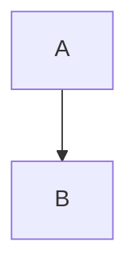

# 제목 1

본문에 **굵게**, *기울임*, `인라인 코드`, [링크](https://example.com)와 각주[^1]가 있습니다.

## 제목 2

### 제목 3

#### 제목 4

- 하나
    - 둘
        - 셋
            - 넷

1. 첫째
    1. 둘째
        1. 셋째

> 인용문입니다.
> 두 번째 줄.

```python
def hello():
    print("안녕")
```



수식: $E = mc^2$

$$\int_0^1 x^2 dx = \frac{1}{3}$$

Table: 요약 표

| 항목 | 값 | 비고 |
|:---|---:|:---:|
| 가 | 1 | 중앙 |
| 나 | 2 | 중앙 |

<!-- table: plain -->

| 단순 | 표 |
|---|---|
| a | b |

<table>
<thead>
<tr><th rowspan="2">구분</th><th colspan="2">값</th></tr>
<tr><th>a</th><th>b</th></tr>
</thead>
<tbody>
<tr><td>X</td><td>1</td><td>2</td></tr>
</tbody>
</table>


---

<!-- pagebreak -->

# 둘째 쪽

마지막 문단.

[^1]: 각주 내용입니다.
