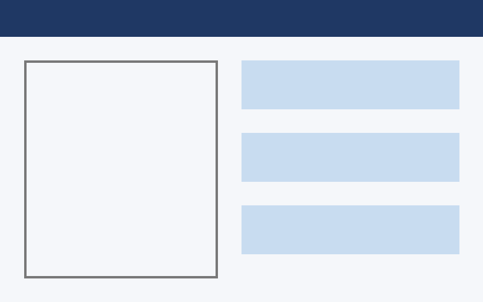

# 성능 기준

Table: 성능 기준표

+------+------------+--------------------------+
| 구분 | 항목       | 성능 기준                |
|      |            +--------+--------+--------+
|      |            | 최소   | 권장   | 비고   |
+======+============+========+========+========+
| 1    | 응답 시간  | 3초    | 1초    | 평균   |
+------+------------+--------+--------+--------+
| 2    | 동시 접속  | 100    | 500    | 최대   |
+------+------------+--------+--------+--------+

# 화면 예시

|  |  |
|:---:|:---:|
| 로그인 화면 | 목록 화면[^cell] |

<!-- table: 제출양식 -->

| 번호 | 기능 | 설명 |
|---|---|---|
| 1 | 등록 | 신규 항목을 등록한다 |
| 2 | 조회 | 조건으로 찾는다 |

# 그림

본문 안 작은 그림 {width=8mm} 이 글자처럼 놓인다.

{width=40%}

# 각주

각주가 있는 문장[^1]과 목록이 든 각주[^2].

[^1]: 첫 각주 내용.
[^2]: 각주 안 목록:

    - 하나
    - 둘

[^cell]: 칸 안 각주.

# 긴 표

| 번호 | 항목 | 값 |
|---|---|---|
| 1 | 항목 1 | 값 1 |
| 2 | 항목 2 | 값 2 |
| 3 | 항목 3 | 값 3 |
| 4 | 항목 4 | 값 4 |
| 5 | 항목 5 | 값 5 |
| 6 | 항목 6 | 값 6 |
| 7 | 항목 7 | 값 7 |
| 8 | 항목 8 | 값 8 |
| 9 | 항목 9 | 값 9 |
| 10 | 항목 10 | 값 10 |
| 11 | 항목 11 | 값 11 |
| 12 | 항목 12 | 값 12 |
| 13 | 항목 13 | 값 13 |
| 14 | 항목 14 | 값 14 |
| 15 | 항목 15 | 값 15 |
| 16 | 항목 16 | 값 16 |
| 17 | 항목 17 | 값 17 |
| 18 | 항목 18 | 값 18 |
| 19 | 항목 19 | 값 19 |
| 20 | 항목 20 | 값 20 |
| 21 | 항목 21 | 값 21 |
| 22 | 항목 22 | 값 22 |
| 23 | 항목 23 | 값 23 |
| 24 | 항목 24 | 값 24 |
| 25 | 항목 25 | 값 25 |
| 26 | 항목 26 | 값 26 |
| 27 | 항목 27 | 값 27 |
| 28 | 항목 28 | 값 28 |
| 29 | 항목 29 | 값 29 |
| 30 | 항목 30 | 값 30 |
| 31 | 항목 31 | 값 31 |
| 32 | 항목 32 | 값 32 |
| 33 | 항목 33 | 값 33 |
| 34 | 항목 34 | 값 34 |
| 35 | 항목 35 | 값 35 |
| 36 | 항목 36 | 값 36 |
| 37 | 항목 37 | 값 37 |
| 38 | 항목 38 | 값 38 |
| 39 | 항목 39 | 값 39 |
| 40 | 항목 40 | 값 40 |
| 41 | 항목 41 | 값 41 |
| 42 | 항목 42 | 값 42 |
| 43 | 항목 43 | 값 43 |
| 44 | 항목 44 | 값 44 |
| 45 | 항목 45 | 값 45 |
| 46 | 항목 46 | 값 46 |
| 47 | 항목 47 | 값 47 |
| 48 | 항목 48 | 값 48 |
| 49 | 항목 49 | 값 49 |
| 50 | 항목 50 | 값 50 |
| 51 | 항목 51 | 값 51 |
| 52 | 항목 52 | 값 52 |
| 53 | 항목 53 | 값 53 |
| 54 | 항목 54 | 값 54 |
| 55 | 항목 55 | 값 55 |
| 56 | 항목 56 | 값 56 |
| 57 | 항목 57 | 값 57 |
| 58 | 항목 58 | 값 58 |
| 59 | 항목 59 | 값 59 |
| 60 | 항목 60 | 값 60 |
